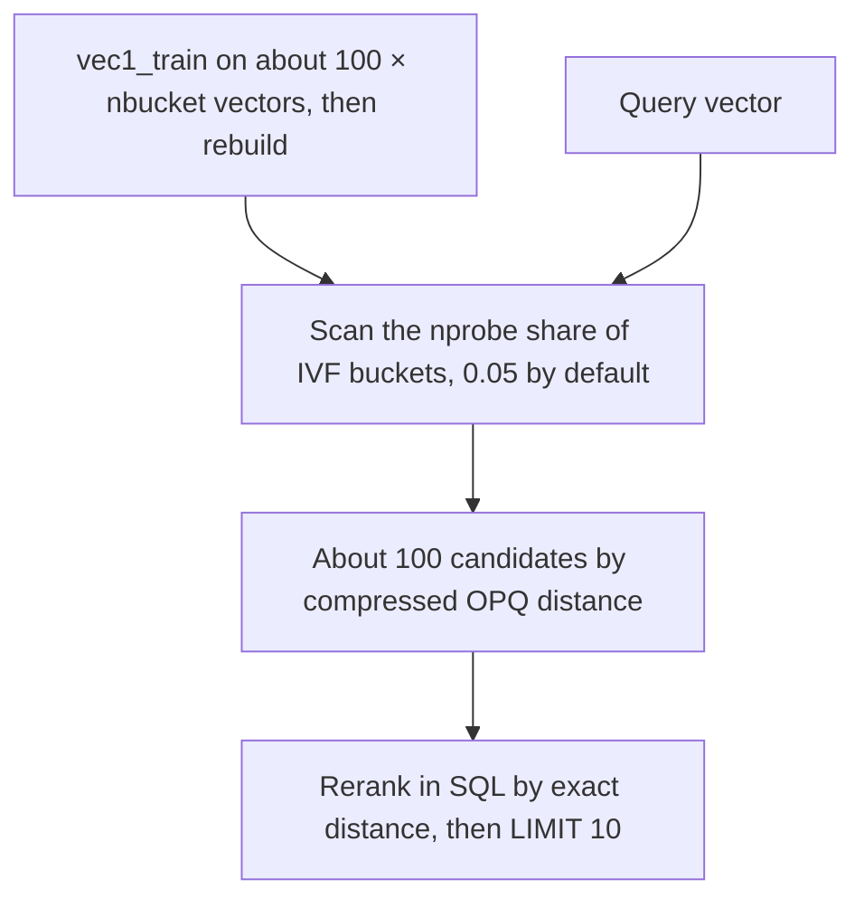
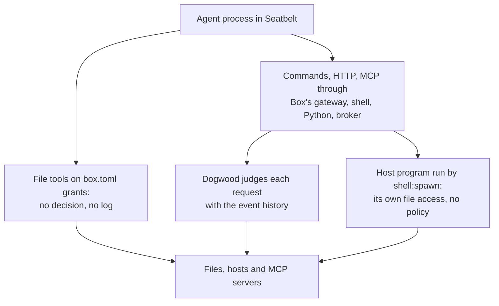
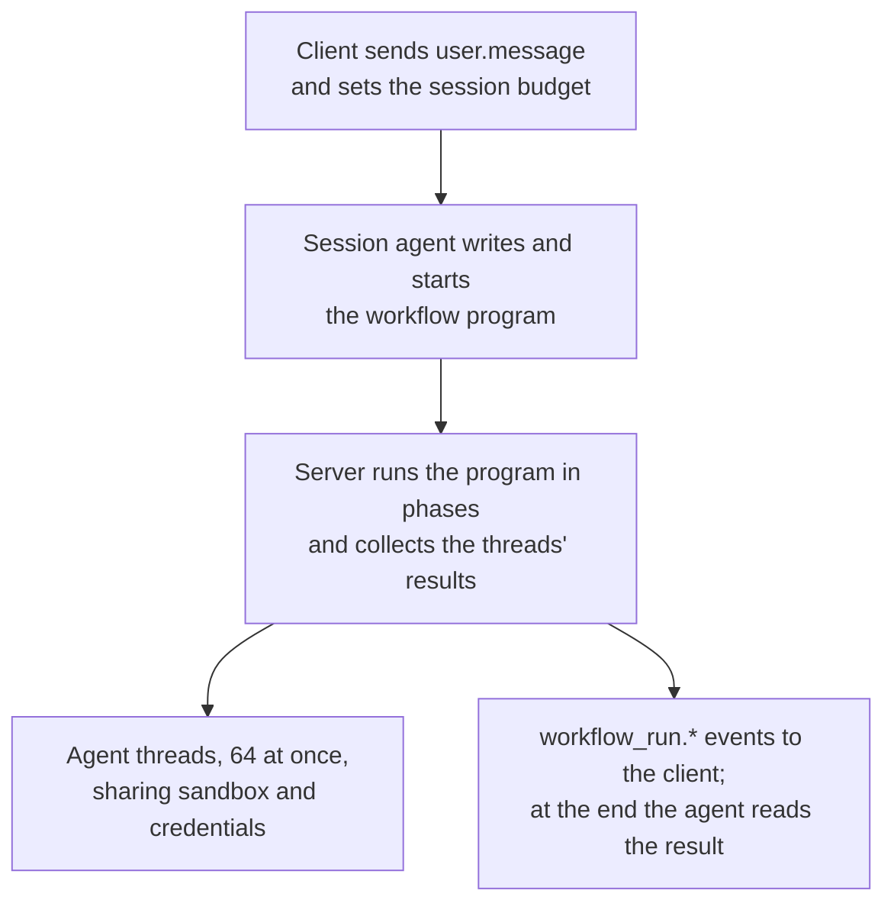

<!-- _class: summary -->

# 🗞️ GenAI Catch-up Report 2026-10-13

6 topics from 2026-10-10 to 10-13 (selected from 32 candidates). Details: <a href="../research/2026-10-13.md">research note</a>.

<article class="card">
<h3>1️⃣ 🎯 OpenAI's Decisions API in public beta at $0.10 per million input tokens</h3>

<code>POST /v1/decisions</code> on GPT-6 Luna returns probabilities, choices and rubric scores for text and images, with no output or cache charges. Independent tests: level with Jev on exact matching, behind on nuanced judgements, at 1.6x to 3.1x its cost.

Impact highPotential highAttention highReleaseModelsAPI and cloud

</article>
<article class="card">
<h3>2️⃣ ⚖️ Microsoft-Decision-1: a Qwen-based decision model at Jev's price</h3>

Post-trained from Qwen3.5-9B, it returns a probability for each fixed answer at $0.042 per million input tokens, output free, in preview on Foundry and OpenRouter. Microsoft's charts put it first on accuracy and speed; one independent test had it slower than Jev.

Impact midPotential highAttention highReleaseModelsAPI and cloud

</article>
<article class="card">
<h3>3️⃣ 🗃️ SQLite takes in vec1: ANN vector search in the 3.54.0 source tree</h3>

One C file adds IVF indexes with PQ or OPQ codes and in-index metadata filters, built separately as a loadable extension. SQLite's own benchmark on 769K text embeddings gives recall@10 of 0.62 without reranking in SQL and 0.93 to 0.98 with it.

Impact midPotential highAttention highReleaseAgent building

</article>

---

<!-- _class: summary -->

# 🗞️ GenAI Catch-up Report 2026-10-13

<article class="card">
<h3>4️⃣ 🛡️ AWS's Strands Box: an agent sandbox with history-aware Dogwood policies</h3>

A developer preview for Apple-silicon Macs pairs Seatbelt containment with Cedar-based rules that can depend on what the agent did earlier, judged at a gateway, a shell, Python and an MCP broker. On EC2 Mac, a host program the policy let run still read a forbidden file.

Impact midPotential highAttention highReleaseSecurity and safetyCoding agents

</article>
<article class="card">
<h3>5️⃣ ✈️ An aviation-based essay: keep the ability to take over from coding agents</h3>

Drawing on FAA and EASA guidance, an engineer argues for keeping the ability to take over from AI rather than to code without it, reading high-risk diffs by hand instead of meeting quotas. Its citations hold up; most featured Hatena comments dispute the analogy.

Impact midPotential midAttention highAnalysisCoding agents

</article>
<article class="card">
<h3>6️⃣ 🧩 Dynamic workflows in Claude Managed Agents: up to 1,000 agents per run</h3>

The session's agent writes a program that Anthropic's servers run in phases, 64 threads at a time, billed as tokens plus $0.08 per session-hour. Anthropic claims 66 of 70 planted bugs found against 14 to 27 for one agent, and warns of high token use.

Impact midPotential highAttention midReleaseAgent buildingAPI and cloud

</article>

---

<!-- _class: topic -->

# 1️⃣ 🎯 OpenAI's Decisions API in public beta at $0.10 per million input tokens

Opened to all developers on 10-06, a week after the DevDay preview, with docs, SDKs in five languages and a Playground; GA is expected within weeks.

## Key points

- `POST /v1/decisions` runs on `gpt-6-luna` only: one shared input of text and images, and a `questions` array of mixed types.
- `predicate` returns a probability, `choice` a value with `probabilities` and a `confidence`, `score` a weighted level index.
- $0.10 per 1M input tokens, no output or cache charges; Luna via the Responses API bills $0.50 output, $0.01 cached input.
- Classmethod's 900 requests: Japanese text scored 93/100 on `predicate`, 84/100 on a three-way `choice`; medians 209–218 ms.
- Against Jev: tied on exact matches (106/107), behind on semantic (90–91 vs 96–97, Classmethod), r = 0.960 on scores (7shi).

## Perspectives and debates

- OpenAI claims up to 10x the speed of Luna via Responses, without a benchmark; 7shi's batch ran 4.8x longer via Responses.
- Simon Willison expects `/v1/decisions` to be a de facto standard; The New Stack sees TypeSafe's schema winning instead.
- Constraints: no calibration data, `choice` skewed and order-sensitive in a forum test, cost 1.6x to 3.1x Jev's as measured.

## Technical details

- Request: `model`, `input` (a string, or user messages with `input_text` and `input_image`) and `questions`; answers echo `name`.
- `choice` takes 2 to 255 unique string or boolean values; any answer may be a `refusal`; dependent decisions need a second call.
- Images: the guide allows inline base64 only, while the API reference takes up to 128, public HTTPS URLs included.
- SDKs call `client.decisions.create(...)`: Python 3.26.0, JavaScript 7.30.0, Go 3.73.0, Ruby 0.101.0 and Java 4.78.0.
- ZDR and HIPAA for eligible customers, US and Europe data residency; long-context and regional multipliers still apply.
- Unstated: Decisions rate limits, caps on questions or `score` levels, the GA date, other models, Azure or Bedrock.

Sources: <a href="https://developers.openai.com/api/docs/guides/decisions">OpenAI</a> · <a href="https://dev.classmethod.jp/articles/openai-decisions-api-hands-on/">Classmethod</a> · <a href="https://zenn.dev/7shi/scraps/38ded435ab8ceb">7shi (Zenn)</a> · Previous: <a href="./2026-10-01.md#10">10-01 #5</a>

---

<!-- _class: topic -->

# 2️⃣ ⚖️ Microsoft-Decision-1: a Qwen-based decision model at Jev's price

Announced on 10-09 in public preview on Foundry and OpenRouter, three days after OpenAI opened its Decisions API; it drew 199 points on Hacker News.

## Key points

- Qwen3.5-9B post-trained to score fixed options in one pass, for yes/no, choice, rating and rubric questions; text only.
- $0.042 per 1M input tokens with output free, Jev's price, on Foundry (US and EU data zones listed) and OpenRouter.
- Microsoft's 36 benchmarks, about 150,000 questions: top accuracy (83.5%, The Register), 2.5x the runner-up's P50 speed.
- Microsoft: eight perturbation types flipped 1.3% of cases on average; reordering or paraphrasing options flipped none.
- Measured: p50 369 ms vs Jev's 283 ms at 0.72x its cost (Topfi, HN), 0.29 s on OpenRouter, 395 ms in a Zenn OCR gate.

## Perspectives and debates

- The New Stack: Qwen over its partner's model, the prize being agent traffic kept on Foundry; MAI or OpenAI rebases undated.
- Speed claims moved: 4.5x over Quyet-1.0-Large at launch, now 2.5x over H2O-Lightning-4B; calibration ranks 2nd or 3rd.
- Microsoft Learn: wording and option order shift scores, best used for ranking and thresholds; JevOut attacks untested.

## Technical details

- Endpoint `<foundry-resource-endpoint>/providers/microsoft/v1/systemone`; `model` is the deployment name, not the model name.
- System One shape: a `state` and a `questions` map of `noul`, `choice` or `score` with `criteria`, unlike OpenAI's `/v1/decisions`.
- Version 1 deploys as `GlobalStandard` or, in some regions, `DataZoneStandard`, with Microsoft Entra ID or an `api-key` header.
- Catalog: Preview, 32,768-token context, text in, JSON out; no images, audio, video or open-ended generation.
- OpenRouter serves `microsoft/microsoft-decision-1` through its Decisions API, so chat-completions SDKs do not work with it.
- Questions in one request run in parallel; a `noul` plus a `score` used 86 input and 2 free output tokens, about $0.0000036.

Sources: <a href="https://commandline.microsoft.com/microsoft-decision-1-model-foundry/">Microsoft</a> · <a href="https://learn.microsoft.com/azure/foundry/foundry-models/how-to/use-foundry-models-microsoft-decision">Microsoft Learn</a> · <a href="https://thenewstack.io/microsoft-decision-model-foundry/">The New Stack</a> · <a href="https://news.ycombinator.com/item?id=50024913">Hacker News</a>

---

<!-- _class: topic -->

# 3️⃣ 🗃️ SQLite takes in vec1: ANN vector search in the 3.54.0 source tree

Merged into trunk on 10-01 without an announcement and tagged at 0.8 in 3.54.0; mattn's Zenn write-up of 10-11 drew 236 Hatena Bookmark users.

## Key points

- Dan Kennedy imported vec1 into `ext/vec1/` on 09-30 and merged it on 10-01; the `version-3.54.0` tag of 10-09 carries 0.8.
- It stays out of the amalgamation and every package, built only by `make vec1.so`; the 3.54.0 release notes are silent on it.
- ANN via a virtual table: IVFADC with OPQ, PQ or binary codes, L2 and cosine, float32 only, AVX2 or NEON, no dependencies.
- SQLite's v0.7 test, 769,382 1024-d text vectors: recall@10 0.62 without reranking, 0.930–0.961 with it, at 2,251–1,290 QPS.
- Prebuilt routes: APSW's PyPI wheels via `apsw.sqlite_extra.load(db, "vec1")`, and the cgo-free ncruces/go-sqlite3 at 0.7.

## Perspectives and debates

- Dan Kennedy (July) puts it in the ballpark of most ANN engines for trainable data; the 10-01 roadmap sets no 1.0 date.
- mattn values plain SQL with joins and WHERE but would wait before production; Hatena readers see small local RAG.
- Robustness: 37 August check-ins fixed crashes and index corruption, fixes went on in October, and testing tops the roadmap.

## Technical details

- `USING vec1(vector, meta1, ...)` takes up to 255 untyped metadata columns; query `t(:v, '{K:10}')`.
- Metadata comparisons filter in the search; a bare `WHERE in_stock` filters after, leaving fewer than K rows.
- sqlite-vec: no ANN index in stable v0.1.9 (alphas only), but int8 and binary vectors and WASM today.

Sources: <a href="https://sqlite.org/vec1doc.html">vec1 manual</a> · <a href="https://sqlite.org/vec1bench.html">vec1 benchmarks</a> · <a href="https://sqlite.org/src/info/92709f54d4">SQLite check-in</a> · <a href="https://zenn.dev/mattn/articles/6e9996319ac099">mattn (Zenn)</a>

---

<!-- _class: topic -->

# 4️⃣ 🛡️ AWS's Strands Box: an agent sandbox with history-aware Dogwood policies

Released on 10-07 as an Apache 2.0 developer preview for Apple-silicon Macs; a Zenn test on EC2 Mac mapped what its policy governs.

## Key points

- v0.1.0 ships only an Apple-silicon macOS 15+ build; Linux builds are held back, and Windows is under consideration.
- Seatbelt bounds the agent; Dogwood rules judge requests at a gateway, Strands Shell, Monty for Python and an MCP broker.
- Rules add temporal clauses to Cedar: three Slack posts per 10 minutes, or `git push` only after a passing `npm test`.
- Zenn: an `awk` admitted by `shell:spawn`, with project reads in its tool table, printed `.env` despite the `no_env` forbid.
- Zenn: the documented write budget never counted shell `>>` or `tee -a` writes; Strands Shell added about 9 ms per command.

## Perspectives and debates

- Marc Brooker: the kernel sandbox funnels traffic to a protocol-aware policy layer, yet "bugs could mean bypassed policy".
- InfoWorld's analysts: consistent across frameworks, but new parts to trust, and bad policies block work or leave gaps.
- No resource limits, tenant isolation, tamper-proof log or built-in IMDS block; Brooker adds a per-session microVM.

## Technical details

- Ten actions, e.g. `fs:read`, `shell:spawn`, `mcp:call`; an outbound call needs `net:connect` and `http:request`.
- The gateway swaps the agent's placeholder for the real secret only on permitted requests, SigV4 included.
- Tutorials: Claude Code 2.1.292 and Codex CLI 0.160.1 run with their own checks off, editing through the shell.

Sources: <a href="https://aws.amazon.com/blogs/opensource/introducing-strands-box-ai-agent-sandboxes-powered-by-dogwood/">AWS</a> · <a href="https://strandsagents.com/blog/strands-box-the-big-picture/">Marc Brooker</a> · <a href="https://github.com/strands-agents/box">strands-agents/box</a> · <a href="https://zenn.dev/kashiwabaray/articles/fc2d097da71f30">Zenn (kashiwabaray)</a>

---

<!-- _class: topic -->

# 5️⃣ ✈️ An aviation-based essay: keep the ability to take over from coding agents

Published on Zenn on 10-05 by an engineer who stalled before approving a CDK diff an AI review had passed; it drew 159 Hatena Bookmark users.

## Key points

- Thesis: aviation keeps pilots able to take over from automation, not to fly without it; engineers need the same with AI.
- Its case rests on SAFO 13002 and 17007, rule 78 FR 67800, AC 120-123, EASA SIB 2013-05R1 and EBT, which say what it claims.
- Daily: no reading quota, echoing SAFO 17007 on flying quotas, but hand-reading of IAM, data-deleting IaC and network diffs.
- Drills after EBT: rebuild an anonymised production incident small and drill it as a team, ungraded, with AI misses added.
- It concedes most software failures roll back, but AI errors raise no alarm, so drills centre on faults in approved code.

## Perspectives and debates

- Hatena: most featured comments reject the analogy, as broken apps don't go manual; one would use it to get training time.
- Aviation practises by hand at low workload and automates at high, the reverse of hand-reading only the riskiest diffs.
- No test of takeover: Anthropic's RCT measured learning (50% with AI, 67% without); Bainbridge: unknown faults defy drills.

## Technical details

- SAFO 13002 (2013): constant autoflight doesn't maintain manual skills; fly by hand at low workload, automate at high.
- SAFO 17007 (2017): manual flight underpins other flying skills; no blanket rules or quotas without scientific evidence.
- AC 120-123 (2022): each pilot must be able to fly by hand, and pilots not flying ready to intervene (PF and PM).
- NASA study (2014): motor skills held, cognitive ones slipped; 75% of pilots followed a faulty altimeter past 300 feet off.
- CDK drill: `RETAIN` to `DESTROY` and `deletionProtection: false` on production RDS delete it on stack deletion or replacement.
- Other drills: IAM `"Action": "*"`, an ALB 502 from logs and target settings, wrong AI fixes; all AWS, no agent named.

Sources: <a href="https://zenn.dev/shimitaro/articles/eb45d8d63c7bd1">shimitaro (Zenn)</a> · <a href="https://www.faa.gov/sites/faa.gov/files/other_visit/aviation_industry/airline_operators/airline_safety/SAFO17007.pdf">FAA SAFO 17007</a> · <a href="https://www.anthropic.com/research/AI-assistance-coding-skills">Anthropic</a> · <a href="https://b.hatena.ne.jp/entry/s/zenn.dev/shimitaro/articles/eb45d8d63c7bd1">Hatena Bookmark</a>

---

<!-- _class: topic -->

# 6️⃣ 🧩 Dynamic workflows in Claude Managed Agents: up to 1,000 agents per run

In public beta since 10-09: the session's agent writes a program that Anthropic's servers run in the background, in phases, as a workflow run.

## Key points

- Enabled by the `multiagent_20261001` type, where workflows default to on, under the `managed-agents-2026-04-01` beta header.
- Per run: 64 threads at once (not guaranteed), 1,000 agents in all, a 24-hour lifetime; 10 open runs per session by default.
- No API call starts a run: the agent decides from the message, and permission policies cover the run's tools, not its start.
- No price of its own: tokens at each model's rates plus $0.08 per session-hour, and a run keeps the session `running`.
- Anthropic on X: workflows found 66 of 70 planted bugs in a 116k-line codebase in each of three runs, one agent 14 to 27.

## Perspectives and debates

- Anthropic suggests a scoped task first, as runs can use many tokens; The Decoder calls the cost-effectiveness debatable.
- MIXED, vanja.io: no approval step, a budget that can overshoot by 64 requests per run, stopping only by asking the agent.
- XenoSpectrum: 1,000 is a lifetime cap, not a parallel count; the bug test leaves budgets and false positives open.

## Technical details

- A `completed` run may hide failed threads; errors include `timeout_error` and `thread_limit_error`.
- No webhooks or run list, and the code stays hidden; `user.interrupt` stops the agent's turn, not a run.
- Claude Code's GA workflows differ: a readable local script, 16 agents at once by default, a prompt on first use.

Sources: <a href="https://platform.claude.com/docs/en/managed-agents/workflow-runs">Claude Platform Docs</a> · <a href="https://x.com/ClaudeDevs/status/2108591328732856655">@ClaudeDevs</a> · <a href="https://mixed-news.com/en/claude-managed-agents-dynamic-workflows-1000-agents-permission-policies/">MIXED</a> · <a href="https://xenospectrum.com/claude-managed-agents-dynamic-workflows/">XenoSpectrum</a>

