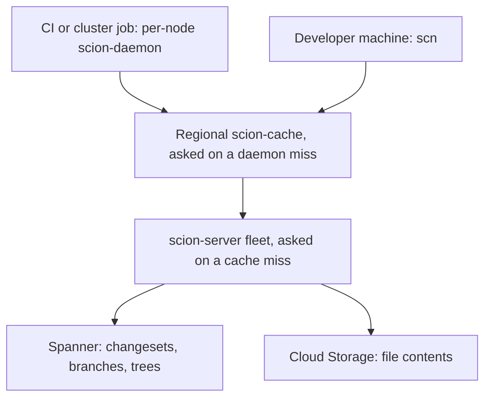
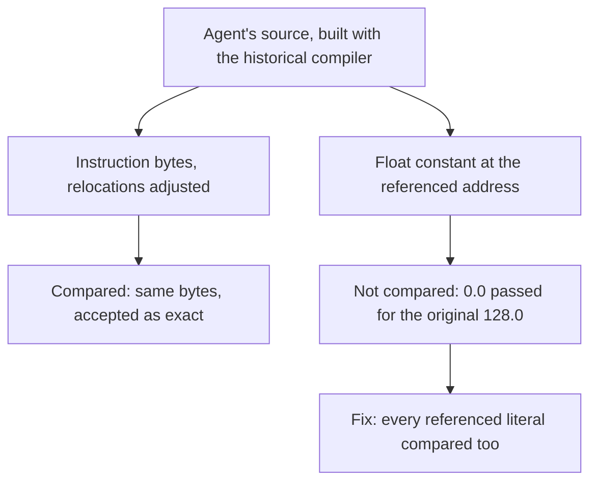

<!-- _class: summary -->

# 🗞️ GenAI Catch-up Report 2026-10-15

5 topics from 2026-10-13 to 10-15 (selected from 92 candidates). Details: <a href="../research/2026-10-15.md">research note</a>.

<article class="card">
<h3>1️⃣ ♊ Gemini 4 Argon goes GA at $2/$10 until November 30, then $4/$20</h3>

<code>gemini-4-argon</code> is GA on the Gemini API, Agent Platform, Antigravity, the Gemini app and GitHub Copilot, with one 1M-token window for input, thinking and output. It ranks first on the Vals Index; practitioners report reasoning loops and false claims.

Impact highPotential midAttention highReleaseModelsAPI and cloud

</article>
<article class="card">
<h3>2️⃣ 🍉 Meta's Muse Wonder at Opus 5.5's price; Wonder Full only in Muse Code</h3>

Meta Superintelligence Labs' first frontier-class models: Wonder is on the Meta Model API at $4/$20 per million tokens, Wonder Full only in Muse Code's $50 and $200 plans. Artificial Analysis scores them 52 and 56 against Opus 5.5's 58.

Impact highPotential midAttention highReleaseModelsCoding agents

</article>
<article class="card">
<h3>3️⃣ 🌱 Scion: Anthropic replaced git after merges peaked above 30,000 a day</h3>

Seven people built a server-centred VCS for a monorepo whose clients are mostly agents and jobs, and migrated in five months; agent worktrees went from 7.1 minutes to 5.1 seconds. No release is announced, and Rain sees Meta's Mononoke in the design.

Impact midPotential highAttention highHands-onCoding agents

</article>

---

<!-- _class: summary -->

# 🗞️ GenAI Catch-up Report 2026-10-15

<article class="card">
<h3>4️⃣ 🐧 Torvalds's first LLM-assisted patches: 2013 bugs, 23x reads, a race</h3>

Userspace tests from an LLM-assisted assoc_array cleanup found four bugs dating to 2013, and a page-cache series written with Claude Code reached 23 times the reads on an artificial 64-thread test. Review found a race within four hours, and Kiryl Shutsemau took the series over.

Impact midPotential midAttention highHands-onCoding agents

</article>
<article class="card">
<h3>5️⃣ 🕹️ Agents rebuilt three Touhou games; a check passed 13 wrong constants</h3>

One engineer had GPT-6-family agents reconstruct TH08, TH095 and TH04 in weeks, with Git as working memory and checks against the original games as acceptance tests. A comparison that matched instructions but not the constants they referenced accepted 13 wrong references in six functions.

Impact midPotential midAttention highHands-onCoding agentsEvals and operations

</article>

---

<!-- _class: topic -->

# 1️⃣ ♊ Gemini 4 Argon goes GA at $2/$10 until November 30, then $4/$20

Generally available since 10-13, two weeks after its 09-30 release to vetted cyber defenders only.

## Key points

- `gemini-4-argon` went GA on 10-13: paid Gemini API, Agent Platform, Antigravity, the Gemini app and GitHub Copilot.
- Per 1M tokens: $2 input, $0.10 cached, $10 output through November 30, then $4, $0.20 and $20, at any prompt length.
- The 1M figure, an output limit on 09-30, is now one 1,048,576-token window shared by input, thinking and output.
- Vals Index: first at 68.90% (Sonnet 5.5 67.04%, Opus 5.5 66.97%); Artificial Analysis Intelligence Index: still 53.
- Solved all 12 simulated cyberattack scenarios (predecessor: 5); the public model blocks offensive work like pentesting.

## Perspectives and debates

- Google's ADK run: 11 unattended hours, six optimizations, two shipped; "the agent explores, the maintainer subtracts."
- CursorBench: Argon Medium 52.8% at $4.39 a task, Opus 5.5 Medium 52.5% at $2.91; Willison: token prices don't compare.
- HN reports loops or errors in 1 of 10 tasks, Theo false claims above 50%; on Zenn, Argon and 3.8 Flash invent figures.

## Technical details

- Input text, image, video, audio and PDF; thinking `low`, `medium` (default) or `high`; 65,536 output tokens by default.
- Versus 3.1 Pro: `thinking_budget`, `MINIMAL`, penalties, `candidate_count` give 400; no explicit cache or prefill.
- Gemini API long decode: Interactions API with `background: true`, `store: true`; 64K-token hops for up to 24 h.
- Agent Platform: client-side `continuation_token` loop on `v1beta1`, 20 min per request, nothing stored server-side.
- Hops re-send the prompt and output so far: 1,000 in and 200,000 out count 397,216 input tokens (repeats 95% off).
- Batch and Flex half price, Priority 1.8x, no Free tier; spend caps per 10 min: $10, $50, $200 by tier.

Sources: <a href="https://blog.google/innovation-and-ai/models-and-research/gemini-models/introducing-gemini-4-argon/">Google</a> · <a href="https://ai.google.dev/gemini-api/docs/latest-model">Gemini API docs</a> · <a href="https://simonwillison.net/2026/Oct/13/llm-gemini/">Simon Willison</a> · Previous: <a href="./2026-10-01.md#8">10-01 #3</a>

---

<!-- _class: topic -->

# 2️⃣ 🍉 Meta's Muse Wonder at Opus 5.5's price; Wonder Full only in Muse Code

Released by Meta Superintelligence Labs on 10-12, the day before the window, as its first frontier-class models.

## Key points

- Wonder is on the Meta Model API in preview and in Muse Code; Wonder Full has no API, only Muse Code's $50 and $200 plans.
- `muse-wonder-1.0`: $4 input, $0.20 cached, $20 output per 1M tokens, Opus 5.5's list price; 1M-token context.
- Artificial Analysis Index: Full 56, Wonder 52, Muse Spark 1.3 48, Opus 5.5 58; Wonder costs $4.52 a task, Opus 5.5 $5.98.
- Meta's 14-row table at max effort: Full beats Opus 5.5 on 8 rows and loses 6; the API model Wonder wins 5 and trails on 9.
- Coding Agents Index: Muse Code with Full 68, Claude Code with Sonnet 5.5 68 and with Opus 5.5 66; Wonder 63.

## Perspectives and debates

- Meta sells Active Memory and Focus; Wang promised a price "meaningfully below" the leaders, yet it equals Opus 5.5's.
- VentureBeat: rows mix internal, vendor and third-party runs; common-harness ProgramBench favours Opus 5.5 by 11.5.
- Theo uses Wonder as a reviewer for Opus 5.5; XenoSpectrum: MemoryBench tests one conversation, not memory across sessions.

## Technical details

- API at `https://api.meta.ai/v1`: Responses, Chat Completions and Anthropic-compatible Messages; effort `minimal` to `max`.
- `max` on `muse-wonder-1.0` is not Wonder Full; 3,000 requests and 4M tokens per minute per team; Standard mode only.
- Claude Code runs on it with `ANTHROPIC_BASE_URL="https://api.meta.ai"` and `ANTHROPIC_MODEL="muse-wonder-1.0"`.
- Muse Code plans: $5, $15, $50 (adds Full) and $200; subscriptions default to Contributor mode, which trains on content.
- Input text, image, video, audio and PDF; Meta injects an unbilled system prompt; `web_search` is $2.50 per 1,000.
- Also on OpenRouter (`meta/muse-wonder`) and Vercel AI Gateway; no source mentions Bedrock, Vertex AI or Foundry.

Sources: <a href="https://research.meta.ai/blog/muse-wonder">Meta</a> · <a href="https://dev.meta.ai/models/muse-wonder">Meta model page</a> · <a href="https://artificialanalysis.ai/articles/muse-wonder">Artificial Analysis</a> · <a href="https://xenospectrum.com/meta-muse-wonder-claude-gpt-comparison/">XenoSpectrum</a>

---

<!-- _class: topic -->

# 3️⃣ 🌱 Scion: Anthropic replaced git after merges peaked above 30,000 a day

Described on 10-13 in Anthropic's engineering blog as a case study, not a product.

## Key points

- Daily merges: about 2,500 on average in May, a peak of 30,401 on Sep 9; the chart's 7-day average ends near 18,000.
- The history is almost 100 GB, a working copy over 25 GB compressed, and CI alone makes about 25 million checkouts a day.
- A team of seven built Scion, the Antique code review, code search and source-control IAM, and migrated in five months.
- Medians, git against `scn`: an agent's new worktree 7.1 min to 5.1 s; source-control time per change 34 min to 3.7 min.
- Over 99% cache hits in every tier, 200x less CPU and memory than the git mirrors it replaced, and 25% of CI's CPU freed.

## Perspectives and debates

- Anthropic: humans review every change for intent, not line by line; "the role of the engineers was to tell Claude ‘no.’"
- No general git replacement and no release announced; Anthropic expects such load to be common in 6 to 12 months.
- Rain, a Mononoke builder: the imitation "goes well beyond having similar insights"; HN doubts review at 30,000 a day.

## Technical details

- A changeset is a server-side log entry listing changed files by content-addressed blobs: no packfiles, no full copy.
- `scn` fetch never says what the client has: it walks from a root tree to the missing trees and blobs, all cacheable.
- History, blame, commits and merges are server APIs: bisect and revert jobs need no checkout; a ref moves by CAS.

Sources: <a href="https://www.anthropic.com/engineering/redesigning-source-control">Anthropic</a> · <a href="https://sunshowers.io/posts/anthropic-mononoke/">Rain (sunshowers)</a> · <a href="https://www.theregister.com/devops/2026/10/13/anthropic-reinvents-source-control-as-claude-floods-the-world-with-code/5302943">The Register</a> · <a href="https://news.ycombinator.com/item?id=50073633">Hacker News</a>

---

<!-- _class: topic -->

# 4️⃣ 🐧 Torvalds's first LLM-assisted patches: 2013 bugs, 23x reads, a race

Published in his tree on 10-11, days after he told the Maintainers Summit an LLM-revised patch left him unwilling to work without one.

## Key points

- assoc_array code he found "too obscure" got 15 `Assisted-by: LLM` commits: ten refactors, a doc fix and four bug fixes.
- A userspace harness confirmed the reported bug and found three more from 2013; Ko and Zeng had LLM-assisted fixes for two.
- The 10-10 cover letter: code, tests, review list and its first draft were done with Claude Code under his direction.
- v3 (10 patches, 10-13): 13.3 M to 304 M reads/s at 64 threads on a Threadripper, 23x; about 3x with 8 on his laptop.
- Four hours later Shutsemau found a race; within the hour Torvalds handed him the series; neither series is in mainline.

## Perspectives and debates

- Torvalds calls the benchmark very artificial; Wilcox objects to the page flag; Falcato: "more trouble than they're worth".
- Summit: `Assisted-by`, on 10% of 7.3 changesets, is no signal; humans should write changelogs, yet Claude drafted his.
- XenoSpectrum: disclosing AI help doesn't make verification independent; HN notes that human review caught the race.

## Technical details

- `noref-filemap-read-with-llm`: 8 patches (10-10); `rcu-free-v3`: 10, two by Shutsemau; all `Assisted-by: LLM`.
- Removed folios are freed only after an RCU grace period, so reads copy under `rcu_read_lock()` with no reference.
- v3 delays only folios read repeatedly; the 10-10 version expedites RCU past 1024 waiting pages on one CPU.
- Race in `filemap_read_rcu_batch()`: stale data from a replaced folio; the fix re-checks `xas_reload(&xas) != folio`.
- Laptop runs had mitigations and `CONFIG_HARDENED_USERCOPY` off; no xfstests, lockdep, KASAN, clang or 32-bit tests.
- assoc_array fixes carry `Fixes: 3cb989501c26` (2013-09-24); Sakkinen's 570-line KUnit test fails without them.

Sources: <a href="https://git.kernel.org/pub/scm/linux/kernel/git/torvalds/linux.git/commit/?h=noref-filemap-read-with-llm&amp;id=4c0f3697118eb3a708ea79175f7f07c43339bfab">Torvalds's cover letter</a> · <a href="https://lore.kernel.org/all/CAHk-=wjLjgfwgSZ1RDk4YdNFcV0ntosMO5AmBoHD76Zb3HFY7Q@mail.gmail.com/T/">LKML thread</a> · <a href="https://git.kernel.org/pub/scm/linux/kernel/git/torvalds/linux.git/tag/?h=assoc-array-fixes">assoc-array-fixes tag</a> · <a href="https://lwn.net/Articles/1099594/">LWN</a>

---

<!-- _class: topic -->

# 5️⃣ 🕹️ Agents rebuilt three Touhou games; a check passed 13 wrong constants

An essay of 10-10 on REA's blog (a reverse-engineering MCP server), also in a Japanese edition, and a 10-13 follow-up.

## Key points

- TH08: resumed 13 August from GensokyoClub's work; all 1,107 functions had source by 19 August, Linux release 30 August.
- TH095: from no confirmed functions on 29 August to playable on Windows i386 on 10 September; TH04 for PC-98 DOS plays too.
- Models, per the follow-up: GPT-6.1-Sol, GPT-6-Astra and GPT-6-Luna-max behind TH09 breakthroughs; no uniform cost data.
- Reference checks are the acceptance tests and Git the memory: checks, reasons for changes and notes for the next session.
- After a Switch port's bug report, an audit of 1,548 float-literal references found 12 more wrong in five functions.

## Perspectives and debates

- Author: "much of my confidence rests on their checks"; a learner rewarded by the old check could learn the wrong answer.
- Elapsed days are commit times, not a controlled speedup (REA's notes), and TH08 began from 128 implemented functions.
- GensokyoClub took TH08 private, barring mostly-AI PRs; on HN, InvisibleUp finds TH04's layout "more optimized for AI use".

## Technical details

- Factory: browser ChatGPT with a five-skill plugin calls one MCP server for IDA or Ghidra, Bash, Wine, objdiff.
- AGENTS.md: one writable session, no subagents, no copied machine code; exact only by a reccmp or objdiff result.
- Only oracle receipts the Truth Kernel admits count; the MCP server is on a Tailscale Funnel URL with no login.

Sources: <a href="https://rea.tools/blog/touhou-reconstruction/">REA essay</a> · <a href="https://rea.tools/blog/reverse-engineering-models/">REA follow-up</a> · <a href="https://github.com/N0zoM1z0/th08/issues/10">th08 issue #10</a> · <a href="https://news.ycombinator.com/item?id=50028275">Hacker News</a>

