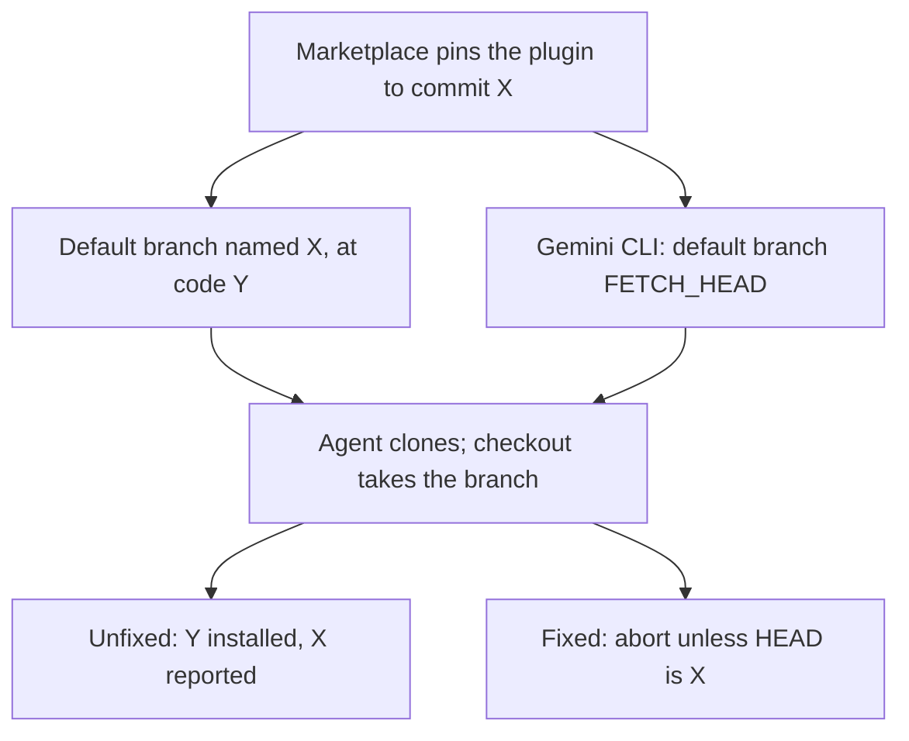
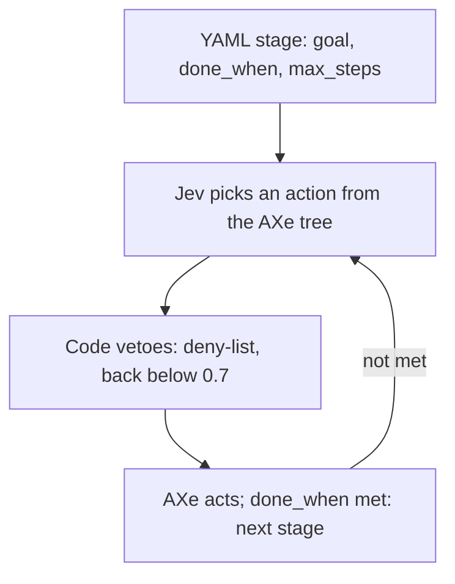
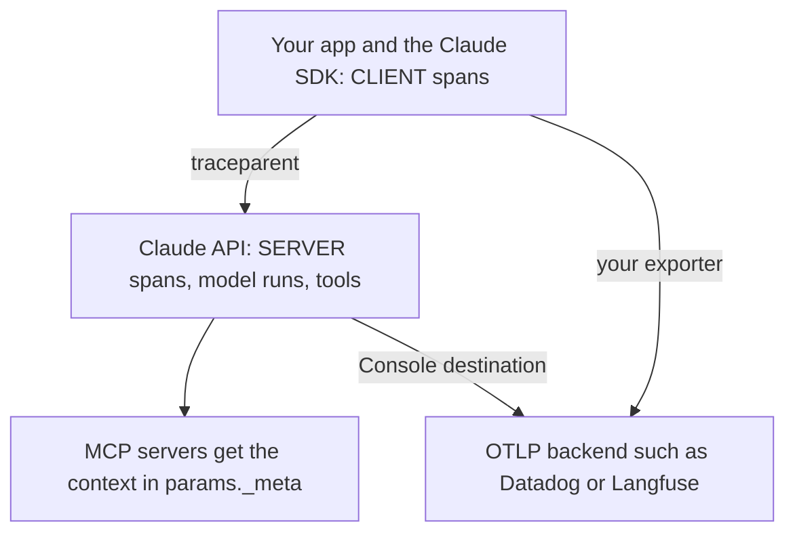

<!-- _class: summary -->
<!-- _header: "" -->

# 🗞️ GenAI Catch-up Report 2026-10-17

5 topics from 2026-10-15 to 10-17 (selected from 62 candidates). Details: <a href="../research/2026-10-17.md">research note</a>.

<article class="card">
<h3><a href="#3">1️⃣ 🔓 Meta's Muse Spark Open: 816B-A42B open weights, top US model at 39</a></h3>

Weights on Hugging Face and three clouds; Together, Fireworks and Baseten charge $1.25/$4.25, the per-token price of Meta's stronger closed Spark 1.3. Five Chinese open models score higher; the licence requires attribution and a deal to serve it past $20M revenue.

Impact midPotential midAttention highReleaseModels

</article>
<article class="card">
<h3><a href="#4">2️⃣ 🪤 Plugin4Shell: a branch named after the SHA beat four agents' pins</a></h3>

A default branch named after the pinned SHA, or <code>FETCH_HEAD</code> for Gemini CLI, makes four agents check out other code. Fixed in Claude Code 2.1.179 (CVE-2026-86063) and Codex 0.146.0; Gemini CLI won't be patched, and Copilot has no published fix.

Impact midPotential midAttention highIncidentSecurity and safetyCoding agents

</article>
<article class="card">
<h3><a href="#5">3️⃣ 📱 jev-qa: Jev picks each iOS test action in 0.33 s; code owns the loop</a></h3>

every's jev-qa has the decision model Jev pick each simulator action from the accessibility tree: 2 to 3 s an action against about 7 s for Claude, under ¥1 for 4 minutes. Code owns the stop checks, as Jev's own success answer proved unreliable.

Impact midPotential midAttention highHands-onAgent buildingModels

</article>

---

<!-- _class: summary -->
<!-- _header: "" -->

# 🗞️ GenAI Catch-up Report 2026-10-17

<article class="card">
<h3><a href="#6">4️⃣ 🖥️ Solvio: Qwen3.5-122B on one B200 passed 17 of 18, Claude Code 18</a></h3>

In OpenCode on one rented B200, Qwen3.5-122B fixed small bugs in 17 of 18 runs, at a 66 s median per task to Opus 5.5's 25 s while running six at once. A log replay put the GPU at 16 concurrent users, about ¥870,000 a month around the clock.

Impact midPotential midAttention highHands-onCoding agentsEvals and operations

</article>
<article class="card">
<h3><a href="#7">5️⃣ 🔭 Claude API OpenTelemetry beta: the API itself now sends spans</a></h3>

The SDK emits spans in seven languages, and the API sends its own spans of Messages API calls and Managed Agents sessions to an OTLP destination set in the Console. Metadata only by default; API spans exist on the Claude API and Claude Platform on AWS only.

Impact midPotential highAttention midReleaseEvals and operationsAPI and cloud

</article>

---

<!-- _class: topic -->

# 1️⃣ 🔓 Meta's Muse Spark Open: 816B-A42B open weights, top US model at 39

Released by Meta on 10-15 as open weights on Hugging Face and three clouds, with seven hosted APIs at launch.

## Key points

- A natively multimodal MoE, 816B total and 42B active parameters, 1M-token context, built for coding and agentic work.
- Artificial Analysis: 39, top US open model (Nemotron 3.5 Super VL 26); five Chinese ones lead, MiMo-V2.6-Pro at 46.
- Of the top nine open models, last on AA's agentic evals but the most frugal: 40k output tokens a task, 43% under GLM-5.3.
- $1.25/$4.25 per 1M tokens at Together, Fireworks and Baseten, the same as closed Spark 1.3 (48); $0.84 per AA task.
- Licence: attribution on products using it or its distilled models; serving it past $20M revenue a year needs a deal.

## Perspectives and debates

- Meta: the most capable US open-weight model yet; Nathan Lambert calls the licence "trash" but sees the US–China gap halved.
- Teortaxes: weak for its size; HN doubts use limits fit open-weight; ITmedia reads the $20M as group, not serving, revenue.
- Meta's table mixes sources and harnesses; its card: least attack success, most over-refusal (FORTRESS 17.4).

## Technical details

- 62 MoE layers, 8 of 256 experts active; 46 use a 2,048-token window, for a KV cache just over a quarter of full (vLLM).
- BF16 about 1.6TB; NVFP4 (experts only) about 530GB, for 4× Blackwell Ultra, 8× H200 or two 512GB M5 Ultra Mac Studios.
- Apple's MLX runs: 24.99 tok/s on two Mac Studios, 36.73 on four (8K context); the 512GB M5 Ultra is not on sale yet.
- vLLM image `vllm/vllm-openai:muse-spark-open`; wheels, TensorRT-LLM and mlx-lm support are still unmerged.
- Groq's preview caps context at 131,072 tokens; OpenRouter has no EU in-region routing; Fireworks' runs to 10-29.
- SageMaker JumpStart: NVFP4 on `ml.p5e.48xlarge`, BF16 on `ml.p6-b300.48xlarge`, in two US East Regions at launch.

Sources: <a href="https://research.meta.ai/blog/muse-spark-open">Meta</a> · <a href="https://huggingface.co/meta-models/Muse-Spark-Open-816B-A42B">Model card</a> · <a href="https://x.com/ArtificialAnlys/status/2110893784422908225">Artificial Analysis</a> · <a href="https://www.latent.space/p/ainews-agents-disprove-polysemanticity">AINews</a> · 📝 <a href="../research/2026-10-17.md#topic-1">Note</a>

---

<!-- _class: topic -->

# 2️⃣ 🪤 Plugin4Shell: a branch named after the SHA beat four agents' pins

Disclosed by AIR Security on 09-17, before the window; Anthropic's advisory of 10-09 gave Claude Code's part CVE-2026-86063.

## Key points

- AIR got Claude Code, Codex, GitHub Copilot and Gemini CLI to install unreviewed code from a plugin pinned to a commit SHA.
- None checked HEAD after checkout; git reads a name that is both a branch and a commit ID as the branch, warning only.
- Zero-click per AIR: a marketplace re-pins to a new benign commit, and auto-update installs the same-named branch's code.
- Fixed in Claude Code 2.1.179 (06-16) and Codex 0.146.0 (07-29); CVE-2026-86063 is still the only CVE among the four.
- Google won't patch Gemini CLI, still shipped to enterprises (v0.64.0 on 10-13); Microsoft has shipped no Copilot fix.

## Perspectives and debates

- AIR, which sells marketplace tools, says zero-click; Anthropic's precondition is a user installing a malicious plugin.
- GitHub bans SHA-like branch names, so the flaw "cannot be exploited on GitHub"; AIR: hosts like Bitbucket expose Copilot.
- Classmethod (git 2.55.0): only `checkout --detach $X^{commit}` reached X; the warning went to stderr with exit code 0.

## Technical details

- GHSA-pq7j-f95f-qfcv: `@anthropic-ai/claude-code` below 2.1.179 and Claude Desktop, no fixed Desktop build named.
- CVSS 4.0: 7.7 (UI:P) in the repository, 7.5 (UI:A) in GitHub's record; CWE-494, CWE-829; not in CISA KEV.
- Auto-update is on by default only for Anthropic's and claude.ai-added marketplaces, and Copilot CLI's built-in one.

Sources: <a href="https://www.air.security/blog-posts/plugin4shell">AIR Security</a> · <a href="https://github.com/anthropics/claude-code/security/advisories/GHSA-pq7j-f95f-qfcv">Anthropic advisory</a> · <a href="https://dev.classmethod.jp/articles/claude-code-plugin-sha-pin-bypass/">Classmethod</a> · <a href="https://www.theregister.com/security/2026/09/17/ai-coding-agents-0-click-rce-flaw-could-hand-attackers-keys-to-the-kingdom/5297335">The Register</a> · 📝 <a href="../research/2026-10-17.md#topic-2">Note</a>

---

<!-- _class: topic -->

# 3️⃣ 📱 jev-qa: Jev picks each iOS test action in 0.33 s; code owns the loop

Described on 10-15 on every's tech blog by the intern who built it, for exploratory QA of an iOS app in the simulator.

## Key points

- AXe reads the accessibility tree; Jev answers `operation`, `target`, `is_error_shown` and `goal_achieved` in one call.
- Per step: Jev 0.33 s, action 1.16 s, settling 2.01 s; deciding each step, Claude took about 7 s an action, Jev 2–3 s.
- `--explore 240`: 83 steps over 65 buttons in 4 minutes, about 1,500 input tokens a step, ¥0.8–0.9 in all.
- `goal_achieved` passed failed runs and long flows lost Jev, so code runs YAML stages with `done_when` and `max_steps`.
- Error, freeze and dead-end checks found real issues on rare paths; one for confusing displays gave many false positives.

## Perspectives and debates

- TypeSafe positions Jev for code-owned workflows, not agents; jev-qa's loop is in code, Jev choosing among listed actions.
- Jev-Mobile, a preprint, splits Android agents alike: success 0.79 against 0.84 step-wise, executor time 94.30 s to 5.16 s.
- Claude's figures are single runs; the author's split: scripts for fixed flows, Jev for exploring, Claude for judging.

## Technical details

- Jev: $0.042 per 1M input tokens, output free, 64k tokens a request and 32k a question; `jev-latest` is `jev-1.13.0`.
- Never tapped: purchase, delete, cancel-membership, sign-in; paywalls closed with ×; back skipped below 0.7 confidence.
- Jev answers each question alone, so the element list joined the state; jev-1.13 favours the first option, CJK is weaker.

Sources: <a href="https://tech.every.tv/entry/2026/10/15/125805">every Tech Blog</a> · <a href="https://docs.typesafe.ai/introduction">TypeSafe docs</a> · <a href="https://arxiv.org/abs/2609.30186">Jev-Mobile (arXiv)</a> · <a href="https://b.hatena.ne.jp/entry/s/tech.every.tv/entry/2026/10/15/125805">Hatena Bookmark</a> · 📝 <a href="../research/2026-10-17.md#topic-3">Note</a>

---

<!-- _class: topic -->

# 4️⃣ 🖥️ Solvio: Qwen3.5-122B on one B200 passed 17 of 18, Claude Code 18

Published by Solvio on Zenn on 10-15: open models on one rented NVIDIA B200, tested as an in-house stand-in for Claude Code.

## Key points

- Six fixes of up to 20 lines from July 2026 on, in Flask, Click, pluggy and three more, three runs each, graded by tests.
- Of 18: Qwen passed 17 first time, gpt-oss-120b 16 with follow-ups (11 without); Claude Code 18 with Opus or Haiku 5.5.
- Median per task: Opus 25 s, Haiku 41 s, Qwen 66 s, gpt-oss 149 s; local models ran six at once, Claude Code one at a time.
- Replay of OpenCode logs at 1 to 64 users, bar median TTFT under 30 s and slowdown under 3x: Qwen held 16 users, gpt-oss 8.
- At $8.04 an hour the 4 h 52 min test cost about ¥5,900; a month nonstop about ¥870,000, ¥14,000 a head for 64 staff.

## Perspectives and debates

- Hatena: a rented cloud GPU tests open, not local, models on small tasks; others see the only option when data must stay in.
- Zenn readers raise speculative decoding and contamination; the fixes postdate all four models' cutoffs or releases.
- Caveats: parallel vs serial runs, Opus effort unstated, 18 runs can't split 17 from 18, Opus grading its own summaries.

## Technical details

- vLLM on a RunPod B200 (180 GB), flags unstated: `Qwen3.5-122B-A10B-FP8` (127 GB) and `gpt-oss-120b` (65 GB).
- OpenCode capped at 65,536 tokens: a quarter of Qwen's native 262,144 and half the 128K Qwen advises for thinking.
- Qwen decoded 145 tok/s alone and 73 each at eight users; TTFT under 2 s to 32 users; KV cache peaked at 35% with 32.
- Compute, not memory, was the limit (3.14x at 32 users); MTP lifted one Qwen stream from 128 to 184 tok/s on MI325X.
- The replay was 5–12% off real OpenCode per request at eight users; gpt-oss ran at medium, 52.6% on SWE-bench Verified.
- Non-coding, Qwen vs Haiku: masking 0.93/0.87, extraction 0.96/0.93, summaries 0.94/0.96, translation 0.92/0.95.

Sources: <a href="https://zenn.dev/solvio/articles/6d374a9224327a">Solvio (Zenn)</a> · <a href="https://huggingface.co/Qwen/Qwen3.5-122B-A10B-FP8">Qwen model card</a> · <a href="https://b.hatena.ne.jp/entry/s/zenn.dev/solvio/articles/6d374a9224327a">Hatena Bookmark</a> · 📝 <a href="../research/2026-10-17.md#topic-4">Note</a>

---

<!-- _class: topic -->

# 5️⃣ 🔭 Claude API OpenTelemetry beta: the API itself now sends spans

Announced by Anthropic on 10-14, before the window, as a public beta for the Messages API, Managed Agents and the Claude SDKs.

## Key points

- SDK spans cover the app's requests and tools; API spans, set in the Console, add model runs, agent turns and server tools.
- SDK spans on the Claude API, Claude Platform on AWS, Bedrock, Google Cloud and Foundry; API spans on the first two only.
- Destinations, set by admins: OTLP/HTTP protobuf over HTTPS on port 443, credentials in headers, 10 per organization.
- Metadata only (default): IDs, timing, status, tokens, agent and tool names; Full content: prompts and responses too.
- Delivery is at least once and best effort, 10 s timeout; a 3xx, a non-public IP or 24 h of failures disables a destination.

## Perspectives and debates

- Anthropic: trust "starts with tracing its model calls, tool use, and MCP server calls"; it names twelve partners.
- Blog posts, one in Japanese: Full content makes the backend a conversation archive; tracing stops no wrong action.
- Thin coverage: Unite.AI is machine-written; it and MLflow say AWS API spans stay in separate traces, unlike the docs.

## Technical details

- Destinations also via the API, beta header `telemetry-destinations-2026-08-11`, or the `ant` CLI.
- Span names such as `anthropic.session.turn` and the GenAI attributes (09-24 commit) may change during the beta.
- No API span for OpenAI-compatible calls or denied tool calls; HIPAA, FERPA or K-12 limits destinations to metadata.

Sources: <a href="https://platform.claude.com/docs/en/manage-claude/opentelemetry">Claude Platform Docs</a> · <a href="https://claude.com/resources/articles/agent-observability-on-the-claude-platform">Anthropic</a> · <a href="https://pasqualepillitteri.it/en/news/23861/opentelemetry-claude-api-traces-public-beta">Pasquale Pillitteri</a> · Previous: <a href="../research/2026-10-15.md#topic-7">10-15 note, topic 7</a> · 📝 <a href="../research/2026-10-17.md#topic-5">Note</a>

