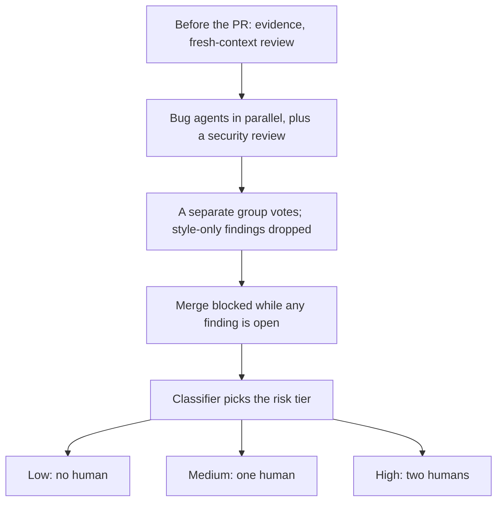
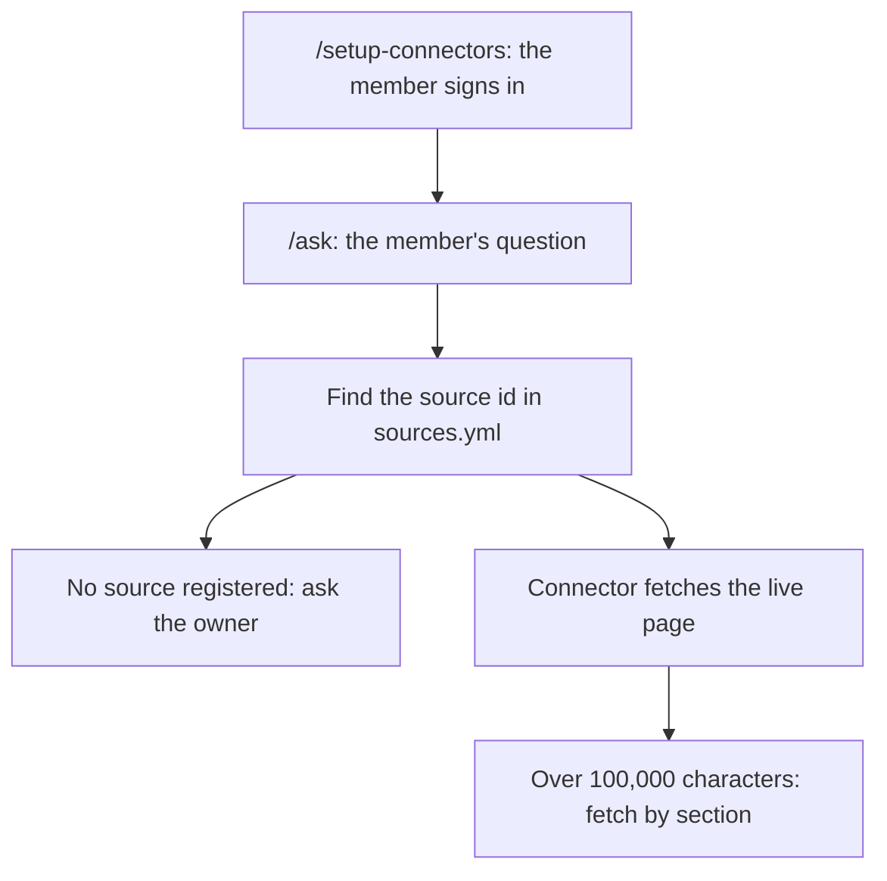

<!-- _class: summary -->
<!-- _header: "" -->

# 🗞️ GenAI Catch-up Report 2026-10-20

3 topics from 2026-10-17 to 10-20 (selected from 53 candidates). Details: <a href="../research/2026-10-20.md">research note</a>.

<article class="card">
<h3><a href="#2">1️⃣ 🐋 DeepSeek-V4.1-Flash-1017: MIT weights, ahead of Opus 5 on 4 of 11 rows</a></h3>

A 552B MoE, now <code>deepseek-flash</code> at $0.30/$1.20 per 1M at peak. DeepSeek's table: 77.0 to Opus 5's 74.0 on DeepSWE v1.1 but behind on Terminal-Bench 4.0 and HLE; Search and Fetch cost $0.75 per 1,000 calls.

Impact midPotential midAttention highReleaseModelsAPI and cloud

</article>
<article class="card">
<h3><a href="#3">2️⃣ 🔍 Claude Code team: AI findings block merges, risk tiers set approvals</a></h3>

Open bug or security findings block merges in the team's repos, and a classifier sets zero to two human approvals by risk. Code Review, GA on 10-15, never blocks a PR and bills on tokens.

Impact midPotential midAttention highHands-onCoding agents

</article>
<article class="card">
<h3><a href="#4">3️⃣ 🧭 DeNA's onboarding repo: Claude Code fetches the live docs by id</a></h3>

Guides cite source ids, and <code>/ask</code> fetches the live page through connectors instead of stale copies. AI dry runs found 44 broken links and a script with 13 <code>sudo rm -rf</code> lines; one hire finished in about a month.

Impact midPotential midAttention highHands-onCoding agents

</article>

---

<!-- _class: topic -->

# 1️⃣ 🐋 DeepSeek-V4.1-Flash-1017: MIT weights, ahead of Opus 5 on 4 of 11 rows

Released by DeepSeek on 10-17 as MIT-licensed weights and as <code>deepseek-flash</code> on its API, alongside Search and Fetch APIs open to all users.

## Key points

- A 552B MoE, 8B parameters active reading input and 16B generating, out 37 days after the September version (PC Watch).
- DeepSeek's card: 77.0 on DeepSWE v1.1, against 74.0 for Opus 5 and 73.0 for GPT-5.6 Sol; ahead of Opus 5 on 4 of 11 rows.
- Opus 5 leads the other 7, such as Terminal-Bench 4.0 at 51.8 to 42.3 (up from 31.2) and HLE without tools at 56.3 to 42.6.
- Artificial Analysis: 45, up from 39, against a median of 19 for open models its size; 210M output tokens, down from 250M.
- Now `deepseek-flash`: $0.30 in and $1.20 out per 1M at peak, half off-peak; Search and Fetch at $0.75 per 1,000 calls.

## Perspectives and debates

- DeepSeek calls it a minor update with shorter runs; PC Watch headlines the coding win, yet paid models still lead overall.
- No source reproduces DeepSWE or Terminal-Bench; on HN one saw 20% fewer tokens, another 30% more time and worse reviews.
- Suganthan's tests: `authority` scores hosts, not pages; Fetch ignored robots.txt, calling from Huawei Cloud in Hong Kong.

## Technical details

- 763B weights, about 765 GB: the 552B MoE, 196B Engram memory, ~14B DSpark speculative decoding, ~0.5B vision.
- No Jinja template; deepseek-recipe (Rust, Python bindings) converts Messages, Chat Completions and Responses requests.
- `temperature` and `top_p` 1.0, 1M context, `max_tokens` ≥ 256K; the API caps output at 384K and thinks by default.
- Anthropic format at `https://api.deepseek.com/anthropic`; old Flash names route here, September's can't be pinned.
- Peak: weekdays 10:00–13:00 and 15:00–19:00 JST; cache hits $0.006 per 1M; AA: 216.5 tok/s, 1.11 s to first token.
- `/v1/tools/search` and `/v1/tools/fetch` use the API key; free from Claude Code or Codex until 11-01 (Beijing time).

Sources: <a href="https://huggingface.co/deepseek-ai/DeepSeek-V4.1-Flash-1017">DeepSeek model card</a> · <a href="https://api-docs.deepseek.com/guides/search/">DeepSeek Search and Fetch docs</a> · <a href="https://artificialanalysis.ai/models/deepseek-v4-1-flash-1017">Artificial Analysis</a> · <a href="https://suganthan.com/blog/deepseek-search-api/">Suganthan Mohanadasan</a> · 📝 <a href="../research/2026-10-20.md#topic-1">Note</a>

---

<!-- _class: topic -->

# 2️⃣ 🔍 Claude Code team: AI findings block merges, risk tiers set approvals

Described by the team on the claude.dev blog on 10-15, before the window, the day Code Review became generally available.

## Key points

- Claude writes about 90% of Claude Code; June to September, merged PRs more than doubled and the reverted share fell 40%+.
- Sensitive paths and CI workflows always need a person; agents never fill a human slot; an approval covers one commit.
- Engineer-confirmed incident and revert PRs form a daily eval; noise is tracked by authors' replies and known-clean PRs.
- Fixes such as a three-round cap lifted one-round passes from 65% to 78% and cut mean review rounds from 2.08 to 1.32.
- Code Review, GA on 10-15, never approves or blocks a PR; 2.1.304 (10-19) added an org-wide level and whole-org coverage.

## Perspectives and debates

- The team calls "did a human read the code?" an imprecise proxy, but has no circuit breakers yet for rising reverts.
- npaka (in Japanese) singles out the false-positive and convergence work; making findings block needs extra GitHub rules.
- HN: reading diffs still catches redundancy and over-complex design; Anthropic gives no base counts or classifier details.

## Technical details

- Team or Enterprise, GitHub or GHES; not under ZDR, HIPAA or CMEK; agents read the diff read-only, never running it.
- No flat price: tokens via usage credits (preview: $15–$25 a review, TNW); admin-added repos review every push.
- Quick, Standard (default) or Deep, repo overrides; on open, every push or `@claude review`; spend limits skip reviews.

Sources: <a href="https://claude.dev/blog/solving-code-review-at-anthropic/">claude.dev blog</a> · <a href="https://code.claude.com/docs/en/code-review">Code Review docs</a> · <a href="https://note.com/npaka/n/ndb4b0f424ced">npaka (note)</a> · Previous: <a href="../research/2026-10-17.md#topic-7">10-17 note, topic 7</a> · 📝 <a href="../research/2026-10-20.md#topic-2">Note</a>

---

<!-- _class: topic -->

# 3️⃣ 🧭 DeNA's onboarding repo: Claude Code fetches the live docs by id

DeNA Engineering described on 10-07, before the window, a healthcare data-science department's onboarding guided by Claude Code.

## Key points

- From `/setup-connectors`, `/init` and `/setup-env` to `/ask` and `/maintain`, nine skills run the `analyst-onboarding` repo.
- Copies went stale, so `knowledge/sources.yml` keeps only URLs and ids, and guides cite `正本: <id>` instead of the text.
- `/ask` fetches pages by id through connectors (Atlassian, Google Drive; Slack optional); the AI can't sign in, so people do.
- Six AI-as-newcomer dry runs found MFA after the VPN step that needs it, all 44 links broken, 13 uncaught `sudo rm -rf` lines.
- A mid-career hire finished in about a month, and setup, once one day to two weeks, was reportedly done worryingly fast.

## Perspectives and debates

- Authors: unstable `/onboarding next` output came from unwritten expectations, not the model; `SKILL.md` rules fixed it.
- A Hatena commenter calls keeping only pointers smart; no independent write-up was found, and the results rest on one hire.
- A fetch can drop a table unnoticed; whether DeNA used claude.ai connectors or servers from `claude mcp add` is unstated.

## Technical details

- claude.ai connectors load only with a claude.ai subscription login, not API keys, Bedrock or Agent Platform.
- `MAX_MCP_OUTPUT_TOKENS` defaults to 25,000, with a warning over 10,000; text over 50,000 characters goes to a file.
- `Bash(rm *)` misses `bash -c 'rm -rf build/'`; the docs call deny rules no security boundary and point to the sandbox.

Sources: <a href="https://engineering.dena.com/blog/2026/10/ai-agent-onboarding/">DeNA Engineering</a> · <a href="https://code.claude.com/docs/en/mcp">Claude Code MCP docs</a> · <a href="https://code.claude.com/docs/en/permissions">Claude Code permissions docs</a> · <a href="https://b.hatena.ne.jp/entry/s/engineering.dena.com/blog/2026/10/ai-agent-onboarding/">Hatena Bookmark</a> · 📝 <a href="../research/2026-10-20.md#topic-3">Note</a>

