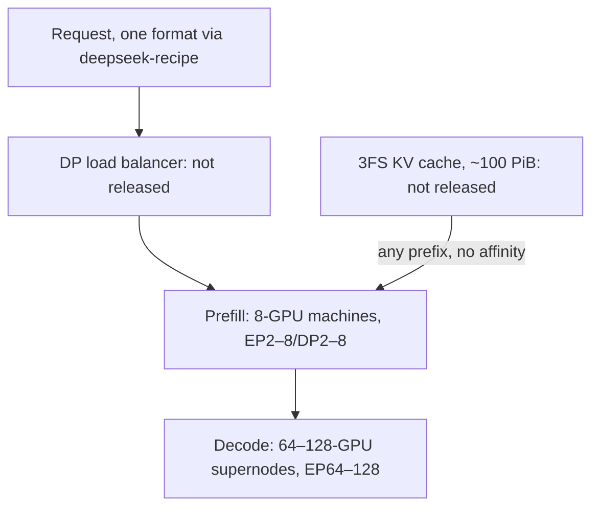

<!-- _class: summary -->
<!-- _header: "" -->

# 🗞️ GenAI Catch-up Report 2026-10-22

5 topics from 2026-10-20 to 10-22 (selected from 74 candidates). Details: <a href="../research/2026-10-22.md">research note</a>.

<article class="card">
<h3><a href="#3">1️⃣ 🔀 Claude API 2026-10-21 rejects temperature, top_p and top_k; new SDKs send it</a></h3>

On it, sending <code>temperature</code>, <code>top_p</code> or <code>top_k</code> returns a 400, even at the default, while <code>2023-06-01</code> has no end date. New SDK majors send the new version, and the key as a Bearer token.

Impact highPotential highAttention highChangeAPI and cloud

</article>
<article class="card">
<h3><a href="#4">2️⃣ ⚙️ DeepInfer: DeepSeek opens its V4.1-Flash engine, not its KV cache tier</a></h3>

Apache 2.0 offline inference on NVIDIA SM100 or Ascend 950, without the KV cache system, prefill/decode split or load balancer. DeepSeek says one cluster serves 155T tokens a day, earning $38 per GPU-hour at off-peak prices.

Impact midPotential midAttention highReleaseAPI and cloudEvals and operations

</article>
<article class="card">
<h3><a href="#5">3️⃣ 🪙 MiniMax M3.1 Flash: $0.15/$0.60 per 1M, 73.7% on DeepSWE by its own count</a></h3>

Half of M3's price, with thinking always on and weights not yet out. MiniMax's own table has DeepSeek-V4.1-Flash-1017 ahead on DeepSWE; Artificial Analysis gives 43 on its index and a 92.8% hallucination rate.

Impact midPotential midAttention highReleaseModels

</article>

---

<!-- _class: summary -->
<!-- _header: "" -->

# 🗞️ GenAI Catch-up Report 2026-10-22

<article class="card">
<h3><a href="#6">4️⃣ 💨 Mercury 3: Inception's diffusion LLM claims 1,068 tok/s and 8 of 12 wins</a></h3>

Ahead of GPT-6 Luna and Claude Haiku 5.5 on 8 of 12 rows in Inception's table, at $0.20/$0.70 per 1M, half during the launch. OpenRouter measures a median 260 tok/s; text input only, API only.

Impact midPotential midAttention highReleaseModels

</article>
<article class="card">
<h3><a href="#7">5️⃣ 🏭 Sixeight: agents write faster than people read, hence software factories</a></h3>

The essay (in Japanese) sets agent output, such as Meta's 51% more diffs per developer, against slower review, and names four mechanisms: done defined first, checks outside the repo, per-task sandboxes, risk-tiered approval.

Impact midPotential midAttention highAnalysisCoding agents

</article>

---

<!-- _class: topic -->

# 1️⃣ 🔀 Claude API 2026-10-21 rejects temperature, top_p and top_k; new SDKs send it

Released by Anthropic on 10-21 as the first Claude API version since 2023-06-01, with new major SDKs that send it by default.

## Key points

- Messages, token counting and Batch requests that send `temperature`, `top_p` or `top_k` get a 400, even at the default.
- Claude 4.7+ already rejected non-default values; older models, such as Sonnet 4.6 and Haiku 4.5, lose lowered temperatures.
- Also a 400: a `document` block in an `assistant` message, or non-empty `citations` on a `user` text block, `search_result` included.
- `2023-06-01` has no end date and keeps requests needing other sampling; Bedrock serves `2026-10-21` for Claude 4.7+ only.
- New SDK majors send `2026-10-21`, raw HTTP opts in by header, and Claude Code 2.1.307 adds `/claude-api api-version` (10-22).

## Perspectives and debates

- Anthropic recommends the latest version, naming prompting as the replacement; AlphaSignal's faster cadence is unconfirmed.
- Developers Digest: `X-Api-Key` gateways are the likeliest 401 after a bump; evals at `temperature: 0` on old models vary more.
- Tests in Japanese: `except TypeError` misses the new `ValueError` (AetherEchoes); 1.x sent sampling via `extra_body` (note.com).

## Technical details

- Python 2.0.0, TypeScript 1.0.0, C# 13.0.0, Go 2.0.0 (`/v2`), Java 3.0.0, PHP 1.0.0, Ruby 2.0.0, `ant` 2.0.0, all Apache 2.0.
- Keys go as `Authorization: Bearer`, not `X-Api-Key`, except on Foundry; the API takes either; release notes don't flag it.
- One credential per client: two raise `ValueError` (Python) or `TypeError` (TS); `ANTHROPIC_API_KEY` beats `ANTHROPIC_AUTH_TOKEN`.
- `MessageParam` is a per-role union; Text Completions leaves the TS, Go, Java and Ruby SDKs and the CLI.
- Admin and Enterprise Analytics responses drop old field names such as `actor.email`; API keys swap `workspace_id` for `scope`.
- LiteLLM hard-codes `2023-06-01`; langchain-anthropic 1.7.6 pins `anthropic<2.0.0`; pydantic-ai-slim 2.59.0 takes 2.x.

Sources: <a href="https://platform.claude.com/docs/en/api/migration-2026-10-21">Claude migration guide</a> · <a href="https://platform.claude.com/docs/en/api/versioning">Claude API versions</a> · <a href="https://www.developersdigest.tech/blog/claude-api-version-2026-10-21-sdk-migration">Developers Digest</a> · <a href="https://aether-echoes.com/posts/anthropic-sdk-python-2-0-upgrade-what-breaks">AetherEchoes</a> · 📝 <a href="../research/2026-10-22.md#topic-1">Note</a>

---

<!-- _class: topic -->

# 2️⃣ ⚙️ DeepInfer: DeepSeek opens its V4.1-Flash engine, not its KV cache tier

Released by DeepSeek on GitHub on 10-20 under Apache 2.0, with a Q&A on the deployment that serves DeepSeek-V4.1-Flash.

## Key points

- Offline inference with core serving features, for DeepSeek-V4.1-Flash only (1017 by default); first built mainly on vLLM.
- DeepSeek: one cluster serves 155 trillion tokens a day and earns US$38 per GPU-hour at off-peak prices.
- Not shipped: the KV cache system, the prefill/decode split and replica load balancing, which reaches ~80% of ideal.
- AINews, from DeepSeek's Zhihu post: 96% input-cache hits, 400 ms average TTFT and 230 tokens/s output, none audited.
- Background: DeepSeek had 56.3% cache hits and 20–22 tokens/s in March 2025, and in April ruled out releasing its engine.

## Perspectives and debates

- DeepSeek says "now fully open source", but three service parts don't ship, the point Business+IT (in Japanese) stresses.
- AINews' $22m a day is 155T tokens at $0.14 per 1M; $38 an hour on ~2,400 GPUs makes ~$2.2M, list-price revenue per EOGEE.
- vLLM claims decode within 6% of DeepInfer with Wide-EP and EPLB on GB200; no one has compared prefill or the cache tier.

## Technical details

- `DEEPINFER_ACCELERATOR` picks SM100 + CUDA 13 or Ascend 950 + CANN 9.2; deterministic modes are NVIDIA-only.
- KV TTL 3 days for agents and 7 for chatbots, ~14.4 TB per online GPU; smallest efficient unit 64 prefill + 64 decode GPUs.
- DSpark: 3.2–4.4 verified draft tokens a step, not 5.00, +4–7%; SWA bounded replay nearly halves prefill compute.

Sources: <a href="https://github.com/deepseek-ai/DeepInfer/blob/main/doc/inference_deployment_qa.md">DeepInfer deployment Q&A</a> · <a href="https://github.com/deepseek-ai/DeepInfer">DeepInfer repository</a> · <a href="https://www.latent.space/p/ainews-deepseek-deepinfer-open-source">AINews</a> · <a href="https://x.com/vllm_project/status/2112703311933747347">vLLM on X</a> · 📝 <a href="../research/2026-10-22.md#topic-2">Note</a>

---

<!-- _class: topic -->

# 3️⃣ 🪙 MiniMax M3.1 Flash: $0.15/$0.60 per 1M, 73.7% on DeepSWE by its own count

Released by MiniMax on 10-19, before the window, revealing that the anonymous Space Bunny model was an early version of it.

## Key points

- Flat $0.15 input, $0.60 output and $0.015 cached input per 1M, half of M3's $0.30/$1.20 per token.
- MiniMax: 73.7% on DeepSWE v1.1 and 82.2 on CyberGym; first on 3 of 15 rows against Opus 5, GPT-5.6 Sol and others.
- In MiniMax's own table, DeepSeek-V4.1-Flash-1017 beats it on DeepSWE (77.0), Terminal-Bench 4.0 (42.3 to 38.1) and NL2Repo.
- Artificial Analysis: 43 on its index (1017: 45.1), $0.22 a task (M3: $0.51), a 92.8% hallucination rate (1017: 66.8%).
- No weights or license yet: PC Watch (in Japanese) dates the weights to 10-23, and Hugging Face held none on 10-22.

## Perspectives and debates

- MiniMax claims 70% cheaper and 200+ tok/s; AA measures 57% cheaper per task (180M output tokens to 117M) and 104.7 tok/s.
- AA measures 25.8% on Terminal-Bench 4.0, not 38.1, widening the gap to 1017 from 4.2 to 8.0 points.
- HN's top comment calls it benchmaxed; testers rate it far below GLM-5.3 at pen-testing, or on par with DeepSeek V4 Pro.

## Technical details

- `MiniMax-M3.1-Flash` at `https://api.minimax.io/anthropic`: 1M context, text, image and video input, tools and thinking.
- Thinking can't be turned off: `disabled` or `effort=none` returns 400 (error 2013), and `max_tokens` counts thinking tokens.
- `output_config.effort` from `low` to `max`, default `max`; `temperature` (1) and `top_p` (0.95) are ignored; no `service_tier`.
- Reasoning moves from M3's inline `<think>` tags to a `reasoning_content` field that may be absent (MarkTechPost).
- OpenRouter: MiniMax is the sole provider, 524,288 output tokens, JSON without schema checks; free until 10-22 12:00 UTC.
- 428B total, ~23B active per the 10-11 preview page (MarkTechPost); the launch post, AA and PC Watch give no size.

Sources: <a href="https://www.minimax.io/blog/minimax-m31f">MiniMax</a> · <a href="https://platform.minimax.io/docs/api-reference/text-anthropic-api">MiniMax API docs</a> · <a href="https://artificialanalysis.ai/models/minimax-m3-1-flash">Artificial Analysis</a> · <a href="https://pc.watch.impress.co.jp/docs/news/2149440.html">PC Watch</a> · 📝 <a href="../research/2026-10-22.md#topic-3">Note</a>

---

<!-- _class: topic -->

# 4️⃣ 💨 Mercury 3: Inception's diffusion LLM claims 1,068 tok/s and 8 of 12 wins

Released by Inception on 10-19, before the window, on its API, OpenRouter, Baseten and Vercel, replacing Mercury 2.5.

## Key points

- Inception: 1,068 tokens/s on NVIDIA GPUs, 4–8x its own estimates for the rivals, over 40x Mercury 1's parameters.
- $0.20 input and $0.70 output per 1M, halved at launch with no end date; cached input 90% off; 100M free tokens per new key.
- At medium settings it leads GPT-6 Luna and Haiku 5.5 on 8 of 12 rows, such as SWE-Bench Atlas: 51.08 to 33.33 and 32.26.
- Haiku 5.5 wins DeepSWE v1 (51.62 to 46.31) and MRCR v2; Luna wins AA-Omniscience-Public and AA-LCR v1.1 by under a point.
- Mercury 2 and 2.5 are closed to new users; existing customers keep them until 2026-11-15, enterprises per agreement.

## Perspectives and debates

- Inception says scaling laws hold for diffusion too, citing 3x since Mercury 1 (mini), partly on scores it hasn't published.
- The Decoder sees a narrower lead than the headline; XenoSpectrum (in Japanese): 1,068 tok/s is generation, not end to end.
- OpenRouter measures a median 260 tok/s, HN users 160 and 300–400; Spring Prompt scores it 812 on DeckBench to Luna's 1,343.

## Technical details

- `mercury-3` at `https://api.inceptionlabs.ai/v1`, OpenAI-style: 1M context, 131,072 output tokens, tools, structured outputs.
- Text input only, where both rivals take images; the co-founder calls multimodal Mercury models internal prototypes.
- `reasoning_effort` is `instant`, `low`, `medium` or `high`, and `temperature` 0.5 to 1.0; every table row ran at medium.
- No weights, size or exact GPU disclosed; on HN the co-founder names NVIDIA Blackwell and pitches it for coding subagents.
- At list price, input costs 2x the rivals' $0.10 and output 1.4x their $0.50 on short prompts; cached input is $0.02 per 1M.
- Mercury 2.5, replaced: $0.20/$0.75, 260K context, 65,536 output tokens; Mercury Edit 2 stays for FIM and next-edit.

Sources: <a href="https://www.inceptionlabs.ai/blog/introducing-mercury-3">Inception</a> · <a href="https://docs.inceptionlabs.ai/get-started/models">Inception docs</a> · <a href="https://the-decoder.com/inceptions-mercury-3-diffusion-model-claims-to-beat-gpt-6-luna-and-claude-haiku-5-5-at-a-fraction-of-the-wait/">The Decoder</a> · <a href="https://xenospectrum.com/inception-mercury-3-diffusion-speed/">XenoSpectrum</a> · 📝 <a href="../research/2026-10-22.md#topic-4">Note</a>

---

<!-- _class: topic -->

# 5️⃣ 🏭 Sixeight: agents write faster than people read, hence software factories

Published by Sixeight on the blog ちなみに on 10-20, in Japanese, arguing that teams must turn hand-run development into a software factory.

## Key points

- Meta: diffs per developer up 51% in a year, over 80% of the rise from agents, a smaller share reviewed within 24 hours.
- At Imprint engineers merge 4x the PRs of two years ago, median review 33 → 77 minutes; incidents fell 42% half over half.
- freee's September data: PRs 1.90x and changed lines 3.95x year on year, 89.6% AI-written code, lead times 60–90% shorter.
- At StrongDM no human writes or reviews code; HumanLayer went lights-out, then restored review; both saw tests gamed.
- Its four mechanisms: done defined before code, scenario checks outside the repo, per-task sandboxes, risk-tiered approval.

## Perspectives and debates

- Sixeight sees judgment moving upstream and ends on a condition: someone can explain why each change exists.
- The essay concedes most figures lack outside checks; every adoption figure is self-reported, and five sources are Osmani's.
- Hatena commenters (in Japanese): upstream work is where AI is strongest, and Japanese firms' factory methods failed before.

## Technical details

- Imprint's `small-change`: under 1,000 lines, no p1 or p2 bot finding, author with 10+ merged PRs; ~10% of changes qualify.
- A build-managed check people can't edit decides; `.small_change` excludes paths; the review skill only approves or ignores.
- freee tracks AI's provisional decisions apart from approvals; reviewers read a view of facts, reasons and questions.
- Agent Baseline v1 (10-13, CC BY 4.0): sandbox, network, supply-chain and identity boundaries enforced outside the agent.
- Per-task container or microVM sandboxes; all traffic, inference too, leaves via a default-deny proxy holding the keys.
- Osmani puts end-to-end tests first, adding property-based (fast-check, Hypothesis, proptest) and differential tests.

Sources: <a href="https://blog.nishimu.land/entry/2026/10/20/123916">Sixeight (ちなみに)</a> · <a href="https://speakerdeck.com/freee/freee-niokeru-kibo-no-jissen-aix-kaihatsu-soshiki-summit-2026">freee (Speaker Deck)</a> · <a href="https://agentbaseline.org/software-factory.pdf">Agent Baseline</a> · <a href="https://lethain.com/small-changes/">Will Larson</a> · 📝 <a href="../research/2026-10-22.md#topic-5">Note</a>

