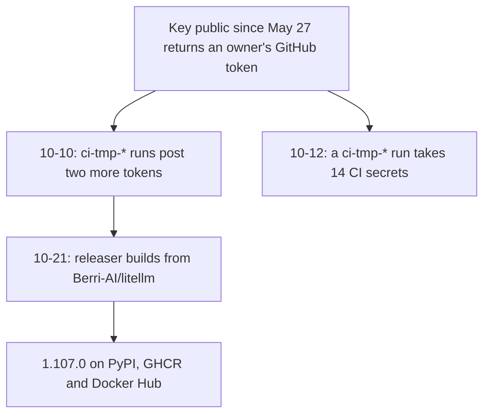
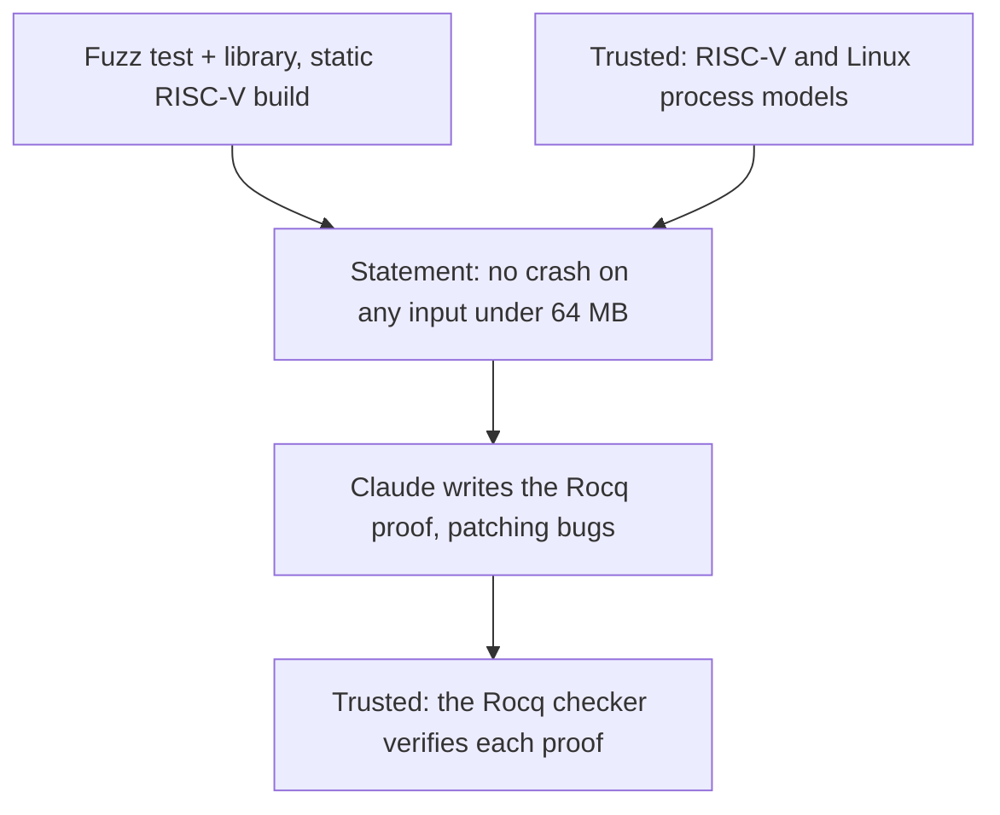

<!-- _class: summary -->
<!-- _header: "" -->

# 🗞️ GenAI Catch-up Report 2026-10-24

5 topics from 2026-10-22 to 10-24 (selected from 68 candidates). Details: <a href="../research/2026-10-24.md">research note</a>.

<article class="card">
<h3><a href="#3">1️⃣ 🔑 LiteLLM 1.107.0: its own release pipeline shipped a credential stealer</a></h3>

A master key leaked in May gave the attackers GitHub tokens to build it from their fork. Planted files ran a credential stealer at every Python start; ~49,000 downloads in about two hours.

Impact highPotential midAttention highIncidentSecurity and safetyAPI and cloud

</article>
<article class="card">
<h3><a href="#4">2️⃣ 🌙 Kimi K3.1 Pro: $2/$10 per 1M, 4th on Artificial Analysis, weights by Nov 4</a></h3>

A third below K3's price, with thinking always on and a 1M context. Artificial Analysis measures 67% on Terminal-Bench 4.0, its best yet; Plotly finds it accurate but slow and costlier than K3.

Impact highPotential midAttention highReleaseModels

</article>
<article class="card">
<h3><a href="#5">3️⃣ 🧮 Claude wrote Rocq proofs that 239 OSS-Fuzz entry points never crash</a></h3>

Anthropic and Theorem: static RISC-V builds of 123 libraries, inputs under 64 MB, ~180M lines of passing proof, hundreds of bugs found. Proofs for 60 entry points are public; none rules out non-termination.

Impact midPotential highAttention highResearchSecurity and safetyCoding agents

</article>

---

<!-- _class: summary -->
<!-- _header: "" -->

# 🗞️ GenAI Catch-up Report 2026-10-24

<article class="card">
<h3><a href="#6">4️⃣ 🤝 Agent Skills moves to the Agentic AI Foundation, beside MCP</a></h3>

Anthropic hands the name, GitHub organization and agentskills.io to the Linux Foundation's AAIF; engineers from six companies will steer the standard. The SKILL.md format is unchanged, with no versioned release yet.

Impact midPotential highAttention highChangeAgent building

</article>
<article class="card">
<h3><a href="#7">5️⃣ 🪨 Flint: Recursive's Apache 2.0 coding MoE, 2.5B of 40B active, for Macs</a></h3>

Recursive claims over 125 tok/s on an M4 Pro and the lead among MoEs under 50B, by its own measurements. Its chart has dense Qwen 3.8 ahead on 4 of 6 benchmarks; testers report weak tool use.

Impact midPotential midAttention highReleaseModelsCoding agents

</article>

---

<!-- _class: topic -->

# 1️⃣ 🔑 LiteLLM 1.107.0: its own release pipeline shipped a credential stealer

Pushed to PyPI and Docker through LiteLLM's own release pipeline on 10-21, before the window; LiteLLM traced the chain on 10-23.

## Key points

- PyPI served `litellm==1.107.0` 11:39–13:23 UTC on 10-21, Docker images until 14:20; Wiz counts ~49,000 downloads.
- Planted `cook.pth` and `sitecustomize.py` run at every Python start, pip included, to steal credentials and load RCE tools.
- Socket found a 10-12 run, absent from LiteLLM's timeline, that took 14 CI secrets such as `ANTHROPIC_API_KEY`.
- Wiz saw stolen AWS role credentials used 16:20–17:01 UTC: `sts:GetCallerIdentity`, then `bedrock:ListFoundationModels`.
- Background: 1.82.7 and 1.82.8 were poisoned on 2026-03-24 (TeamPCP); OSV's `MAL-2026-2144` now lists them with 1.107.0.

## Perspectives and debates

- LiteLLM traces it to a key never revoked, dropping its first theory that logged Claude Code responses leaked the tokens.
- HN debates 24–48 h install cooldowns in uv and npm, which also hold back fixes, and attacks the private-registry embargo.
- GMO Flatt Security (in Japanese): 16 stealer modules, Claude, Cursor, Kiro, Codex CLI and Gemini CLI settings among them.

## Technical details

- On disk: `cook.pth`, `sitecustomize.py` or `litellm-1.107.0.dist-info`; their absence proves nothing.
- At risk: the host's IAM role, env secrets, master and virtual keys, and up to 500 rows of `LiteLLM_CredentialsTable`.
- The 1.107.0 images' SLSA provenance names `Berri-AI/litellm` as source; the GitHub tag is clean; `latest` is 1.106.2 (10-24).

Sources: <a href="https://docs.litellm.ai/blog/security-incident-oct-21-2026">LiteLLM</a> · <a href="https://docs.litellm.ai/blog/security-incident-oct-21-2026-attack-chain">LiteLLM attack chain</a> · <a href="https://www.wiz.io/blog/litellm-compromised-steals-credentials">Wiz</a> · <a href="https://socket.dev/blog/litellm-attack-timeline">Socket</a> · 📝 <a href="../research/2026-10-24.md#topic-1">Note</a>

---

<!-- _class: topic -->

# 2️⃣ 🌙 Kimi K3.1 Pro: $2/$10 per 1M, 4th on Artificial Analysis, weights by Nov 4

Released by Moonshot on 10-23 in Kimi.ai, Kimi Work, Kimi Code and the API, with full weights promised by November 4, 2026.

## Key points

- $2 input, $10 output and $0.20 cache hits per 1M tokens, a third below K3; Highspeed doubles all but the cache-hit price.
- Artificial Analysis (AA) ranks it 4th with 55, behind Opus 5.5, Sonnet 5.5 and Muse Wonder Full; 67% on Terminal-Bench 4.0.
- Moonshot's chart: ahead on SWE-Marathon v1.1 (51.7 to Opus 5.5's 46.3), far behind on ProgramBench (31.5 to 65.0).
- Hallucination: 23.4% → 8.3% on Moonshot's internal test (Opus 5.5: 15.0%), 53% → 44% on AA-Omniscience.
- Cyber data was cut from mid-training and RL for the open release: 81.0% on Moonshot's xdev-bench-hard, 90.5% unfiltered.

## Perspectives and debates

- Moonshot's chart credits Opus 5.5 with 66.4% on Terminal-Bench 4.0; AA's own run of all 66 tasks gives Opus 5.5 59.6%.
- Plotly: 42 of 43 on its data exam, but a 2.5-minute median per question and $13.47 a run against K3's $5.01.
- Constraints: OpenRouter measured Highspeed at ~1.5× the standard speed, not 2–3×; the weights' license is unannounced.

## Technical details

- `kimi-k3.1-pro` and `kimi-k3.1-pro-highspeed` at the OpenAI-compatible `https://api.moonshot.ai/v1`, with a 1M context.
- Thinking is always on: `reasoning_effort` is `low`, `high` or `max` (default); output defaults to 131,072 tokens, max 1,048,576.
- Temperature 1.0, top_p 0.95, `n` and the penalties are fixed; each turn must send back the full assistant message.
- Native Responses API for Codex (`wire_api = "responses"`); `search_context_size` returns a 400, and the CLI passes no video.
- Caching is automatic, with a 5-minute TTL or 1 h via `prompt_cache_options.ttl`; access needs a top-up of at least $1.
- AA lists 2.8T total, 104B active; background (07-28, in Japanese): Fixstars served K3's ~1.6 TB weights on one 8×B300 node.

Sources: <a href="https://www.kimi.ai/blog/kimi-k3-1-pro">Moonshot</a> · <a href="https://platform.kimi.ai/docs/guide/kimi-k3-1-pro-quickstart">Kimi API docs</a> · <a href="https://artificialanalysis.ai/articles/kimi-k3-1-pro-launch-benchmarks">Artificial Analysis</a> · <a href="https://plotly.com/blog/kimi-k3-1-pro-plotly-data-analytics-bench/">Plotly</a> · 📝 <a href="../research/2026-10-24.md#topic-2">Note</a>

---

<!-- _class: topic -->

# 3️⃣ 🧮 Claude wrote Rocq proofs that 239 OSS-Fuzz entry points never crash

Published by Anthropic on 10-22 from a few weeks' work by its Frontier Red Team and Theorem, with part of the proofs released.

## Key points

- Claude proved 239 entry points in 123 libraries never crash on any input up to 64 MB, after patching the bugs it found.
- About 180 million lines of passing Rocq out of ~1 billion written; over half of each proof came from tools Claude wrote.
- Hundreds of bugs fuzzers miss turned up, such as CVE-2026-56132 in libexpat and an underflow only ~20 MB inputs reach.
- Every patch was penalized, logged and audited, since rewriting a program can make any theorem provable.
- Proofs can take hundreds of millions of tokens; on 36 small tasks Opus 5.5 proved half, with ~40% fewer tokens than Opus 5.

## Perspectives and debates

- Developers Digest: not proof of security, but no-crash is now provable at scale where a good fuzz harness exists.
- HN doubts specs from fuzz harnesses of unknown coverage; Business+IT (in Japanese) relays that verified isn't bug-free.
- The post says the programs "will always exit normally", yet no released proof rules out a run that never ends.

## Technical details

- Public: 138 statements for 60 entry points in 25 libraries, such as openssl; one `./oft check` can need 20 GiB.
- Static riscv64 binaries (clang 20.1.8, musl), one thread; statements assume runs within 2 GiB (ASan) or 16 GiB (UBSan).
- Theorem's OSS Verify is free: maintainers add a static riscv64 build by PR; findings go out with no promised human review.

Sources: <a href="https://www.anthropic.com/research/formal-verification">Anthropic</a> · <a href="https://www-cdn.anthropic.com/files/4zrzovbb/website/6867eadf760258fa8b42a504600cd3c036d16358.pdf">Anthropic appendix</a> · <a href="https://github.com/theorem-labs/oss-verify-proofs">Theorem proofs</a> · <a href="https://www.developersdigest.tech/blog/claude-formal-verification-123-libraries-fuzz-tests-proofs-2026">Developers Digest</a> · 📝 <a href="../research/2026-10-24.md#topic-3">Note</a>

---

<!-- _class: topic -->

# 4️⃣ 🤝 Agent Skills moves to the Agentic AI Foundation, beside MCP

Donated by Anthropic on 10-22 to the Linux Foundation's AAIF, one of four new projects announced at AGNTCon + MCPCon North America.

## Key points

- Donated: the name and logo, the GitHub organization and agentskills.io; using or contributing needs no AAIF membership.
- A steering committee of engineers from Anthropic, Earendil (Pi), Google, Microsoft, OpenAI and OpenCode will govern it.
- Anthropic's David Soria Parra and Mahesh Murag are Lead Maintainers; existing skills and their licences are unchanged.
- Anthropic counts 70+ platforms, such as ChatGPT, Cursor and GitHub Copilot, without a list; the showcase holds 46 (10-24).
- Anthropic's 1 million published skills and ~280 million installs equal Vercel's skills.sh totals through August.

## Perspectives and debates

- Anthropic pledges to keep it "open, community-driven, and vendor-neutral", yet both Lead Maintainers are its employees.
- Developers Digest sees a cross-vendor supply-chain risk in portable skills; a scan flagged 30 of 9,930 SKILL.md files.
- Business+IT (in Japanese) asks why Anthropic again gives away a standard it grew; Simon Willison predicted it in 2025.

## Technical details

- Format unchanged: a folder with a `SKILL.md`; agentskills/agentskills has no tags or releases, last commit 2026-08-09.
- Proposal #47's 12-month plan: tagged spec releases, a changelog, a SECURITY.md and numbered proposals like MCP's SEPs.
- The experimental `allowed-tools` field is to be stabilized or removed; spec changes merge today without a written rule.
- No version to pin: `metadata.version` is a label nothing checks; Max Nardit pins by git commit or marketplace `sha`.
- `skills-ref validate`, demonstration-only, failed ~1 in 4 of his skills: unquoted colons in `description`, a root `version`.
- Still open on 10-24: the proposal, its contribution agreement unsigned; no GOVERNANCE.md or MAINTAINERS.md yet.

Sources: <a href="https://www.anthropic.com/news/donating-agent-skills-to-the-agentic-ai-foundation">Anthropic</a> · <a href="https://x.com/ClaudeDevs/status/2113328526413996100">ClaudeDevs on X</a> · <a href="https://github.com/aaif/project-proposals/issues/47">AAIF proposal #47</a> · <a href="https://www.developersdigest.tech/blog/agent-skills-agentic-ai-foundation-what-changes-2026">Developers Digest</a> · 📝 <a href="../research/2026-10-24.md#topic-4">Note</a>

---

<!-- _class: topic -->

# 5️⃣ 🪨 Flint: Recursive's Apache 2.0 coding MoE, 2.5B of 40B active, for Macs

Released by Recursive on 10-21, before the window, with weights on Hugging Face and its own Mac inference engine, <code>rec</code>.

## Key points

- 40B parameters with 2.5B active, built from scratch by a small team of people and agents in under four months.
- Recursive claims 125+ tok/s on an M4 Pro MacBook Pro and 150+ on a 64 GB RTX Spark with its engine, at short contexts.
- It claims the lead among MoEs under 50B on SWE-Bench Pro v2, Terminal-Bench 2.1 and SWE-Bench Verified.
- It claims to rival dense 25–40B models; in its chart dense Qwen 3.8 leads on 4 of 6, Terminal-Bench 2.1 by 73.0 to 54.9.
- Up to 512K context, 256K recommended; Recursive warns it may need more guidance than larger closed models.

## Perspectives and debates

- Every coding score is Recursive's own; MarkTechPost warns its SWE-Bench Pro v2 isn't comparable with the public benchmark.
- Wired: three small builds on a 48 GB Mac worked; r/LocalLLaMA testers (via AINews) rank it below Qwen 27B for agentic work.
- Rapid-MLX measured 131 tok/s at 1K context on an M5 Max using ~24 GB, the only third-party speed figure so far.

## Technical details

- 39.8B parameters, 49 layers, 256 routed experts with 6 plus a shared one per token; a 150,144-token vocabulary.
- 35 sliding-window (513-token) and 14 full-attention layers without positional encoding; 262,144-token context.
- BF16 ~80 GB with an SGLang kit for one B300 or H200; INT4 MLX 22.6 GB and NVFP4 GGUF 22.9 GB, 48 GB advised for both.
- `rec` needs an M4 Pro, M5 Pro or M5 Max with 48 GB; Recursive measures 1.4–2.6× llama.cpp's throughput, prefill excluded.
- `rec serve`: OpenAI-compatible at `http://127.0.0.1:11500/v1` plus Anthropic `/v1/messages`, model `flint`; `rec launch pi`.
- Also llama.cpp, Ollama, Unsloth, LM Studio, vLLM, SGLang; the card asks to keep `reasoning_content` in history.

Sources: <a href="https://recursive.com/updates/introducing-recursive-flint">Recursive</a> · <a href="https://huggingface.co/RecursiveSI/flint">Hugging Face model card</a> · <a href="https://github.com/recursive-oss/rec">rec on GitHub</a> · <a href="https://www.marktechpost.com/2026/10/21/recursive-flint-local-coding-model/">MarkTechPost</a> · 📝 <a href="../research/2026-10-24.md#topic-5">Note</a>

