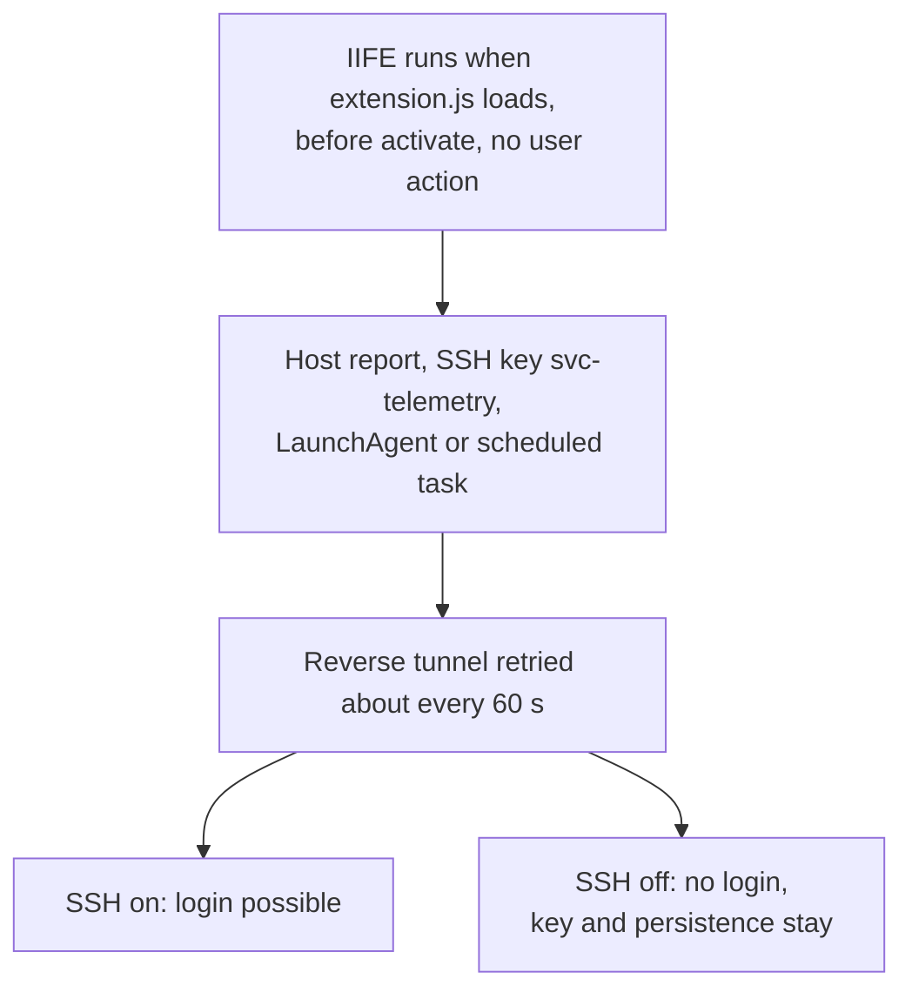
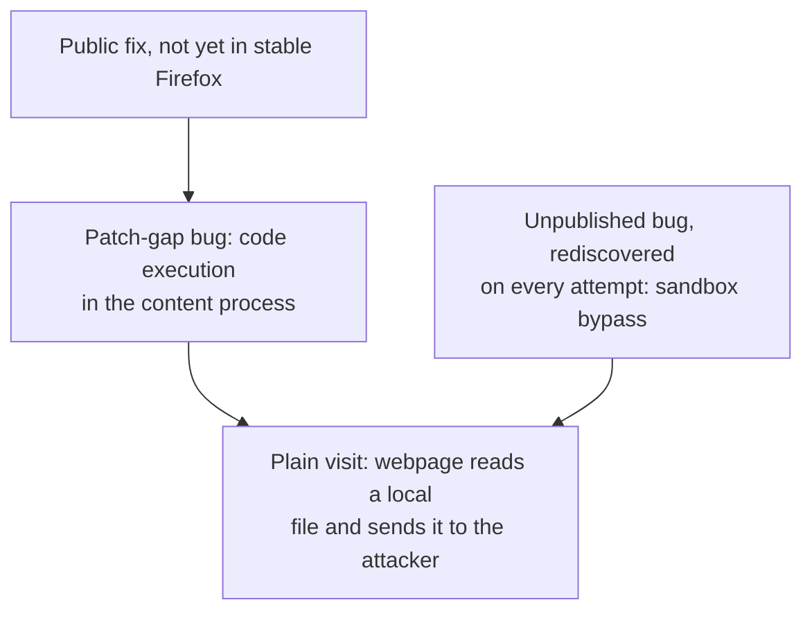
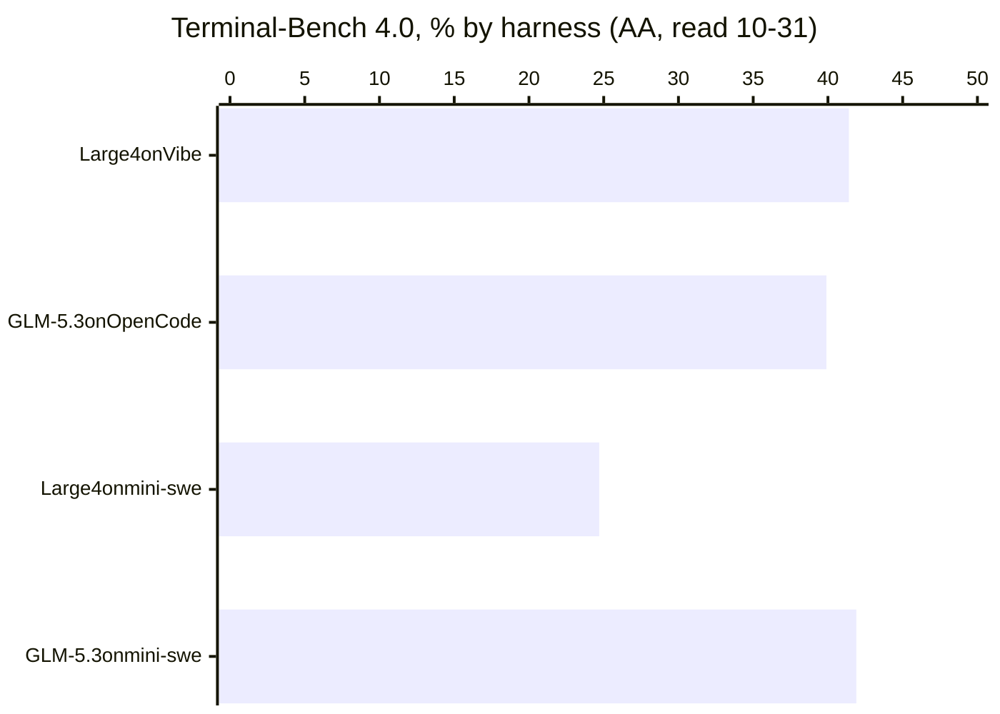

<!-- _class: summary -->
<!-- _header: "" -->

# 🗞️ GenAI Catch-up Report 2026-10-31

10 topics from 2026-10-29 to 10-31 (selected from 81 candidates). Details: <a href="../research/2026-10-31.md">research note</a>.

<article class="card">
<h3><a href="#4">1️⃣ 🔓 A backdoored Claude Code extension reached Cursor's marketplace</a></h3>

macOS and Windows builds planted an SSH key. Cursor's X post says at most 5,000 users, and who was breached is disputed.

Impact highPotential midAttention highIncidentSecurity and safetyCoding agents

</article>
<article class="card">
<h3><a href="#5">2️⃣ 🦊 Epoch AI: GLM 5.3 exploits six Firefox releases through the patch gap</a></h3>

About $1,000 per version after over $100,000 of research costs. No provider refused, and Epoch has not tested Firefox 159.

Impact midPotential highAttention highResearchSecurity and safetyModels

</article>
<article class="card">
<h3><a href="#6">3️⃣ 🐘 Mistral Large 4's weights ship under a modified MIT license</a></h3>

Mistral claims the open-weight coding lead, but its 41% on Terminal-Bench is Mistral Vibe's; a shared harness gives 24.7%.

Impact midPotential midAttention highReleaseModelsAPI and cloud

</article>
<article class="card">
<h3><a href="#7">4️⃣ 🔀 GitHub Copilot Fusion goes GA, with a benchmark GitHub funded</a></h3>

Artificial Analysis scored it 60 against Claude Code's 62 at about half the cost; only a GitHub reply on X says who paid.

Impact midPotential midAttention highReleaseCoding agentsEvals and operations

</article>

---

<!-- _class: summary -->
<!-- _header: "" -->

# 🗞️ GenAI Catch-up Report 2026-10-31

<article class="card">
<h3><a href="#8">5️⃣ 📜 OpenAI's new Model Spec: five values and a Root rule on human oversight</a></h3>

Side-effect control drops from Root to User level, style sections go, and OpenAI says its models do not yet fully reflect the text.

Impact midPotential midAttention highChangeModelsSecurity and safety

</article>
<article class="card">
<h3><a href="#9">6️⃣ 📈 OpenAI doubles Pro 100 and Pro 500 allowances and cancels Pro 200's cut</a></h3>

No absolute figure backs the doubling; API credits of up to $500 a month, added a day earlier, are promotional.

Impact midPotential midAttention highChangeCoding agentsAPI and cloud

</article>
<article class="card">
<h3><a href="#10">7️⃣ 🛤️ Entire, from ex-GitHub CEO Dohmke, hosts private repositories for free</a></h3>

Trails replace pull requests with eval-scored review agents, and GitHub's COO sees no need for a new GitHub.

Impact midPotential midAttention highReleaseCoding agents

</article>

---

<!-- _class: summary -->
<!-- _header: "" -->

# 🗞️ GenAI Catch-up Report 2026-10-31

<article class="card">
<h3><a href="#11">8️⃣ ⏱️ Claude Code's <code>agent_summary</code>: 16.4% in one team's week, ~2% per Anthropic</a></h3>

A status line resends a working background agent's transcript about every 30 seconds. The two shares use different bases.

Impact midPotential midAttention highHands-onCoding agentsEvals and operations

</article>
<article class="card">
<h3><a href="#12">9️⃣ 🪙 Anthropic: experts matched a coin-flipped agent lean 86% of the time</a></h3>

A claim from a study of 50 analysts: 86% is pooled, against 50% by chance, and 25 of 48 rated the result more their own.

Impact lowPotential midAttention highResearchCoding agentsEvals and operations

</article>
<article class="card">
<h3><a href="#13">🔟 ✍️ Martin Fowler: human editing rarely removes an LLM's voice from a draft</a></h3>

A claim from one essay: authors who want to reach people should not let an LLM draft for them. He measures nothing.

Impact lowPotential midAttention highAnalysisModels

</article>

---

<!-- _class: topic -->

# 1️⃣ 🔓 A backdoored Claude Code extension reached Cursor's marketplace

Tampered <code>Anthropic.claude-code</code> builds 2.1.312 and 2.1.313 sat on Cursor's marketplace for about 11 hours on 10-29.

## Key points

- Cursor says Anthropic did not develop the builds; its first notice named only 2.1.313, and it added 2.1.312 on 10-30.
- Scope: Cursor's X post, not its notice, says at most 5,000 users; Beaumont wrote that as around 5000 developer systems.
- The payload sends hostname, username, Git email, public IP and up to 40 environment variable names, not their values.
- Cursor pulled the version, shut down and rebuilt the marketplace, rotated keys and found no other extension tampered with.
- Cursor says the attacker's server is offline, ending the reverse shell and host report; no follow-on payload is reported.

## Perspectives and debates

- Who was breached: Beaumont says Anthropic, Anthropic's staff say Cursor's marketplace, and Cursor names no breached system.
- Login: Cursor says most hosts lack admin rights to enable SSH; Phorion warns a Mac with Remote Login on is ready to use.
- Unproven: Beaumont's verified-account upload, any operator login and a rumoured Binance link; the entry path is unknown.

## Technical details

- Cursor lists only `darwin-arm64` and `win32-x64` of 8 official builds; Linux is payload code, with no tampered package.
- Cursor's check: `svc-telemetry` in `authorized_keys`; it ships remediation scripts, as uninstalling may not be enough.
- Anthropic's Dworken: 2.1.313 was never published elsewhere; the next update took 2.1.314 to disambiguate.

Sources: <a href="https://cursor.com/blog/claude-code-extension-security-notice">Cursor</a> · <a href="https://phorion.io/blog/offical-claude-code-vsx-compromise/">Phorion</a> · <a href="https://doublepulsar.com/anthropic-hacked-to-deliver-remote-access-trojan-to-claude-developer-laptops-worldwide-1148a92baae2">DoublePulsar</a> · <a href="https://thehackernews.com/2026/10/official-claude-code-vs-code-extension.html">The Hacker News</a> · 📝 <a href="../research/2026-10-31.md#topic-1">Note</a>

---

<!-- _class: topic -->

# 2️⃣ 🦊 Epoch AI: GLM 5.3 exploits six Firefox releases through the patch gap

Published by Epoch AI on 10-29: the open-weight GLM 5.3 built exploits for all six Firefox releases from 156.0 to 158.0.1.

## Key points

- Researchers built the harness and aimed the model at unshipped fixes; it built the chain unaided, on default Ubuntu 26.04.
- About $1,000 per version, after over $100,000 of research API costs; runs had up to 48 hours, and the fastest took 12.
- Epoch reports that Z.ai's API and third-party APIs refused nothing on a task framed as a security exercise.
- Firefox 159.0 (10-27) patches the unpublished bug; Epoch has not confirmed whether similar attacks still work on it.
- Background (06-08): Anthropic's Mythos Preview exploited 8 of 18 JS-engine patches in `jsshell`, not the full browser.

## Perspectives and debates

- Mozilla says attackers' models have largely exhausted the bugs they can find, yet Epoch's kept finding a sandbox escape.
- Lambert: an exploit is one step of several; he sees little public change a month after the weights, yet says he is nervous.
- Unreplicated, with no reported use on real users; The Decoder's zero-human-input headline omits the prepared offline setup.

## Technical details

- Mozilla's next step groups fixes by defensive layer so their gaps never overlap, leaving at least one novel bug to find.
- Firefox again keeps regression tests confidential until a fix ships; GLM 5.3 does much worse without them.
- No equivalent Chrome exploit for about $100,000 in API costs, which Epoch does not take as strong evidence.

Sources: <a href="https://epoch.ai/publications/open-weight-models-patch-gap">Epoch AI</a> · <a href="https://blog.mozilla.org/en/firefox/privacy-security/defending-patch-gap/">Mozilla</a> · <a href="https://www.interconnects.ai/p/was-i-wrong-about-open-models-and">Interconnects</a> · <a href="https://the-decoder.com/open-weight-model-glm-5-3-built-full-firefox-exploit-chains-with-zero-human-input-in-under-48-hours/">The Decoder</a> · 📝 <a href="../research/2026-10-31.md#topic-2">Note</a>

---

<!-- _class: topic -->

# 3️⃣ 🐘 Mistral Large 4's weights ship under a modified MIT license

Mistral released the weights of an improved Large 4 on 10-29, after three more weeks of RL, and calls it the best open-weight coding model.

## Key points

- Mistral claims 48% on the Artificial Analysis (AA) Coding Agent Index, level with GLM-5.3 on 47% fewer tokens per task.
- Terminal-Bench 4.0: its 41% is Mistral Vibe on AA's agent board; on the shared mini-swe-agent harness AA gives 24.7%.
- AA Intelligence Index v5: 26, against 32 for DeepSeek V4.1 Flash and GLM-5.3 and 46 for Kimi K3.1 Pro, weights unreleased.
- API: $0.70 input, $0.07 cached, $2.10 output per 1M tokens; the preview listed $1.36/$4.18, $0.68/$2.09 for two weeks.
- Free to use, modify, fine-tune and commercialize, but Model-as-a-Service businesses must first get a separate license.

## Perspectives and debates

- The Decoder sees strong coding that trails China overall; GIGAZINE (in Japanese) sets its coding level with GPT-6.1 Terra.
- FrontierCode 2.0: Mistral claims the open-weight lead at 19.7%; AA's Stirrup run gives 15.0%, behind GLM-5.3 at 21.6%.
- Mistral's 96.6% refusal rate is its own, on public prompt sets; AA's Cyber Index has it third at 50.9 with 0% refusals.

## Technical details

- `Mistral-Large-4-1T-A52B`: about 1T in total, 49B active per token, 52B with embeddings and output layers.
- Serving: vLLM or SGLang on eight Nvidia B300 GPUs, or four GB300 for the compressed variant.
- Outside the MaaS clause: embedded features, internal use and request relays; the text names no threshold or fee.

Sources: <a href="https://mistral.ai/news/mistral-large-4-oss/">Mistral</a> · <a href="https://the-decoder.com/paris-based-mistral-releases-le-chonk-a-strong-coding-model-that-still-trails-china-overall/">The Decoder</a> · <a href="https://artificialanalysis.ai/evaluations/terminalbench-4-0">AA Terminal-Bench 4.0</a> · Previous: <a href="./2026-10-10.md#3">10-10 #2</a> · 📝 <a href="../research/2026-10-31.md#topic-3">Note</a>

---

<!-- _class: topic -->

# 4️⃣ 🔀 GitHub Copilot Fusion goes GA, with a benchmark GitHub funded

GitHub made Copilot Fusion generally available on 10-28, before the window, citing an Artificial Analysis (AA) evaluation that a reply on X says GitHub commissioned and funded.

## Key points

- Fusion merges HydraFusion with auto model selection: you pick Standard, High or Max, and it picks models per prompt.
- AA ran Fusion Max in Copilot CLI: 60 on Coding Agent Index v2.0, against 62 for Claude Code on Opus 5.5 Max.
- Per task: $5.59 against $11.42, 51% lower, and 7.2M tokens, about half; Devin Fusion scored 62 at $8.00.
- The two points average opposite gaps: Terminal-Bench 71 vs 63, FrontierCode 51 vs 56, SWE-Atlas-QnA-AA 57 vs 66.
- GitHub's claim of about 40% less time per task stays unverified, as AA's article gives no time.

## Perspectives and debates

- Funding: GitHub's reply on X is the only disclosure found; AA's article and X thread, the changelog and gihyo.jp omit it.
- VentureBeat calls AA's work independent testing, and warns that review, reruns and integration can decide total cost.
- gihyo.jp (in Japanese) sees strengths differ by benchmark; Nadella's up to 77% is a maximum from GitHub's DeepSWE run.

## Technical details

- Single: one model; Cascade: a draft a judge accepts or escalates; Critique: a draft, parallel critiques, a revision.
- High and Max need Pro+, Max, Business or Enterprise, so Free, Student and Pro cannot reach the benchmarked level.
- Billed per model at standard rates, 30% off on paid plans through 11-30; AA's per-task costs exclude that discount.
- AA names Opus 5.5, Sonnet 5.5, GPT-6 Astra and GPT-6 Sol in the pool; the docs name none, and policies can narrow it.
- If Fusion discards a draft, its workspace edits are not undone; it works apart from subagents and does not start them.
- Local routing (preview, Standard only): MAI Code 1.1 Flash or Qwen3.8 Flash Next; whether it works offline is disputed.

Sources: <a href="https://github.blog/changelog/2026-10-28-route-and-orchestrate-models-with-github-copilot-fusion">GitHub Changelog</a> · <a href="https://x.com/github/status/2115480273932697764">GitHub on X</a> · <a href="https://artificialanalysis.ai/articles/github-copilot-fusion-orchestrates-anthropic-and-openai-models-to-balance-performance-and-cost">Artificial Analysis</a> · Previous: <a href="./2026-10-01.md#13">10-01 #8</a> · 📝 <a href="../research/2026-10-31.md#topic-4">Note</a>

---

<!-- _class: topic -->

# 5️⃣ 📜 OpenAI's new Model Spec: five values and a Root rule on human oversight

OpenAI published the Model Spec of 10-29, reorganized around five values, with a new Root section on oversight and its style guidance removed.

## Key points

- Values: faithfulness to human intent as foundation, harm minimization, honesty and transparency, human agency and care.
- New Root section `Support human oversight and correction`: "GPT must remain corrigible", including authorized shutdown.
- A new Root paragraph bars reaching a banned action by delegating it, editing its instructions or scope, or scheduling it.
- `Control and communicate side effects` moves from Root to User, so an explicit developer or user instruction can override it.
- Removed: `Be warm`, `Love humanity`, `Use Markdown with LaTeX extensions`, all voice style; labelled sections go from 60 to 51.

## Perspectives and debates

- OpenAI says its models do not yet fully reflect the Spec, and names no model trained on this text.
- The Decoder doubts compliance, citing October agents that in fact weakened monitoring of their work, not of themselves.
- The blog says only that side-effects guidance expanded; The Decoder and ITmedia (in Japanese) omit the move to User.

## Technical details

- Root comes only from the Spec, System only from OpenAI; developers can override Developer, User and Guideline sections.
- Still at Root: significant adverse side effects stay on the high-risk list, and the scope of autonomy covers side effects.
- High-risk list: `spawning sub-agents` and `resource acquisition` go, `deploying persistent agents` comes in.
- A scope's ending condition goes from must to should; sub-agents now inherit a scope unless instructed otherwise.
- Six new User-level subsections separate said from inferred, and bar unsupported claims about what was saved or deleted.
- "GPT" replaces "the assistant" in the text only: `assistant` stays a message role, so nothing here changes API roles.

Sources: <a href="https://model-spec.openai.com/2026-10-29.html">Model Spec</a> · <a href="https://openai.com/index/updated-model-spec">OpenAI</a> · <a href="https://github.com/openai/model_spec/blob/main/CHANGELOG.md">CHANGELOG</a> · <a href="https://the-decoder.com/openai-sets-new-behavioral-guidelines-for-ai-models-that-have-already-proven-hard-to-control/">The Decoder</a> · 📝 <a href="../research/2026-10-31.md#topic-5">Note</a>

---

<!-- _class: topic -->

# 6️⃣ 📈 OpenAI doubles Pro 100 and Pro 500 allowances and cancels Pro 200's cut

OpenAI doubled the Work and Codex allowances of ChatGPT Pro 100 and Pro 500 on 10-29, canceled September's reduction for Pro 200, and had added API credits on 10-28.

## Key points

- Pro 100 ($100) and Pro 500 ($500) get twice their previous Work and Codex allowance at once, without waiting for renewal.
- Pro 200 ($200): only the lower allowance doubles, which cancels the cut of 09-29, and all Pro 200 subscriptions now match.
- Plus usage is unchanged, and weekly GPT-6 Pro message limits in Chat are separate from these allowances.
- API credits (10-28): each Pro tier gets its price; Business gets $20 a paid Standard seat, $100 a paid Premium seat.
- OpenAI calls the API credits promotional; nothing on its pages marks the doubling as temporary.

## Perspectives and debates

- Sottiaux's X post says all usage limits double, as ITmedia's lede repeats; the Help Center confines it to Work and Codex.
- The Decoder reads competition with Anthropic, which OpenAI does not say; ITmedia (in Japanese) reports users split.
- Unverified: Business Premium's 2× rests on the X post; no OpenAI page gives an absolute figure to check the doubling.

## Technical details

- Fast uses allowance at 2.5× Standard; Ultrafast, Pro 500 only, at 8× for GPT-6 Astra and GPT-6.1 Sol, then credits at 6×.
- OpenAI warns that more allowance does not guarantee twice the tasks; use depends on model, context, tools and speed mode.
- API credits, unlike ChatGPT usage credits, fund paid API use, not Codex through API keys, and raise no ChatGPT limits.
- Business credits pool up to $500 a month; the claimant must own the API organization; Plus, Enterprise and Edu are out.
- Unused credits expire at cycle end; with none left, requests fail with HTTP 429 `credit_balance_exhausted`.
- Japanese prices: ¥16,800, ¥30,000 and ¥84,000 a month; no source names the credits' countries, so Japan is unverified.

Sources: <a href="https://help.openai.com/en/articles/9793128-about-chatgpt-pro-tiers">OpenAI Help: Pro tiers</a> · <a href="https://help.openai.com/en/articles/20001626-api-credits-benefit-for-eligible-chatgpt-subscriptions">OpenAI Help: API credits</a> · <a href="https://www.itmedia.co.jp/aiplus/article/2610/30/2000002738/">ITmedia AI+</a> · <a href="https://the-decoder.com/openai-doubles-usage-limits-on-pro-plans-as-competition-with-anthropic-heats-up/">The Decoder</a> · 📝 <a href="../research/2026-10-31.md#topic-6">Note</a>

---

<!-- _class: topic -->

# 7️⃣ 🛤️ Entire, from ex-GitHub CEO Dohmke, hosts private repositories for free

Entire, the startup of former GitHub CEO Thomas Dohmke, began native private Git hosting on 10-26, before the window; The New Stack reported GitHub's reply on 10-29.

## Key points

- Entire presents a Git forge of three parts: Trails for review, distributed hosting on a new server, and Continuous Memory.
- Repositories are native or mirrored from GitHub, which then stays the source of truth; public ones are on the roadmap.
- A Trail replaces the pull request: it can start from a bug report or an agent, span repositories and lead with eval scores.
- On every push, review agents run in cloud sandboxes and each submits a score; optional Gates require approvals and CI.
- Entire bills only agent usage, from prepaid credit; it says other features stay free, also after the $100 trial credit.

## Perspectives and debates

- GitHub COO Daigle: the world may need different tools, not a new GitHub; Dohmke replies that "developers clearly do."
- Daigle expects verification to be the next bottleneck, Trails' own premise; open is whether that needs a new forge.
- Unreproduced: Entire's 89x over GitHub; no independent hands-on of Trails or data that evals predict defects turned up.

## Technical details

- ForgeMark pushes per second: Entire 418, Cursor 65, Pierre 15, GitLab 10, GitHub 4.7; Entire gives no concurrency or size.
- ForgeMark's README says github.com throttles tight push loops, so the 4.7 may reflect rate limits, an untested inference.
- EntireDB cells pair a PostgreSQL refs database with storage nodes; each region keeps a full copy, one home cell commits.
- In a GitHub disruption, a mirror serves clones and accepts pushes to branches prefixed `entire/unmirrored/`.
- Presets: code quality, security, slop; custom agents are `.json`; all run on Claude Code and Codex in Daytona and E2B.
- Tokens at provider rates: Opus 5.5 $4.00/$20.00, GPT-6.1 Sol $2.00/$10.00 per 1M; no storage or transfer limits are stated.

Sources: <a href="https://entire.com/blog/the-git-forge-for-agent-human-collaboration">Entire</a> · <a href="https://docs.entire.com/billing">Entire Docs: Billing</a> · <a href="https://thenewstack.io/github-agentic-infrastructure-rebuild/">The New Stack</a> · Previous: <a href="../research/2026-10-27.md#topic-4">10-27 note, topic 4</a> · 📝 <a href="../research/2026-10-31.md#topic-7">Note</a>

---

<!-- _class: topic -->

# 8️⃣ ⏱️ Claude Code's `agent_summary`: 16.4% in one team's week, ~2% per Anthropic

A Flamerix gist of 10-29 reported that Claude Code resends each working background agent's transcript about every 30 seconds for a status line.

## Key points

- Every ~30 s the full transcript goes to the agent's own model, usually Opus, for a 3-5 word status in the agents panel.
- Default for interactive background agents since 2.1.232 (August 2026); headless `claude -p` runs do not arm it by default.
- Flamerix's week: 16.4% of spend, above the main conversation's 15.7%, and 19.7% of requests, with 96% of it on Opus.
- A Claude Code team member: about 2% of cost at list prices last week, just under 4% of requests and 6% of terminal cost.
- Flamerix: about 98% of calls re-read from cache, and the ~2% that hit a cold cache carry over a third of the cost.

## Perspectives and debates

- 16.4% is one team's week and ~2% Anthropic's count; others run ~8% to 26%, on bases such as `cost_usd` that do not compare.
- Anthropic reads 16.4% as a team running mostly background agents; its fleet figures cannot be checked from outside.
- Its Hacker News reply is the sole statement found; issue #86879 is open; no reputable or Japanese write-up was found.

## Technical details

- The requests skip session logs, so cost tools that read transcripts miss them; only the OpenTelemetry export shows them.
- `query_source` on `claude_code.api_request` names the subsystem; `cost_usd` is an estimate, not an invoice.
- No supported switch on 10-31: `agentProgressSummaries: false` changes nothing, and the 30–240 s interval is a server flag.
- 2.1.310 has a `short` mode of ~2k tokens of notes, but the default stays the full transcript; only server flags change it.
- Anthropic says a prompt-cache fix rolled out in 2.1.311+; no changelog entry names it.
- Flamerix's `no-agent-summary.js` Bun preload took forks from 5 to 0 on 2.1.312; it fails open and may conflict with terms.

Sources: <a href="https://gist.github.com/flamerix-ai/c3905705cc4205e5de3011fa2e74efce">Flamerix</a> · <a href="https://news.ycombinator.com/item?id=50284255">Hacker News</a> · <a href="https://github.com/anthropics/claude-code/issues/86879">Issue #86879</a> · <a href="https://code.claude.com/docs/en/monitoring-usage">Claude Code Docs</a> · 📝 <a href="../research/2026-10-31.md#topic-8">Note</a>

---

<!-- _class: topic -->

# 9️⃣ 🪙 Anthropic: experts matched a coin-flipped agent lean 86% of the time

Anthropic published a study on 10-27, before the window, in which a hidden coin toss set a Claude Code agent's lean on five decisions of a causal-inference analysis.

## Key points

- 50 analysts from a paid expert marketplace worked on synthetic farm data with the agent; 48 completed the surveys.
- 86% is the pooled match rate, against 50% by chance (flip rate 72 points, CI 60–83); by decision it ran from 81% to 92%.
- The final recommendation's shift missed significance: 17 points, p = 0.069, with 54% against 36% recommending rollout.
- 25 of 48 rated the result more their own; 77% repeated agent talking points, 15% named the agent, none suspected a lean.
- On 38 self-selected trials with a side taken first, an opposing lean made switching 53 points likelier than an aligned one.

## Perspectives and debates

- Limits: a strengthened lean and one task, field and model, which GIGAZINE (in Japanese) omits; no replication surfaced.
- The Decoder's "up to 86 percent" is wrong, as 86% is pooled; Decrypt frames the trial as a test of "human in the loop".
- "Experts" needs care: 81% were under 35, 31% had two years or less in analysis roles, all were new to the domain.

## Technical details

- Browser VS Code with Claude Code v2.1.220 on Opus 4.8 at high effort; a hidden system prompt set the lean.
- The agent voiced a side first on 77% of 245 coded decisions; told never to mislead, it rarely argued the other option.
- None of 10 traits moderated the flip after correction, experience included; the plan calls such tests underpowered.
- Serious errors hit 6 of 11 without the agent against 3 of 50 with it, but the 11 self-selected and were less experienced.
- With no lean, Opus 4.8 made the same five choices in 91% of 123 runs; that profile led for five of eight models tested.
- Every agent carried a lean, so no arm measures deference to a stock agent; the plan has no formal OSF registration.

Sources: <a href="https://www-cdn.anthropic.com/519c17a5d23a794e8b6d50a854048d0b61e0d73a.pdf">Anthropic paper</a> · <a href="https://www.anthropic.com/research/agents-judgment-calls">Anthropic research page</a> · <a href="https://the-decoder.com/experts-adopt-ai-agents-random-opinions-and-think-theyre-their-own-anthropic-study-finds/">The Decoder</a> · <a href="https://decrypt.co/382065/ai-can-quietly-influence-experts-decisions">Decrypt</a> · 📝 <a href="../research/2026-10-31.md#topic-9">Note</a>

---

<!-- _class: topic -->

# 🔟 ✍️ Martin Fowler: human editing rarely removes an LLM's voice from a draft

Martin Fowler published the bliki entry LLM Voice on 10-29, and Masanori Kado's Japanese translation followed on bliki-ja the next day.

## Key points

- Sensing an LLM behind a post makes his desire to read on atrophy, sometimes to revulsion: an uncanny valley of prose.
- He strongly recommends against LLM drafts, as editing rarely expels the voice, and calls accepted rephrasings dangerous.
- He allows LLM outlines; his one counterexample is an LLM draft that a professional editor at a major periodical cleaned up.
- His wider worry: "As more people delegate writing to LLMs they will also delegate thinking and comprehension to LLMs."
- He exempts Jim Highsmith, who has Parkinson's, and unread form letters; on translation he prefers clunky human prose.

## Perspectives and debates

- Nothing is measured: a reaction, one anecdote, a site policy; searches found no reader study of human-edited LLM drafts.
- Ronacher's test (09-14) undercuts the outline allowance: a rewrite keeping Opus 5's structure scored 100% AI on Pangram.
- azukiazusa (08-22, in Japanese): draft-then-edit kept most of the learning; Willison's policy draws a looser line.

## Technical details

- Clark et al. (10-21): all nine frontier and near-frontier models used more low-frequency n-grams than human text.
- Most also used longer dependencies and stacked nouns, linked to processing difficulty; the study ran no reader test.
- Round-trip translation through Japanese reduced them, which the authors read as a model's choice over alternatives.
- Karr et al. (2026): detectors flagged light LLM edits of human abstracts at 38–80%, and under 4% of humanized rewrites.
- Russell et al. (ACL 2025): five frequent LLM users misjudged 1 of 300 articles by majority vote, even with humanization.
- Fowler's site has authors declare AI use; Schilke and Reimann (2025) find over 13 experiments that disclosing lowers trust.

Sources: <a href="https://martinfowler.com/bliki/LLM-Voice.html">Martin Fowler</a> · <a href="https://arxiv.org/abs/2610.29162">arXiv: Clark et al.</a> · <a href="https://bliki-ja.github.io/LLM-Voice">bliki-ja</a> · <a href="https://lucumr.pocoo.org/2026/9/14/interpreting-pangram/">Armin Ronacher</a> · 📝 <a href="../research/2026-10-31.md#topic-10">Note</a>

