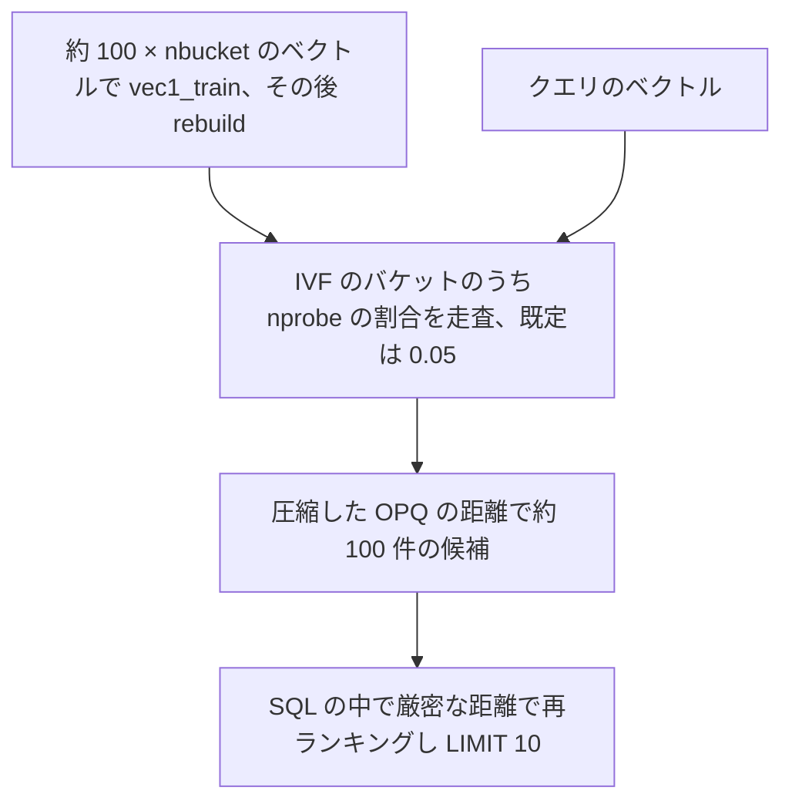
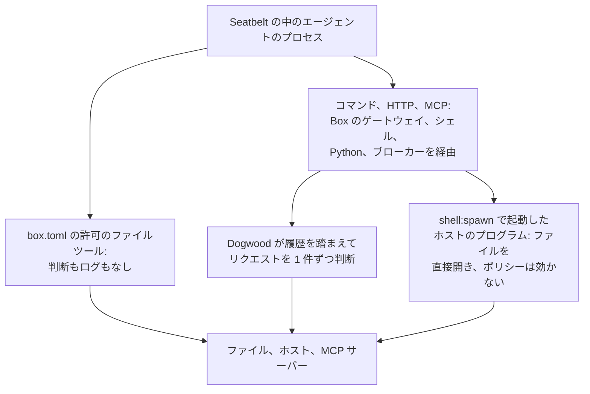
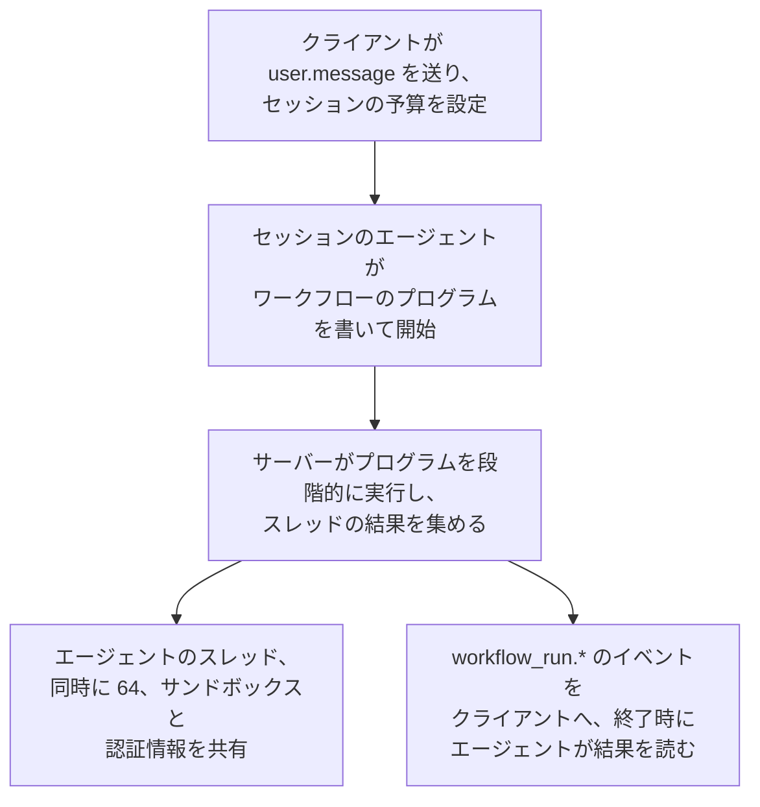

<!-- _class: summary -->

# 🗞️ GenAI Catch-up Report 2026-10-13

2026-10-10 〜 10-13 の 6 トピック (候補 32 件から選定)。詳細は <a href="../research/2026-10-13.md">調査ノート</a>。

<article class="card">
<h3>1️⃣ 🎯 OpenAI の Decisions API がパブリックベータに、入力 100 万トークンあたり $0.10</h3>

GPT-6 Luna の <code>POST /v1/decisions</code> がテキストと画像から確率、選択、ルーブリックのスコアを返し、出力とキャッシュには課金しない。第三者の検証では、完全一致では Jev と並び、微妙な判断では劣り、費用は Jev の 1.6〜3.1 倍だった。

影響 高将来性 高注目度 高リリースモデルAPI・クラウド

</article>
<article class="card">
<h3>2️⃣ ⚖️ Microsoft-Decision-1: Qwen ベースの決定モデルを Jev と同じ価格で</h3>

Qwen3.5-9B を追加学習したモデルで、固定の回答候補それぞれの確率を入力 100 万トークンあたり $0.042、出力無料で返し、Foundry と OpenRouter でプレビュー中。Microsoft のグラフでは精度と速さで首位だが、第三者の計測の 1 つでは Jev より遅かった。

影響 中将来性 高注目度 高リリースモデルAPI・クラウド

</article>
<article class="card">
<h3>3️⃣ 🗃️ SQLite に vec1: ANN のベクトル検索が 3.54.0 のソースツリーに</h3>

1 つの C ファイルで、PQ か OPQ のコードによる IVF のインデックスとインデックス内でのメタデータの絞り込みを提供し、ローダブル拡張として別にビルドする。769,382 件のテキスト埋め込みでの SQLite の計測では、recall@10 は SQL での再ランキングなしで 0.62、ありで 0.93〜0.98。

影響 中将来性 高注目度 高リリースエージェント開発

</article>

---

<!-- _class: summary -->

# 🗞️ GenAI Catch-up Report 2026-10-13

<article class="card">
<h3>4️⃣ 🛡️ AWS の Strands Box: 履歴で判断する Dogwood のポリシー付きサンドボックス</h3>

Apple シリコンの Mac 向けの developer preview で、Seatbelt の封じ込めに、エージェントの過去の操作に応じて判断する Cedar ベースのルールを組み合わせ、ゲートウェイ、シェル、Python、MCP のブローカーで適用する。EC2 Mac では、ポリシーが起動を許したホストのプログラムが禁じたファイルを読めた。

影響 中将来性 高注目度 高リリースセキュリティ・安全性コーディングエージェント

</article>
<article class="card">
<h3>5️⃣ ✈️ 航空に学ぶエッセイ: コーディングエージェントから引き継ぐ力を保つ</h3>

FAA と EASA の指針を引いて、保つべきは AI なしで書く力ではなく AI から引き継ぐ力だとし、ノルマではなくリスクの高い差分を手で読むよう説く。引用は確かめられたが、はてなの注目コメントの多くはアナロジーに異を唱える。

影響 中将来性 中注目度 高論考コーディングエージェント

</article>
<article class="card">
<h3>6️⃣ 🧩 Claude Managed Agents の dynamic workflows: 1 回の実行で最大 1,000 体</h3>

セッションのエージェントが書いたプログラムを Anthropic のサーバーが同時 64 スレッドで段階的に動かし、課金はトークンとセッション時間 1 時間あたり $0.08。仕込んだ 70 個のバグのうち 66 個を見つけた (単一のエージェントは 14〜27 個) と Anthropic は主張し、トークンの消費の多さに注意を促す。

影響 中将来性 高注目度 中リリースエージェント開発API・クラウド

</article>

---

<!-- _class: topic -->

# 1️⃣ 🎯 OpenAI の Decisions API がパブリックベータに、入力 100 万トークンあたり $0.10

DevDay の限定プレビューから 1 週間、10-06 に全開発者へ開かれ、ドキュメント、5 言語の SDK、Playground がそろい、一般提供は数週間内の見込み。

## 要点

- `POST /v1/decisions` は `gpt-6-luna` 専用で、テキストと画像の共通の入力 1 つに、種類を混ぜた `questions` の配列を添える。
- `predicate` は確率を、`choice` は選んだ値と `probabilities`、`confidence` を、`score` は確率で重み付けしたレベルの番号を返す。
- 入力 100 万トークンあたり $0.10 で出力とキャッシュは無料、Responses API の Luna は出力 $0.50、キャッシュ済み入力 $0.01。
- クラスメソッドの 900 件: 日本語のテキストは `predicate` が 93/100、3 分類の `choice` が 84/100 で、中央値は 209〜218 ms。
- Jev との比較: 完全一致は 106/107 で並び、意味の一致は 90〜91 対 96〜97 で劣り (クラスメソッド)、スコアは r = 0.960 (7shi)。

## 見方と論点

- OpenAI は Responses API の Luna より最大 10 倍速いとするがベンチマークはなく、7shi の一括処理では 4.8 倍速かった。
- Simon Willison は `/v1/decisions` が事実上の標準になるとみるが、The New Stack は TypeSafe のスキーマが優勢とみる。
- 制約: キャリブレーションのデータがなく、フォーラムのテストでは `choice` が偏り順序にも左右され、実測の費用は Jev の 1.6〜3.1 倍。

## 技術要素

- リクエストは `model`、`input` (文字列か、`input_text` と `input_image` のユーザーメッセージ)、`questions` で、答えは `name` を返す。
- `choice` は重複しない 2〜255 個の文字列か真偽値を取り、どの答えも `refusal` になりえ、依存する判断には 2 回目の呼び出しが要る。
- 画像: ガイドはインラインの base64 だけを認めるが、API リファレンスは公開の HTTPS の URL を含めて最大 128 枚を受け付ける。
- SDK の `client.decisions.create(...)` には Python 3.26.0、JavaScript 7.30.0、Go 3.73.0、Ruby 0.101.0、Java 4.78.0 が要る。
- 対象の顧客には ZDR と HIPAA、データレジデンシーは米国と欧州で、長いコンテキストとリージョン処理の倍率はかかる。
- 未公表: Decisions のレート制限、質問数や `score` のレベル数の上限、一般提供の日付、ほかのモデル、Azure や Bedrock での提供。

出典: <a href="https://developers.openai.com/api/docs/guides/decisions">OpenAI</a> · <a href="https://dev.classmethod.jp/articles/openai-decisions-api-hands-on/">クラスメソッド</a> · <a href="https://zenn.dev/7shi/scraps/38ded435ab8ceb">7shi (Zenn)</a> · 前回: <a href="./2026-10-01.md#10">10-01 #5</a>

---

<!-- _class: topic -->

# 2️⃣ ⚖️ Microsoft-Decision-1: Qwen ベースの決定モデルを Jev と同じ価格で

OpenAI の Decisions API の 3 日後の 10-09 に Foundry と OpenRouter でプレビューとして発表され、Hacker News で 199 ポイントを集めた。

## 要点

- テキスト専用で、Qwen3.5-9B を固定の選択肢を 1 回で採点するよう追加学習し、yes/no、多肢選択、評価尺度、ルーブリックに答える。
- Jev と同じ入力 100 万トークンあたり $0.042 で出力は無料、Foundry (料金表は米国と EU のデータゾーン) と OpenRouter で提供。
- Microsoft の 36 のベンチマーク、約 15 万問で精度は首位 (The Register によれば 83.5%)、P50 は 2 位の 2.5 倍の速さ。
- Microsoft: 8 通りの揺さぶりで判断が反転したのは平均 1.3% で、選択肢の並べ替えや言い換えでは反転しなかった。
- 実測: p50 は Jev の 283 ms に対し 369 ms、費用は 0.72 倍 (HN の Topfi)、OpenRouter は 0.29 秒、Zenn の OCR ゲートは 395 ms。

## 見方と論点

- The New Stack: OpenAI でなく Qwen を選んだ狙いはエージェントの利用を Foundry に留めること、MAI や OpenAI での作り直しは日付なし。
- 速さの主張は変わり、発表時の Quyet-1.0-Large の 4.5 倍がいまは H2O-Lightning-4B の 2.5 倍、キャリブレーションは 2 位か 3 位。
- Microsoft Learn は言い回しと選択肢の順序でスコアが動くとし、順位付けとしきい値に使うよう勧め、JevOut の攻撃は未検証。

## 技術要素

- エンドポイントは `<foundry-resource-endpoint>/providers/microsoft/v1/systemone` で、`model` にはモデル名でなくデプロイ名を入れる。
- System One の形で `state` と、`criteria` 付きの `noul`、`choice`、`score` の `questions` マップを送り、OpenAI の `/v1/decisions` と違う。
- バージョン 1 は `GlobalStandard` か、一部のリージョンで `DataZoneStandard` でデプロイし、Microsoft Entra ID か `api-key` で認証する。
- カタログ: Preview、コンテキスト 32,768 トークン、入力はテキストで出力は JSON、画像、音声、動画、自由な生成は対象外。
- OpenRouter は `microsoft/microsoft-decision-1` を自前の Decisions API で提供するので、chat completions の SDK では使えない。
- 1 リクエストの質問は並列に評価され、`noul` と `score` を 1 つずつ送ると入力 86、無料の出力 2 トークンで約 $0.0000036。

出典: <a href="https://commandline.microsoft.com/microsoft-decision-1-model-foundry/">Microsoft</a> · <a href="https://learn.microsoft.com/azure/foundry/foundry-models/how-to/use-foundry-models-microsoft-decision">Microsoft Learn</a> · <a href="https://thenewstack.io/microsoft-decision-model-foundry/">The New Stack</a> · <a href="https://news.ycombinator.com/item?id=50024913">Hacker News</a>

---

<!-- _class: topic -->

# 3️⃣ 🗃️ SQLite に vec1: ANN のベクトル検索が 3.54.0 のソースツリーに

告知なしに 10-01 に trunk にマージされて 3.54.0 のタグに 0.8 が載り、10-11 の mattn の Zenn の記事は、はてなブックマーク 236 users。

## 要点

- Dan Kennedy が 09-30 に vec1 を `ext/vec1/` に取り込んで 10-01 にマージし、10-09 の `version-3.54.0` のタグには 0.8 が入った。
- amalgamation にもどの配布パッケージにも含まれず、`make vec1.so` でだけビルドされ、3.54.0 のリリースノートは vec1 に触れない。
- 仮想テーブルで ANN を提供: OPQ、PQ、二値のコードによる IVFADC、距離は L2 とコサイン、float32 のみ、AVX2 か NEON、依存なし。
- 公式の v0.7 の計測、1024 次元のテキスト 769,382 件: recall@10 は再ランキングなし 0.62、あり 0.930〜0.961 (2,251〜1,290 QPS)。
- ビルド済みの入手経路: APSW の PyPI の wheel (`apsw.sqlite_extra.load(db, "vec1")`) と、cgo なしの ncruces/go-sqlite3 (0.7)。

## 見方と論点

- Dan Kennedy は 7 月、学習できるデータならたいていの ANN の実装と競える水準とし、10-01 のロードマップは 1.0 の日付を示さない。
- mattn は結合や WHERE が使える普通の SQL を評価しつつ本番投入は様子見とし、はてなでは小規模なローカルの RAG 向けとの声。
- 頑健性: 8 月の 37 のチェックインがクラッシュやインデックスの破損を直し、修正は 10 月も続き、ロードマップの先頭はテスト。

## 技術要素

- `USING vec1(vector, meta1, ...)` は型のないメタデータ列を 255 まで取り、クエリは `t(:v, '{K:10}')`。
- メタデータの比較は探索の中で絞り込むが、比較演算子のない `WHERE in_stock` は取り出したあとに適用され、K 件より少なくなる。
- sqlite-vec の安定版 v0.1.9 に ANN のインデックスはなく (アルファのみ)、int8 と二値のベクトル、WASM には対応済み。

出典: <a href="https://sqlite.org/vec1doc.html">vec1 のマニュアル</a> · <a href="https://sqlite.org/vec1bench.html">vec1 のベンチマーク</a> · <a href="https://sqlite.org/src/info/92709f54d4">SQLite のチェックイン</a> · <a href="https://zenn.dev/mattn/articles/6e9996319ac099">mattn (Zenn)</a>

---

<!-- _class: topic -->

# 4️⃣ 🛡️ AWS の Strands Box: 履歴で判断する Dogwood のポリシー付きサンドボックス

10-07 に Apple シリコンの Mac 向けに Apache 2.0 の developer preview が出て、EC2 Mac での Zenn の検証がポリシーの効く経路を仕分けた。

## 要点

- v0.1.0 は Apple シリコンの macOS 15 以降のビルドだけを出し、Linux のビルドは公開を見送り、Windows は検討中。
- Seatbelt がエージェントを封じ込め、Dogwood のルールがゲートウェイ、Strands Shell、Python 用の Monty、MCP ブローカーで判断する。
- ルールは Cedar に時間の条件を加え、Slack への投稿を 10 分に 3 回まで、`git push` を `npm test` の成功後だけに限れる。
- Zenn: `shell:spawn` で許し、`[tool.awk]` でプロジェクトの読み取りを与えた `awk` は、`no_env` の forbid があっても `.env` を表示した。
- Zenn: ポリシーガイドの書き込み予算はシェルの `>>` や `tee -a` を 1 度も数えず、Strands Shell は 1 コマンドあたり約 9 ms 増やした。

## 見方と論点

- Marc Brooker: カーネルのサンドボックスは全通信をプロトコルを理解するポリシー層へ流す役で、その層のバグはポリシーの迂回になりうる。
- InfoWorld のアナリスト: フレームワークをまたいで一貫するが、信頼すべき部品が増え、まずいポリシーは作業を止めるか穴を残す。
- リソース制限、テナント間の分離、改ざんできないログ、IMDS の組み込みの遮断はなく、Brooker はセッションごとの microVM で包む。

## 技術要素

- 操作は `fs:read`、`shell:spawn`、`mcp:call` など 10 個で、外向きの呼び出しには `net:connect` と `http:request` の両方が要る。
- ゲートウェイは許可したリクエストにだけ、エージェントのプレースホルダーを本物の秘密に差し替え、SigV4 にも対応する。
- チュートリアルでは Claude Code 2.1.292 と Codex CLI 0.160.1 が自前の確認を切って動き、編集はシェルを通す。

出典: <a href="https://aws.amazon.com/blogs/opensource/introducing-strands-box-ai-agent-sandboxes-powered-by-dogwood/">AWS</a> · <a href="https://strandsagents.com/blog/strands-box-the-big-picture/">Marc Brooker</a> · <a href="https://github.com/strands-agents/box">strands-agents/box</a> · <a href="https://zenn.dev/kashiwabaray/articles/fc2d097da71f30">Zenn (kashiwabaray)</a>

---

<!-- _class: topic -->

# 5️⃣ ✈️ 航空に学ぶエッセイ: コーディングエージェントから引き継ぐ力を保つ

AI のレビューが通した CDK の差分を承認しかけて手が止まったエンジニアが 10-05 に Zenn で公開し、はてなブックマークで 159 users を集めた。

## 要点

- 主張は「目的は AI なしで書けることではなく、AI から引き継げること」で、航空も自動化なしで飛ぶ力より引き継ぐ力を保たせるとする。
- 論拠の SAFO 13002 と 17007、規則 78 FR 67800、AC 120-123、EASA SIB 2013-05R1、EBT は、どれもエッセイの記述どおりだった。
- 日常: SAFO 17007 にならって読む量のノルマは置かず、IAM、データを消しうる IaC、ネットワークの差分だけは手で読む。
- EBT にならう演習: 本番の障害を匿名化して小さく再現し、合否を付けずにチームで演習し、AI の見逃しも素材にする。
- ソフトウェアの障害の多くはロールバックできると認めつつ、AI の誤りは警報を伴わないので、演習は承認済みのコードの欠陥を中心にする。

## 見方と論点

- はてな: 注目コメントの多くは壊れたアプリを人手に切り替えはしないとアナロジーを退け、訓練の時間を取る説得に使いたいという声も。
- 航空は手動の練習を低負荷の場面に置き、高負荷では自動化を使うので、最もリスクの高い差分だけを手で読むのとは逆向き。
- 引き継ぐ力の検証はなく、Anthropic の RCT が測ったのは学習 (AI あり 50%、なし 67%)、Bainbridge は未知の故障は模擬できないとした。

## 技術要素

- SAFO 13002 (2013): 自動飛行を使い続けても手動の技能は保てず、手動の練習は低負荷の場面、自動化は高負荷の場面に。
- SAFO 17007 (2017): 手動飛行はほかの操縦技能の土台で、一律のルールや科学的な根拠のないノルマは避ける。
- AC 120-123 (2022): 各パイロットは手で飛ばせる力を持ち、操縦していないパイロットはつねに介入できる用意をする (PF と PM)。
- NASA の研究 (2014): 身体技能は保たれ認知技能が落ち、高度計の故障では 75% が 300 フィート以上ずれるまでそれに従った。
- CDK の例題: 本番の RDS で `RETAIN` を `DESTROY` に、`deletionProtection` を `false` にすると、スタックの削除や置き換えで消える。
- ほかの演習: IAM の `"Action": "*"`、ログとターゲットの設定から探る ALB の 502、AI の誤った修正で、すべて AWS、エージェント名なし。

出典: <a href="https://zenn.dev/shimitaro/articles/eb45d8d63c7bd1">shimitaro (Zenn)</a> · <a href="https://www.faa.gov/sites/faa.gov/files/other_visit/aviation_industry/airline_operators/airline_safety/SAFO17007.pdf">FAA SAFO 17007</a> · <a href="https://www.anthropic.com/research/AI-assistance-coding-skills">Anthropic</a> · <a href="https://b.hatena.ne.jp/entry/s/zenn.dev/shimitaro/articles/eb45d8d63c7bd1">はてなブックマーク</a>

---

<!-- _class: topic -->

# 6️⃣ 🧩 Claude Managed Agents の dynamic workflows: 1 回の実行で最大 1,000 体

10-09 からパブリックベータで、エージェントの書いたプログラムを Anthropic のサーバーが workflow run としてバックグラウンドで段階的に動かす。

## 要点

- `managed-agents-2026-04-01` のベータヘッダーのもと、ワークフローが既定で有効な `multiagent_20261001` 型で使える。
- 1 回の実行あたり同時 64 スレッド (保証なし)、累計 1,000 エージェント、有効期間 24 時間で、開いた実行は既定でセッションあたり 10。
- 実行を始める API はなく、メッセージから始めるかをエージェントが決め、許可のポリシーは実行の中のツールにだけ効く。
- 独自の価格はなく、各モデルの単価のトークンとセッション時間 1 時間あたり $0.08 で、実行中はセッションが `running` のまま。
- Anthropic の X 投稿: 116k 行のコードに仕込んだ 70 個のバグをワークフローは 3 回とも 66 個見つけ、単一のエージェントは 14〜27 個。

## 見方と論点

- Anthropic はトークンを大量に使いうるので範囲を絞ったタスクから始めるよう勧め、The Decoder は費用対効果に議論の余地があるとする。
- MIXED と vanja.io: 起動の承認がなく、予算は実行あたり 64 リクエストまで超過することがあり、止めるにはエージェントに頼むしかない。
- XenoSpectrum: 1,000 は累計の上限で同時に動く数ではなく、バグのテストは予算をそろえたかも誤検知も不明とする。

## 技術要素

- 結果が `completed` でもスレッドの失敗を含むことがあり、エラーには `timeout_error` や `thread_limit_error` がある。
- webhook も実行の一覧もなくコードも見えず、`user.interrupt` はエージェントのターンを止めるが実行は止めない。
- Claude Code の一般提供版は別物で、読めるローカルのスクリプト、既定で同時 16 エージェント、初回に確認を求める。

出典: <a href="https://platform.claude.com/docs/en/managed-agents/workflow-runs">Claude Platform のドキュメント</a> · <a href="https://x.com/ClaudeDevs/status/2108591328732856655">@ClaudeDevs</a> · <a href="https://mixed-news.com/en/claude-managed-agents-dynamic-workflows-1000-agents-permission-policies/">MIXED</a> · <a href="https://xenospectrum.com/claude-managed-agents-dynamic-workflows/">XenoSpectrum</a>

