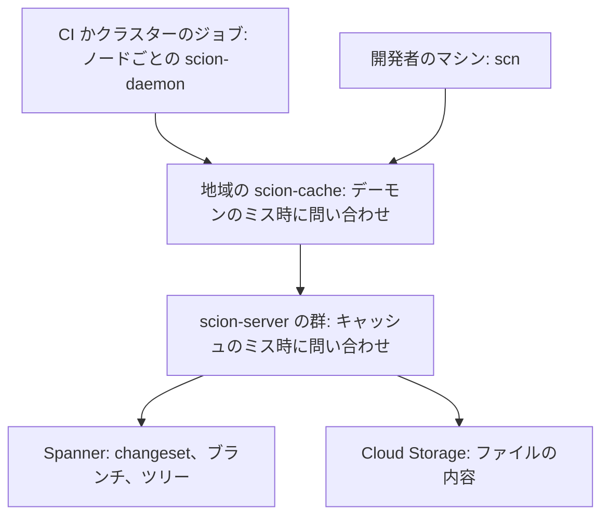
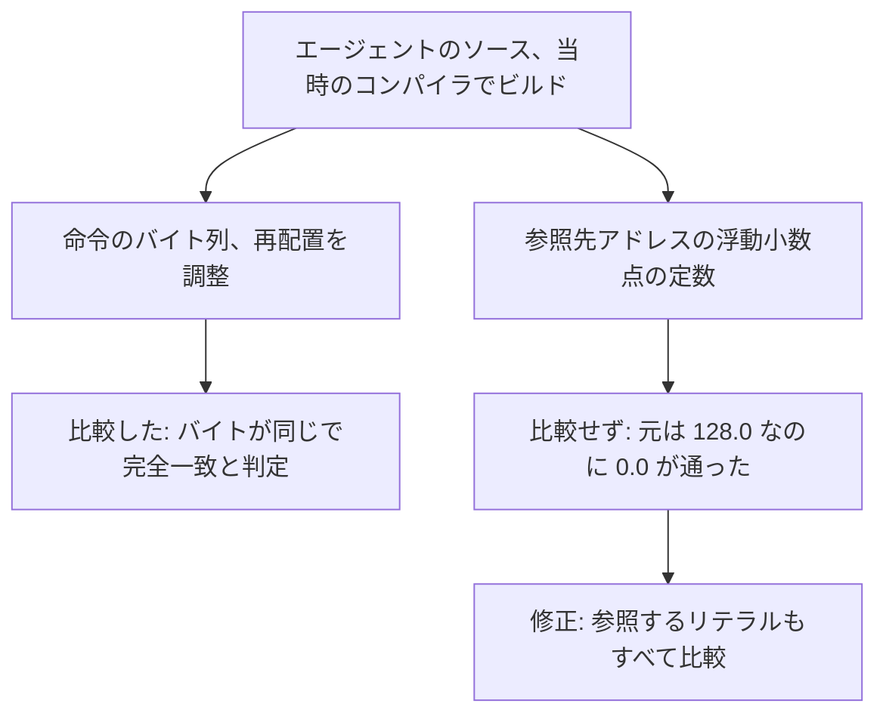

<!-- _class: summary -->

# 🗞️ GenAI Catch-up Report 2026-10-15

2026-10-13 〜 10-15 の 5 トピック (候補 92 件から選定)。詳細は <a href="../research/2026-10-15.md">調査ノート</a>。

<article class="card">
<h3>1️⃣ ♊ Gemini 4 Argon が一般提供に、11 月 30 日まで $2/$10、その後は $4/$20</h3>

<code>gemini-4-argon</code> が Gemini API、Agent Platform、Antigravity、Gemini アプリ、GitHub Copilot で一般提供になり、入力、思考、出力が 100 万トークンの 1 つのウィンドウを共有する。Vals Index では 1 位だが、実務者からは推論のループや虚偽の主張が報告されている。

影響 高将来性 中注目度 高リリースモデルAPI・クラウド

</article>
<article class="card">
<h3>2️⃣ 🍉 Meta の Muse Wonder は Opus 5.5 と同じ価格、Wonder Full は Muse Code だけ</h3>

Meta Superintelligence Labs 初のフロンティア級のモデルで、Wonder は Meta Model API で 100 万トークンあたり $4/$20、Wonder Full は Muse Code の $50 と $200 のプランでだけ使える。Artificial Analysis の評価は Opus 5.5 の 58 に対して 52 と 56。

影響 高将来性 中注目度 高リリースモデルコーディングエージェント

</article>
<article class="card">
<h3>3️⃣ 🌱 Scion: 1 日のマージがピークで 3 万件を超え、Anthropic が git を置き換えた</h3>

クライアントの大半がエージェントとジョブであるモノレポのために、7 人がサーバー中心のバージョン管理システムを作って 5 か月で移行し、エージェントの worktree の作成は 7.1 分から 5.1 秒になった。公開は発表されておらず、Rain は Meta の Mononoke に強く倣った設計だと指摘する。

影響 中将来性 高注目度 高検証・実践コーディングエージェント

</article>

---

<!-- _class: summary -->

# 🗞️ GenAI Catch-up Report 2026-10-15

<article class="card">
<h3>4️⃣ 🐧 Torvalds 初の LLM を使ったパッチ: 2013 年のバグ、23 倍の読み取り、競合状態</h3>

LLM の助けを借りた assoc_array の整理ではユーザー空間のテストが 2013 年からのバグを 4 件見つけ、Claude Code で書いたページキャッシュのシリーズは人工的な 64 スレッドのテストで読み取りが 23 倍になった。レビューが 4 時間で競合状態を見つけ、シリーズは Kiryl Shutsemau が引き継いだ。

影響 中将来性 中注目度 高検証・実践コーディングエージェント

</article>
<article class="card">
<h3>5️⃣ 🕹️ エージェントが東方のゲーム 3 本を再構築、チェックは誤った定数 13 個を通した</h3>

1 人のエンジニアが GPT-6 系のエージェントに、Git を作業メモリに、元のゲームと照らすチェックを受け入れテストにして、TH08、TH095、TH04 を数週間で再構築させた。命令は比べても参照先の定数は比べない比較が、6 つの関数で 13 個の誤った参照を通していた。

影響 中将来性 中注目度 高検証・実践コーディングエージェント評価・運用

</article>

---

<!-- _class: topic -->

# 1️⃣ ♊ Gemini 4 Argon が一般提供に、11 月 30 日まで $2/$10、その後は $4/$20

09-30 に審査を経たサイバー防御組織だけへ出してから 2 週間後の 10-13 に一般提供となった。

## 要点

- `gemini-4-argon` は 10-13 に、有料の Gemini API、Agent Platform、Antigravity、Gemini アプリ、GitHub Copilot で一般提供になった。
- 100 万トークンあたり 11 月 30 日まで入力 $2、キャッシュ済み $0.10、出力 $10、以後は $4、$0.20、$20 で、プロンプト長によらない。
- 09-30 には出力の上限だった 100 万という数字は、入力、思考、出力で共有する 1,048,576 トークンの 1 つのウィンドウになった。
- Vals Index は 68.90% で 1 位 (Sonnet 5.5 67.04%、Opus 5.5 66.97%)、Artificial Analysis の Intelligence Index は 53 のまま。
- 模擬したサイバー攻撃の 12 のシナリオをすべて解き (前の世代は 5)、公開版のモデルはペネトレーションテストのような攻撃側の作業を止める。

## 見方と論点

- Google の ADK の実行は無人で 11 時間、6 つの最適化のうち出荷は 2 つで、筆者らは分担をエージェントが探り、メンテナーが削ると要約する。
- CursorBench: Argon Medium は 52.8% で 1 タスク $4.39、Opus 5.5 Medium は 52.5% で $2.91、Willison は単価では比べにくいとみる。
- HN ではタスク約 10 回に 1 回のループかエラー、Theo は虚偽の主張の率 50% 超、Zenn では Argon も 3.8 Flash も出典のない数字を書いた。

## 技術要素

- 入力はテキスト、画像、動画、音声、PDF、思考は `low`、`medium` (既定)、`high` で、出力の上限は既定で 65,536 トークン。
- 3.1 Pro との違い: `thinking_budget`、`MINIMAL`、ペナルティ、`candidate_count` は 400 を返し、明示的なキャッシュも事前入力もない。
- Gemini API の long decode: Interactions API で `background: true` と `store: true`、64K トークンずつのホップで最大 24 時間。
- Agent Platform: `v1beta1` でクライアント側の `continuation_token` のループ、1 リクエスト 20 分まで、サーバーには何も保存しない。
- ホップごとにプロンプトと生成済みの出力を送り直し、1,000 トークンから 200,000 トークンを出すと入力は 397,216 (繰り返しは 95% 引き)。
- Batch と Flex は半額、Priority は 1.8 倍で Free のティアはなく、10 分あたりの支出の上限はティアの順に $10、$50、$200。

出典: <a href="https://blog.google/innovation-and-ai/models-and-research/gemini-models/introducing-gemini-4-argon/">Google</a> · <a href="https://ai.google.dev/gemini-api/docs/latest-model">Gemini API のドキュメント</a> · <a href="https://simonwillison.net/2026/Oct/13/llm-gemini/">Simon Willison</a> · 前回: <a href="./2026-10-01.md#8">10-01 #3</a>

---

<!-- _class: topic -->

# 2️⃣ 🍉 Meta の Muse Wonder は Opus 5.5 と同じ価格、Wonder Full は Muse Code だけ

Meta Superintelligence Labs が期間の前日の 10-12 に初のフロンティア級のモデルとして公開した。

## 要点

- Wonder は Meta Model API (プレビュー) と Muse Code で使え、Wonder Full は API がなく Muse Code の $50 と $200 のプランだけ。
- `muse-wonder-1.0` は 100 万トークンあたり入力 $4、キャッシュ済み $0.20、出力 $20 で Opus 5.5 の定価と同じ、コンテキストは 100 万。
- Artificial Analysis の Index: Full 56、Wonder 52、Muse Spark 1.3 48、Opus 5.5 58、1 タスクは Wonder $4.52、Opus 5.5 $5.98。
- max の effort での Meta の 14 行の表で、Full は Opus 5.5 に 8 勝 6 敗、API のモデルの Wonder は 5 勝 9 敗。
- Coding Agents Index: Muse Code の Full は 68、Claude Code は Sonnet 5.5 で 68、Opus 5.5 で 66、Wonder は 63。

## 見方と論点

- Meta は Active Memory と Active Focus を売りにし、Wang は主力モデルより大幅に安くすると言っていたが、価格は Opus 5.5 と同じ。
- VentureBeat は表に社内、ベンダー、第三者の実行が混ざると注意し、共通のハーネスの ProgramBench では Opus 5.5 が 11.5 ポイント上。
- Theo は Wonder を Opus 5.5 のレビュー役に使い、XenoSpectrum は MemoryBench をセッション間でなく会話内の記憶の試験とみる。

## 技術要素

- API は `https://api.meta.ai/v1` で Responses、Chat Completions、Anthropic 互換の Messages を備え、effort は `minimal` から `max`。
- `muse-wonder-1.0` の `max` は Wonder Full ではなく、上限はチームごとに毎分 3,000 リクエストと 4M トークン、Standard モードだけ。
- Claude Code は `ANTHROPIC_BASE_URL="https://api.meta.ai"` と `ANTHROPIC_MODEL="muse-wonder-1.0"` の設定で Wonder を使える。
- Muse Code のプランは $5、$15、$50 (Full が加わる)、$200 で、サブスクリプションは既定で内容を学習に使う Contributor モード。
- 入力はテキスト、画像、動画、音声、PDF で、課金されない Meta のシステムプロンプトが入り、`web_search` は 1,000 回で $2.50。
- OpenRouter (`meta/muse-wonder`) と Vercel AI Gateway にもあり、Bedrock、Vertex AI、Foundry に触れた情報源はない。

出典: <a href="https://research.meta.ai/blog/muse-wonder">Meta</a> · <a href="https://dev.meta.ai/models/muse-wonder">Meta のモデルのページ</a> · <a href="https://artificialanalysis.ai/articles/muse-wonder">Artificial Analysis</a> · <a href="https://xenospectrum.com/meta-muse-wonder-claude-gpt-comparison/">XenoSpectrum</a>

---

<!-- _class: topic -->

# 3️⃣ 🌱 Scion: 1 日のマージがピークで 3 万件を超え、Anthropic が git を置き換えた

10-13 に Anthropic の技術ブログで製品ではなく事例として紹介された。

## 要点

- 1 日のマージは 5 月の平均が約 2,500 件、ピークは 9 月 9 日の 30,401 件で、グラフの 7 日平均は 18,000 件近くで終わる。
- 履歴は 100 GB 近く、圧縮した作業コピーは 25 GB 超で、CI だけで 1 日約 2,500 万回のチェックアウトがある。
- 7 人のチームが Scion、コードレビューの Antique、コード検索、ソース管理の IAM を作り、5 か月で移行した。
- git 対 `scn` の中央値で、エージェントの新しい worktree は 7.1 分から 5.1 秒、変更要求あたりのソース管理の時間は 34 分から 3.7 分。
- どの層もキャッシュヒット率は 99% 超、CPU とメモリは置き換えた git のミラーの 200 分の 1 で、CI は CPU の 25% を取り戻した。

## 見方と論点

- Anthropic: 人はすべての変更を行ごとでなく意図でレビューし、エンジニアの役割の多くは Claude にノーと言うことだった。
- git の一般的な代わりではなく公開も発表されておらず、こうした負荷は 6〜12 か月でありふれたものになると Anthropic はみる。
- Mononoke の開発に加わった Rain は模倣が似た洞察の域をはるかに超えるとし、HN は 1 日 3 万件をどうレビューするのかと疑う。

## 技術要素

- changeset はサーバー側のログのエントリーで、変わったファイルをコンテンツアドレスの blob で並べ、packfile も完全なコピーもない。
- `scn` の取得はクライアントの手持ちを伝えず、ルートのツリーから足りないツリーと blob をたどり、どれもキャッシュできる。
- 履歴、blame、コミット、マージはサーバーの API で、bisect と revert のジョブはチェックアウト不要、ref は CAS で動かす。

出典: <a href="https://www.anthropic.com/engineering/redesigning-source-control">Anthropic</a> · <a href="https://sunshowers.io/posts/anthropic-mononoke/">Rain (sunshowers)</a> · <a href="https://www.theregister.com/devops/2026/10/13/anthropic-reinvents-source-control-as-claude-floods-the-world-with-code/5302943">The Register</a> · <a href="https://news.ycombinator.com/item?id=50073633">Hacker News</a>

---

<!-- _class: topic -->

# 4️⃣ 🐧 Torvalds 初の LLM を使ったパッチ: 2013 年のバグ、23 倍の読み取り、競合状態

古いパッチを LLM に手直しさせてもう LLM なしで働く気になれないと Maintainers Summit で語った数日後の 10-11 に、自分のツリーで公開した。

## 要点

- 本人にも難解だった assoc_array のコードに `Assisted-by: LLM` のコミット 15: リファクタリング 10、文書の修正 1、バグの修正 4。
- ユーザー空間のハーネスが報告を確かめ、2013 年からのバグを 3 つ追加で見つけ、4 件中 2 件は Ko と Zeng が LLM で先に修正を出していた。
- 10-10 のカバーレター: コード、テスト、レビューの一覧、カバーレターの初稿は、彼の指示のもとで Claude Code を使って作った。
- v3 (10 本、10-13): Threadripper の 64 スレッドで毎秒の読み取りが 13.3 M から 304 M と 23 倍、ノート PC の 8 スレッドでは約 3 倍。
- 4 時間後に Shutsemau が競合状態を見つけ、1 時間以内に Torvalds はシリーズを託し、どちらのシリーズもメインラインに入っていない。

## 見方と論点

- Torvalds 自身がベンチマークをとても人工的とし、Wilcox は新しいページのフラグに反対、Falcato は得るものより手間が大きいとみる。
- サミット: 7.3 の変更の 10% に付く `Assisted-by` は信号にならず、changelog は人が書くべきだが、彼の初稿は Claude が書いた。
- XenoSpectrum は AI 支援だけでは「検証の独立性が担保されているとはいえない」とし、HN は人のレビューが競合状態を捉えた点を挙げる。

## 技術要素

- `noref-filemap-read-with-llm` は 8 本 (10-10)、`rcu-free-v3` は 10 本でうち 2 本は Shutsemau、すべて `Assisted-by: LLM`。
- ページキャッシュから外した folio は RCU の猶予期間のあとで解放するので、読み取りは参照なしに `rcu_read_lock()` のもとでコピーできる。
- v3 は読まれ続ける folio だけ解放を遅らせ、10-10 の版は 1 つの CPU で解放待ちが 1024 ページを超えると RCU を急がせる。
- `filemap_read_rcu_batch()` の競合状態: 差し替わった folio の古いデータを読み、修正は `xas_reload(&xas) != folio` を確かめ直す。
- ノート PC の計測は緩和策と `CONFIG_HARDENED_USERCOPY` を切っており、xfstests、lockdep、KASAN、clang、32 ビットは試していない。
- assoc_array の修正は `Fixes: 3cb989501c26` (2013-09-24) を持ち、Sakkinen の 570 行の KUnit のテストはそれなしで失敗する。

出典: <a href="https://git.kernel.org/pub/scm/linux/kernel/git/torvalds/linux.git/commit/?h=noref-filemap-read-with-llm&amp;id=4c0f3697118eb3a708ea79175f7f07c43339bfab">Torvalds のカバーレター</a> · <a href="https://lore.kernel.org/all/CAHk-=wjLjgfwgSZ1RDk4YdNFcV0ntosMO5AmBoHD76Zb3HFY7Q@mail.gmail.com/T/">LKML のスレッド</a> · <a href="https://git.kernel.org/pub/scm/linux/kernel/git/torvalds/linux.git/tag/?h=assoc-array-fixes">assoc-array-fixes のタグ</a> · <a href="https://lwn.net/Articles/1099594/">LWN</a>

---

<!-- _class: topic -->

# 5️⃣ 🕹️ エージェントが東方のゲーム 3 本を再構築、チェックは誤った定数 13 個を通した

リバースエンジニアリングの MCP サーバー REA のブログに載った 10-10 のエッセイ (日本語版もある) と 10-13 の続編。

## 要点

- TH08 は 8 月 13 日に GensokyoClub の成果から再開し、8 月 19 日に 1,107 の関数すべてにソースがそろい、8 月 30 日に Linux 版が出た。
- TH095 は確認済みの関数がない 8 月 29 日から 9 月 10 日に Windows i386 で遊べるまでになり、PC-98 DOS の TH04 も遊べる。
- 続編によれば TH09 の突破を支えたのは GPT-6.1-Sol、GPT-6-Astra、GPT-6-Luna-max で、実行ごとの費用をそろえた記録はない。
- 参照のチェックが受け入れテストとなり、Git が記憶としてチェック、変更の理由、次のセッションへのメモを持つ。
- Switch の移植からのバグ報告を受け、浮動小数点のリテラルへの 1,548 の参照を監査すると、5 つの関数でさらに 12 の誤りが見つかった。

## 見方と論点

- 筆者は確信の多くがチェックに懸かっていると書き、古いチェックで報酬を得た学習者は誤った再構築を学びかねないと警告する。
- 経過日数はコミットの時刻の差で統制した高速化ではなく (REA の証拠のメモ)、TH08 は実装済みの 128 の関数から始まった。
- GensokyoClub は主に AI 製の PR を禁じて TH08 を非公開にし、HN の InvisibleUp は TH04 の構成が AI 向けに最適化されているとみる。

## 技術要素

- Factory: スキル 5 つのプラグインを持つブラウザの ChatGPT が、IDA か Ghidra、Bash、Wine、objdiff を出す MCP サーバー 1 つを呼ぶ。
- AGENTS.md: 書き込めるセッションは 1 つ、サブエージェントもコピーした機械語も禁止、完全一致の証拠は reccmp か objdiff の結果だけ。
- 数えるのは Truth Kernel が認めたオラクルの受領書だけで、MCP サーバーはログインのない Tailscale Funnel の URL にある。

出典: <a href="https://rea.tools/blog/touhou-reconstruction/">REA のエッセイ</a> · <a href="https://rea.tools/blog/reverse-engineering-models/">REA の続編</a> · <a href="https://github.com/N0zoM1z0/th08/issues/10">th08 の issue #10</a> · <a href="https://news.ycombinator.com/item?id=50028275">Hacker News</a>

