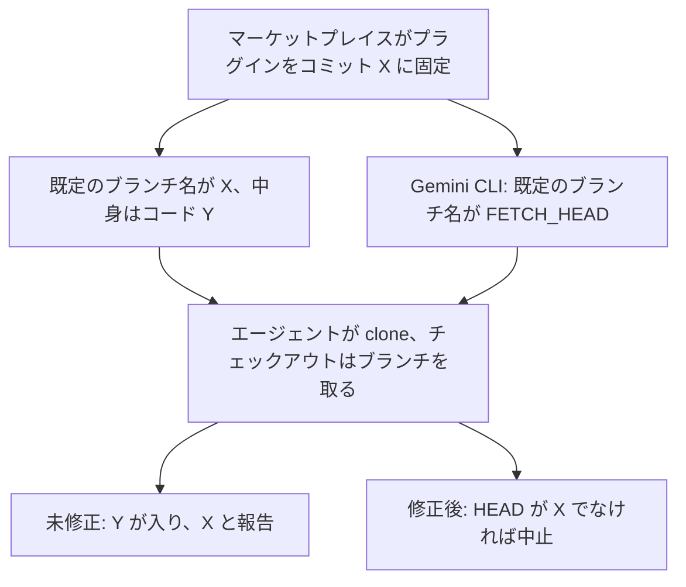
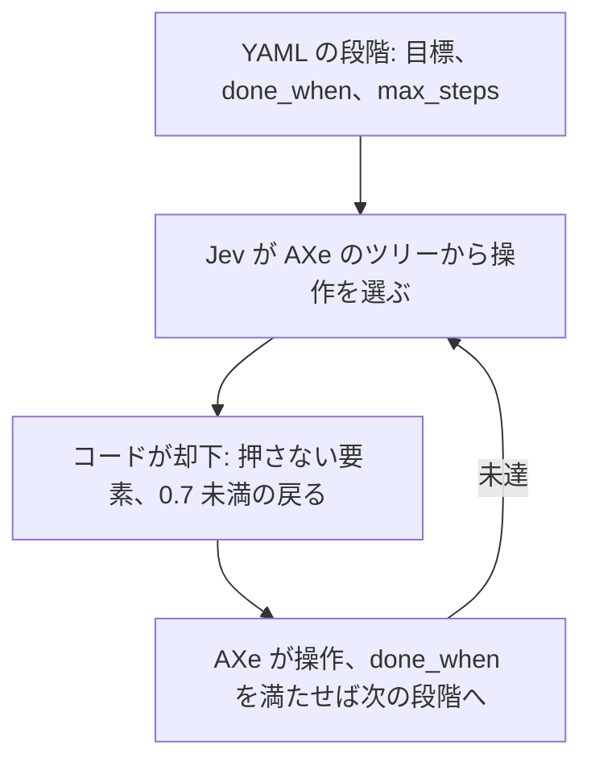
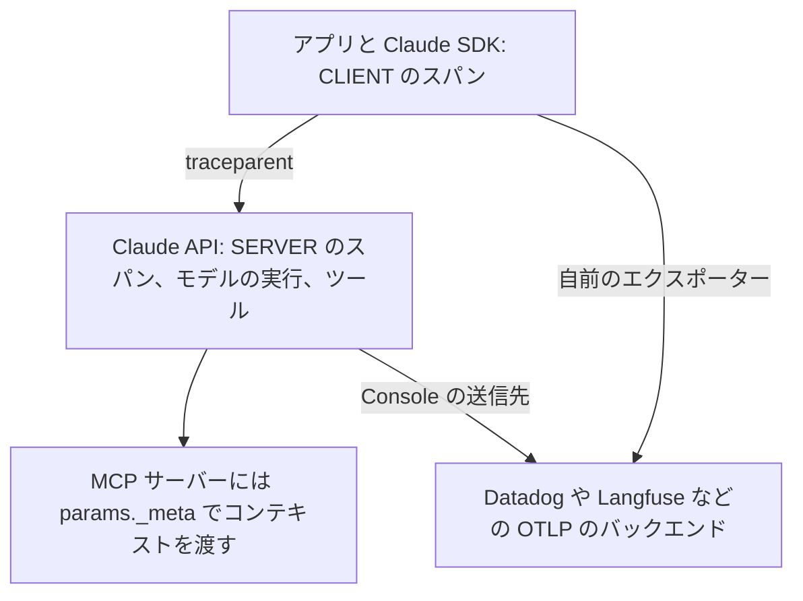

<!-- _class: summary -->
<!-- _header: "" -->

# 🗞️ GenAI Catch-up Report 2026-10-17

2026-10-15 〜 10-17 の 5 トピック (候補 62 件から選定)。詳細は <a href="../research/2026-10-17.md">調査ノート</a>。

<article class="card">
<h3><a href="#3">1️⃣ 🔓 Meta の Muse Spark Open: 816B-A42B のオープンウェイトで米国製の首位 (39)</a></h3>

重みは Hugging Face と 3 つのクラウドにあり、Together、Fireworks、Baseten の $1.25/$4.25 は Meta のより強いクローズドな Spark 1.3 と同じトークン単価。中国の 5 モデルが上で、ライセンスは表示を求め、収入 $20M 超でのサービス提供には契約が要る。

影響 中将来性 中注目度 高リリースモデル

</article>
<article class="card">
<h3><a href="#4">2️⃣ 🪤 Plugin4Shell: SHA と同名のブランチが 4 つのエージェントの固定をすり抜けた</a></h3>

固定した SHA (Gemini CLI では <code>FETCH_HEAD</code>) と同じ名前の既定のブランチがあると、4 つのエージェントは別のコードをチェックアウトする。Claude Code は 2.1.179 (CVE-2026-86063)、Codex は 0.146.0 で直ったが、Gemini CLI は修正されず、Copilot には公開された修正がない。

影響 中将来性 中注目度 高インシデントセキュリティ・安全性コーディングエージェント

</article>
<article class="card">
<h3><a href="#5">3️⃣ 📱 jev-qa: iOS のテストの操作を Jev が 0.33 秒で選び、ループはコードが持つ</a></h3>

every の jev-qa は決定モデル Jev にシミュレータでの操作をアクセシビリティツリーから選ばせ、1 操作は Claude の約 7 秒に対して 2〜3 秒、4 分の探索で 1 円未満。Jev 自身の完了の判定が当てにならないので、止める判定はコードが持つ。

影響 中将来性 中注目度 高検証・実践エージェント開発モデル

</article>

---

<!-- _class: summary -->
<!-- _header: "" -->

# 🗞️ GenAI Catch-up Report 2026-10-17

<article class="card">
<h3><a href="#6">4️⃣ 🖥️ Solvio: B200 1 枚の Qwen3.5-122B は 18 回中 17 回合格、Claude Code は 18 回</a></h3>

借りた B200 1 枚で OpenCode と組んだ Qwen3.5-122B は小さなバグの修正 18 回中 17 回を通し、6 課題を同時に解いて 1 課題の中央値は 66 秒 (Opus 5.5 は 25 秒)。ログの再生では同時 16 人までで、常時借りると月約 87 万円。

影響 中将来性 中注目度 高検証・実践コーディングエージェント評価・運用

</article>
<article class="card">
<h3><a href="#7">5️⃣ 🔭 Claude API の OpenTelemetry がベータに、API 自体もスパンを送る</a></h3>

Claude SDK は 7 つの言語でスパンを出し、API 自体も Messages API の呼び出しと Managed Agents のセッションのスパンを Console で設定した OTLP の送信先に送る。既定はメタデータだけで、API のスパンは Claude API と Claude Platform on AWS に限られる。

影響 中将来性 高注目度 中リリース評価・運用API・クラウド

</article>

---

<!-- _class: topic -->

# 1️⃣ 🔓 Meta の Muse Spark Open: 816B-A42B のオープンウェイトで米国製の首位 (39)

Meta が 10-15 にオープンウェイトとして Hugging Face と 3 つのクラウドで公開し、同時に 7 社がホストした API を出した。

## 要点

- 総パラメータ 816B、アクティブ 42B、コンテキスト 100 万トークンのマルチモーダルな MoE で、コーディングとエージェント向け。
- Artificial Analysis: 39 で米国製のオープンモデルの首位 (Nemotron 3.5 Super VL 26)、中国の 5 つが上で MiMo-V2.6-Pro は 46。
- 上位 9 つのオープンモデルでは AA のエージェント評価で最下位だが、出力は 1 タスク 40k トークンと最少で GLM-5.3 より 43% 少ない。
- Together、Fireworks、Baseten は 100 万トークンあたり $1.25/$4.25 でクローズドな Spark 1.3 (48) と同額、AA の 1 タスク $0.84。
- ライセンス: モデル本体や蒸留したモデルを使う製品には表示が要り、収入が年 $20M を超えるとサービスとしての提供に別の契約が要る。

## 見方と論点

- Meta は米国製で過去最高のオープンウェイトとし、Nathan Lambert はライセンスを酷評しつつ米中の差はほぼ半分に縮んだとみる。
- Teortaxes はサイズの割に弱いとし、HN は利用制限があってもオープンウェイトかと問い、ITmedia は $20M をグループ全体の収入と読む。
- Meta の表は出典もハーネスも混在し、モデルカードでは比較した中で攻撃成功率が最も低く、過剰拒否が最も多い (FORTRESS 17.4)。

## 技術要素

- 62 層で 256 のエキスパートから 8 つ、46 層は 2,048 トークンのウィンドウで KV キャッシュはフルの 4 分の 1 強 (vLLM)。
- エキスパートだけの NVFP4 は約 530GB で H200 8 枚、Blackwell Ultra 4 枚、512GB の Mac Studio 2 台で動き、BF16 は約 1.6TB。
- Apple の MLX では Mac Studio 2 台で毎秒 24.99 トークン、4 台で 36.73 (8K のコンテキスト)、512GB の M5 Ultra は未発売。
- vLLM のイメージ `vllm/vllm-openai:muse-spark-open` はあるが、wheel、TensorRT-LLM、mlx-lm の対応は未マージ。
- Groq はプレビューで上限 131,072 トークン、OpenRouter は EU 域内ルーティング非対応、Fireworks は 10-29 まで。
- SageMaker JumpStart は NVFP4 が `ml.p5e.48xlarge`、BF16 が `ml.p6-b300.48xlarge`、公開時は米国東部の 2 リージョン。

出典: <a href="https://research.meta.ai/blog/muse-spark-open">Meta</a> · <a href="https://huggingface.co/meta-models/Muse-Spark-Open-816B-A42B">モデルカード</a> · <a href="https://x.com/ArtificialAnlys/status/2110893784422908225">Artificial Analysis</a> · <a href="https://www.latent.space/p/ainews-agents-disprove-polysemanticity">AINews</a> · 📝 <a href="../research/2026-10-17.md#topic-1">調査ノート</a>

---

<!-- _class: topic -->

# 2️⃣ 🪤 Plugin4Shell: SHA と同名のブランチが 4 つのエージェントの固定をすり抜けた

AIR Security が期間前の 09-17 に公表し、10-09 の Anthropic のアドバイザリが Claude Code の部分に CVE-2026-86063 を付けた。

## 要点

- AIR は SHA に固定したプラグインで Claude Code、Codex、GitHub Copilot、Gemini CLI にレビューされていないコードを入れさせた。
- どれもチェックアウト後に HEAD を確かめず、git はブランチ名でもコミット ID でもある名前をブランチとして解決し、警告するだけ。
- AIR のいうゼロクリック: マーケットプレイスが無害な新しいコミットに固定し直すと、自動更新がその名のブランチのコードを入れる。
- 修正は Claude Code 2.1.179 (06-16) と Codex 0.146.0 (07-29) で、CVE が付いたのはいまも 4 つのうち CVE-2026-86063 だけ。
- Google は企業向けに出荷が続く Gemini CLI (10-13 に v0.64.0) を直さないとし、Microsoft は Copilot の修正を出していない。

## 見方と論点

- マーケットプレイスの製品を売る AIR はゼロクリックとするが、Anthropic の前提条件は利用者が悪意のあるプラグインを入れること。
- GitHub は SHA に似たブランチ名を禁じるので自社では悪用できないとし、AIR は Bitbucket などでは Copilot が影響を受けると反論。
- クラスメソッド (git 2.55.0) で X になったのは `checkout --detach $X^{commit}` だけで、警告は標準エラーのみ、終了コードは 0。

## 技術要素

- GHSA-pq7j-f95f-qfcv は 2.1.179 未満の `@anthropic-ai/claude-code` と Claude Desktop (修正版は未記載)。
- CVSS 4.0 はリポジトリで 7.7 (UI:P)、GitHub のレコードで 7.5 (UI:A)、CWE-494 と CWE-829、CISA KEV には未掲載。
- 自動更新が既定で有効なのは Anthropic の公式と claude.ai から追加したマーケットプレイスと Copilot CLI の組み込みだけ。

出典: <a href="https://www.air.security/blog-posts/plugin4shell">AIR Security</a> · <a href="https://github.com/anthropics/claude-code/security/advisories/GHSA-pq7j-f95f-qfcv">Anthropic のアドバイザリ</a> · <a href="https://dev.classmethod.jp/articles/claude-code-plugin-sha-pin-bypass/">クラスメソッド</a> · <a href="https://www.theregister.com/security/2026/09/17/ai-coding-agents-0-click-rce-flaw-could-hand-attackers-keys-to-the-kingdom/5297335">The Register</a> · 📝 <a href="../research/2026-10-17.md#topic-2">調査ノート</a>

---

<!-- _class: topic -->

# 3️⃣ 📱 jev-qa: iOS のテストの操作を Jev が 0.33 秒で選び、ループはコードが持つ

シミュレータで iOS アプリの探索的な QA を行うツールを、作ったインターン本人が 10-15 に every の技術ブログで紹介した。

## 要点

- AXe がアクセシビリティツリーを読み、Jev は `operation`、`target`、`is_error_shown`、`goal_achieved` に 1 回の呼び出しで答える。
- 1 ステップは判断 0.33 秒、操作 1.16 秒、画面の変化待ち 2.01 秒、1 手ずつ判断させると Claude は 1 操作約 7 秒、Jev は 2〜3 秒。
- `--explore 240` は 4 分で 65 種類のボタンに 83 ステップで触れ、1 ステップは入力約 1,500 トークン、全体で 0.8〜0.9 円。
- `goal_achieved` は失敗した実行も完了とし長い流れで Jev が迷うため、`done_when` と `max_steps` を持つ YAML の段階をコードが回す。
- エラー、固まる、行き詰まるのチェックはまれな道筋で実際の問題を見つけたが、わかりにくい表示を問うチェックは誤検知が多かった。

## 見方と論点

- TypeSafe は Jev をエージェントではなくコード主導のワークフロー向けとし、jev-qa もループはコード、Jev は列挙した行動から選ぶ。
- プレプリントの Jev-Mobile も Android で同様に分け、成功率 0.79 (ステップごとの VLM は 0.84)、実行器の時間は 94.30 から 5.16 秒に。
- Claude の数字は 1 回ずつの実行で、筆者は決まったフローはスクリプト、探索は Jev、見つかったものの判断は Claude と分ける。

## 技術要素

- Jev は入力 100 万トークンあたり $0.042、出力は無料、1 リクエスト 64k、1 質問 32k まで、`jev-latest` は `jev-1.13.0`。
- 購入、削除、退会、サインインは押さず、課金画面は × で閉じ、確信度 0.7 未満なら戻る操作をしない。
- Jev は質問ごとに独立に答えるため要素の一覧を状態にも入れ、jev-1.13 は最初の選択肢に偏り、CJK に弱い。

出典: <a href="https://tech.every.tv/entry/2026/10/15/125805">every Tech Blog</a> · <a href="https://docs.typesafe.ai/introduction">TypeSafe のドキュメント</a> · <a href="https://arxiv.org/abs/2609.30186">Jev-Mobile (arXiv)</a> · <a href="https://b.hatena.ne.jp/entry/s/tech.every.tv/entry/2026/10/15/125805">はてなブックマーク</a> · 📝 <a href="../research/2026-10-17.md#topic-3">調査ノート</a>

---

<!-- _class: topic -->

# 4️⃣ 🖥️ Solvio: B200 1 枚の Qwen3.5-122B は 18 回中 17 回合格、Claude Code は 18 回

Solvio が 10-15 に Zenn で、借りた NVIDIA B200 1 枚のオープンモデルが社内向けの Claude Code の代わりになるかを検証した。

## 要点

- 課題は Flask、Click、pluggy など 6 つのプロジェクトで 2026 年 7 月以降に入った 20 行以内の修正 6 つを 3 回ずつ、テストで採点。
- 18 回中、Qwen は初回で 17 回、gpt-oss-120b は追加の指示込みで 16 回 (なしで 11)、Claude Code は Opus と Haiku 5.5 で 18 回。
- 1 課題の中央値は Opus 25 秒、Haiku 41 秒、Qwen 66 秒、gpt-oss 149 秒で、ローカルは 6 課題を同時に、Claude Code は逐次。
- OpenCode のログを 1〜64 人分再生し、TTFT の中央値 30 秒以内と伸び 3 倍以内の基準で、Qwen は 16 人、gpt-oss は 8 人まで。
- 1 時間 $8.04 で 4 時間 52 分の検証は約 5,900 円、常時借りれば月約 87 万円、64 人で割ると 1 人あたり月約 1.4 万円。

## 見方と論点

- はてなでは、借りた GPU ならローカルでなくオープンモデルの検証、課題も小さいとの声と、データを出せない企業には唯一の道との声。
- Zenn の読者は投機的デコーディングと学習データへの混入を問うが、修正は 4 つのモデルのカットオフや公開より後のもの。
- 留意点: 並列と逐次の違い、Opus の effort が不明、18 回では 17 と 18 を区別できない、Opus が自分の要約も採点。

## 技術要素

- RunPod の B200 (180 GB) 上の vLLM で `Qwen3.5-122B-A10B-FP8` (127 GB) と `gpt-oss-120b` (65 GB) を実行、フラグ不明。
- OpenCode の上限 65,536 トークンは Qwen のネイティブ 262,144 の 4 分の 1、Qwen が思考用に勧める 128K の半分。
- Qwen の生成は 1 人で毎秒 145 トークン、8 人で各 73、TTFT は 32 人まで 2 秒以内、KV キャッシュは 32 人でも最大 35%。
- 上限はメモリでなく計算 (32 人で 3.14 倍) で、MI325X では MTP で Qwen の 1 本の生成が毎秒 128 から 184 トークンに。
- 再生は 8 人の実際の OpenCode とリクエストごとに 5〜12% の差、gpt-oss は推論レベル中で SWE-bench Verified 52.6%。
- コーディング以外 (Qwen/Haiku): マスキング 0.93/0.87、抽出 0.96/0.93、要約 0.94/0.96、翻訳 0.92/0.95。

出典: <a href="https://zenn.dev/solvio/articles/6d374a9224327a">Solvio (Zenn)</a> · <a href="https://huggingface.co/Qwen/Qwen3.5-122B-A10B-FP8">Qwen のモデルカード</a> · <a href="https://b.hatena.ne.jp/entry/s/zenn.dev/solvio/articles/6d374a9224327a">はてなブックマーク</a> · 📝 <a href="../research/2026-10-17.md#topic-4">調査ノート</a>

---

<!-- _class: topic -->

# 5️⃣ 🔭 Claude API の OpenTelemetry がベータに、API 自体もスパンを送る

Anthropic が期間前の 10-14 に、Messages API、Managed Agents、Claude SDK 向けのパブリックベータとして発表した。

## 要点

- SDK のスパンはリクエストとツール、Console で設定する API のスパンはモデルの実行、エージェントのターン、サーバーツールも追う。
- SDK のスパンは Claude API、Claude Platform on AWS、Bedrock、Google Cloud、Foundry で、API のスパンは最初の 2 つだけ。
- 送信先は管理者が設定し、ポート 443 の HTTPS で protobuf を受ける OTLP/HTTP、認証情報はヘッダー、1 組織 10 個まで。
- Metadata only (既定) は ID、時間、状態、トークン数、エージェントとツールの名前、Full content はプロンプトと応答も送る。
- 配信は at least once のベストエフォートでタイムアウト 10 秒、3xx、公開でない IP、24 時間続く失敗で送信先は無効になる。

## 見方と論点

- Anthropic はエージェントへの信頼をモデル、ツール、MCP サーバーの呼び出しのトレースから始まるものとし、12 のパートナーを挙げる。
- Pillitteri は Full content だとバックエンドが会話のアーカイブになるとし、日本語の note の投稿はトレースは誤操作を止めないとする。
- 独立した分析は乏しく、Unite.AI は機械が書いた記事で、MLflow とともに AWS の API のスパンは別のトレースとするがドキュメントにない。

## 技術要素

- 送信先は API (ベータヘッダー `telemetry-destinations-2026-08-11`) や `ant` CLI でも作れる。
- `anthropic.session.turn` などのスパン名と、09-24 のコミットに準拠した GenAI の属性は、ベータの間に変わりうる。
- OpenAI 互換の呼び出しと拒否されたツールの呼び出しに API のスパンはなく、HIPAA、FERPA、K-12 の組織はメタデータのみ。

出典: <a href="https://platform.claude.com/docs/en/manage-claude/opentelemetry">Claude Platform のドキュメント</a> · <a href="https://claude.com/resources/articles/agent-observability-on-the-claude-platform">Anthropic</a> · <a href="https://pasqualepillitteri.it/en/news/23861/opentelemetry-claude-api-traces-public-beta">Pasquale Pillitteri</a> · 前回: <a href="../research/2026-10-15.md#topic-7">10-15 の調査ノートのトピック 7</a> · 📝 <a href="../research/2026-10-17.md#topic-5">調査ノート</a>

