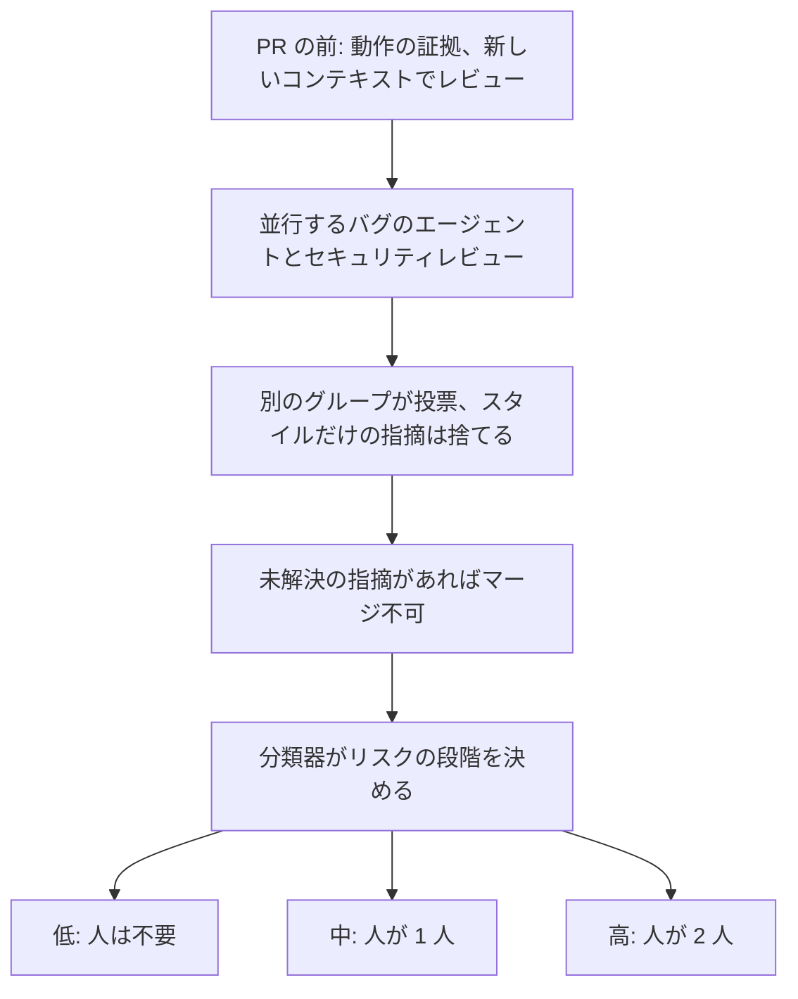
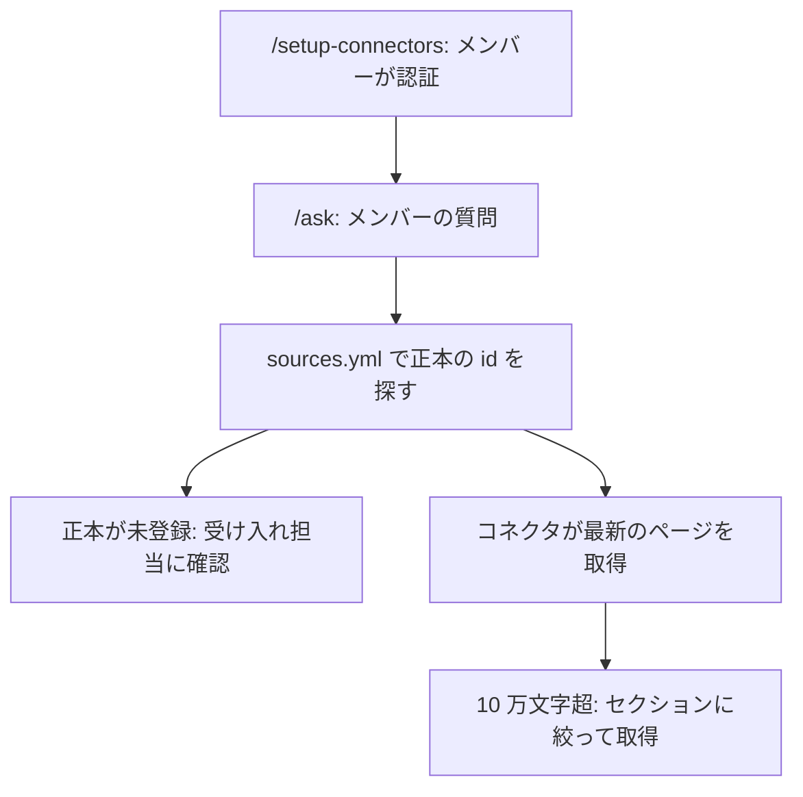

<!-- _class: summary -->
<!-- _header: "" -->

# 🗞️ GenAI Catch-up Report 2026-10-20

2026-10-17 〜 10-20 の 3 トピック (候補 53 件から選定)。詳細は <a href="../research/2026-10-20.md">調査ノート</a>。

<article class="card">
<h3><a href="#2">1️⃣ 🐋 DeepSeek-V4.1-Flash-1017: 重みを MIT で公開、11 項目中 4 つで Opus 5 超え</a></h3>

552B の MoE で、API の <code>deepseek-flash</code> はピーク時に 100 万トークンあたり入力 $0.30、出力 $1.20。DeepSeek の表では DeepSWE v1.1 が 77.0 で Opus 5 の 74.0 を上回るが、Terminal-Bench 4.0 と HLE では及ばない。Search と Fetch は 1,000 回 $0.75。

影響 中将来性 中注目度 高リリースモデルAPI・クラウド

</article>
<article class="card">
<h3><a href="#3">2️⃣ 🔍 Claude Code チーム: AI の指摘が残るとマージ不可、人の承認はリスク次第</a></h3>

チームのリポジトリでは未解決のバグやセキュリティの指摘がマージを止め、分類器がリスクに応じて人の承認を 0〜2 人に決める。Code Review は 10-15 に一般提供となったが、PR を自ら止めることはなく、トークンの使用量で課金する。

影響 中将来性 中注目度 高検証・実践コーディングエージェント

</article>
<article class="card">
<h3><a href="#4">3️⃣ 🧭 DeNA のオンボーディング用リポジトリ: Claude Code が id で正本を取得</a></h3>

ガイドは資料を転記せず正本の id だけを書き、<code>/ask</code> がコネクタで最新のページを取りに行く。AI による試走で 44 件のリンク切れと <code>sudo rm -rf</code> を 13 行含むスクリプトが見つかり、中途入社の 1 人は約 1 か月で終えた。

影響 中将来性 中注目度 高検証・実践コーディングエージェント

</article>

---

<!-- _class: topic -->

# 1️⃣ 🐋 DeepSeek-V4.1-Flash-1017: 重みを MIT で公開、11 項目中 4 つで Opus 5 超え

DeepSeek が 10-17 に MIT ライセンスの重みと API の <code>deepseek-flash</code> として公開し、Search API と Fetch API も全ユーザーに開放した。

## 要点

- 総パラメータ 552B の MoE で、入力を読む段階では 8B、生成する段階では 16B が動き、9 月の版から 37 日での公開 (PC Watch)。
- モデルカードでは DeepSWE v1.1 が 77.0 で Opus 5 の 74.0、GPT-5.6 Sol の 73.0 を上回り、Opus 5 超えは 11 項目中 4 つ。
- 残る 7 項目は Opus 5 が上で、Terminal-Bench 4.0 は 51.8 対 42.3 (前の版は 31.2)、ツールなしの HLE は 56.3 対 42.6。
- Artificial Analysis の指数は 39 から 45 へ (同規模のオープンモデルの中央値 19)、計測時の出力は 250M から 210M トークンに減少。
- `deepseek-flash` はピーク時 100 万トークンあたり入力 $0.30、出力 $1.20 (オフピークは半額)、Search と Fetch は 1,000 回 $0.75。

## 見方と論点

- DeepSeek は実行を短くした小幅な更新とし、PC Watch は Opus 5 超えを見出しにしつつ「総合力では上位の有料モデルに一歩譲る」と書く。
- DeepSWE や Terminal-Bench の独立した再現はなく、HN ではトークン約 20% 減の報告と、時間 30% 増でレビューも悪化との報告が並ぶ。
- Suganthan の検証では `authority` はホスト単位の採点で、Fetch は robots.txt を守らず、香港の Huawei Cloud から届いた。

## 技術要素

- 重みは計 763B (約 765 GB): 552B の MoE、196B の条件付きメモリ Engram、約 14B の投機的デコーディング DSpark、画像用の約 0.5B。
- Jinja のテンプレートはなく、deepseek-recipe (Rust、Python バインディング付き) が Messages、Chat Completions、Responses を変換。
- コンテキストは 100 万トークン、推奨は `temperature`・`top_p` 1.0 と `max_tokens` 256K 以上、API の出力上限は 384K で既定は thinking。
- `https://api.deepseek.com/anthropic` で Anthropic 形式も受け、廃止した Flash の旧名もこのモデルに回り、9 月の版には固定できない。
- ピークは平日の日本時間 10〜13 時と 15〜19 時、キャッシュヒットは 100 万トークン $0.006、AA で毎秒 216.5 トークン、TTFT 1.11 秒。
- `/v1/tools/search` と `/v1/tools/fetch` は API キーで呼び、Claude Code や Codex から呼ぶ分は北京時間 11-01 まで無料。

出典: <a href="https://huggingface.co/deepseek-ai/DeepSeek-V4.1-Flash-1017">DeepSeek のモデルカード</a> · <a href="https://api-docs.deepseek.com/guides/search/">DeepSeek の Search と Fetch のドキュメント</a> · <a href="https://artificialanalysis.ai/models/deepseek-v4-1-flash-1017">Artificial Analysis</a> · <a href="https://suganthan.com/blog/deepseek-search-api/">Suganthan Mohanadasan</a> · 📝 <a href="../research/2026-10-20.md#topic-1">調査ノート</a>

---

<!-- _class: topic -->

# 2️⃣ 🔍 Claude Code チーム: AI の指摘が残るとマージ不可、人の承認はリスク次第

Claude Code チームが期間前の 10-15 に claude.dev のブログで説明し、同じ日に Code Review が一般提供になった。

## 要点

- Claude Code のコードの約 90% は Claude が書き、6〜9 月にマージされた PR は 2 倍を超え、リバートが要った割合は 40% 超下がった。
- 機微なパスと CI のワークフローは必ず人が見て、エージェントの承認は人の枠を埋めず、承認は 1 つのコミットにだけ効く。
- エンジニアが確かめた過去のインシデントとリバートの PR が毎日の評価セットになり、ノイズは作成者の対応と問題のない PR での誤報で測る。
- 3 回の上限などの収束策で、1 回で通る割合は 65% から 78% に上がり、通るまでの平均レビュー回数は 2.08 から 1.32 に減った。
- Code Review 自体は PR を承認もブロックもせず、2.1.304 (10-19) で組織全体のレベルと Organization 全体の対象化が入った。

## 見方と論点

- チームは人がコードを読んだかを不正確な代理指標とみるが、リバートが増えたら承認を厳しくするサーキットブレーカーはまだない。
- npaka は誤検知を減らしてレビューを収束させる工夫に注目し、指摘でマージを止めるには GitHub 側に追加のルールが要ると補う。
- HN では差分を読めば冗長さや複雑すぎる設計にまだ気づけるとの声があり、Anthropic は母数も分類器の中身も示していない。

## 技術要素

- Team か Enterprise の組織と GitHub か GHES が要り、ZDR、HIPAA、CMEK の組織は不可、差分は読むだけで実行しない。
- 定額はなく usage credits でトークン課金 (プレビュー中は 1 回 $15〜$25、TNW)、管理画面からの追加は push ごと。
- Quick、Standard (既定)、Deep をリポジトリで上書きでき、契機は作成時、push ごと、`@claude review`、上限超過は省略。

出典: <a href="https://claude.dev/blog/solving-code-review-at-anthropic/">claude.dev のブログ</a> · <a href="https://code.claude.com/docs/en/code-review">Code Review のドキュメント</a> · <a href="https://note.com/npaka/n/ndb4b0f424ced">npaka (note)</a> · 前回: <a href="../research/2026-10-17.md#topic-7">10-17 の調査ノートのトピック 7</a> · 📝 <a href="../research/2026-10-20.md#topic-2">調査ノート</a>

---

<!-- _class: topic -->

# 3️⃣ 🧭 DeNA のオンボーディング用リポジトリ: Claude Code が id で正本を取得

DeNA Engineering が期間前の 10-07 に、ヘルスケア領域のデータサイエンス部で Claude Code が伴走するオンボーディングを紹介した。

## 要点

- `/setup-connectors`、`/init`、`/setup-env` から `/ask` や `/maintain` まで 9 つのスキルで `analyst-onboarding` を回す。
- 転記は古びるため、URL と id は `knowledge/sources.yml` にだけ置き、ガイドは本文でなく `正本: <id>` と書く。
- `/ask` は id からコネクタ (Atlassian と Google Drive、Slack は任意) でページを取得し、AI は認証できないので認証は人が行う。
- 新人役の AI の 6 周の試走で、VPN に要る MFA が後の手順という矛盾、全 44 件のリンク切れ、禁止をすり抜ける `sudo rm -rf` 13 行が出た。
- 中途入社のメンバーは約 1 か月で終え、以前は 1 日から 2 週間かかった環境構築は「大丈夫か心配になるくらい爆速で終わった」という。

## 見方と論点

- 筆者は `/onboarding next` の出力の揺れの原因をモデルでなく期待する形の書き漏れとし、`SKILL.md` のルールで安定させた。
- はてなには本文を持たず導線だけ管理する設計を賢いとする声があるが、独立した記事はなく、成果は中途入社の 1 人に拠る。
- 取得で表が欠けても AI は気づかないことがあり、使ったのが claude.ai のコネクタか `claude mcp add` のサーバーかは記事にない。

## 技術要素

- claude.ai のコネクタはサブスクリプションのログインでのみ読み込まれ、API キー、Bedrock、Agent Platform では不可。
- `MAX_MCP_OUTPUT_TOKENS` の既定は 25,000 (10,000 超で警告)、50,000 文字を超えるテキストはファイルに保存。
- `Bash(rm *)` は `bash -c 'rm -rf build/'` を止めず、ドキュメントは deny を境界とせずサンドボックスを勧める。

出典: <a href="https://engineering.dena.com/blog/2026/10/ai-agent-onboarding/">DeNA Engineering</a> · <a href="https://code.claude.com/docs/en/mcp">Claude Code の MCP のドキュメント</a> · <a href="https://code.claude.com/docs/en/permissions">Claude Code の権限のドキュメント</a> · <a href="https://b.hatena.ne.jp/entry/s/engineering.dena.com/blog/2026/10/ai-agent-onboarding/">はてなブックマーク</a> · 📝 <a href="../research/2026-10-20.md#topic-3">調査ノート</a>

