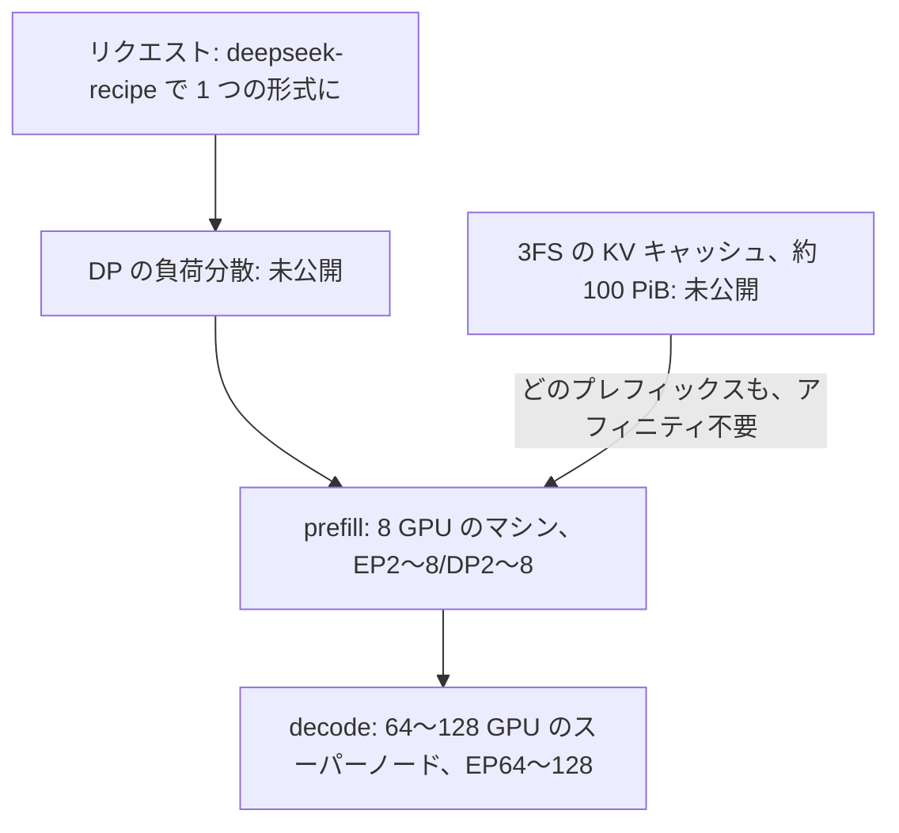

<!-- _class: summary -->
<!-- _header: "" -->

# 🗞️ GenAI Catch-up Report 2026-10-22

2026-10-20 〜 10-22 の 5 トピック (候補 74 件から選定)。詳細は <a href="../research/2026-10-22.md">調査ノート</a>。

<article class="card">
<h3><a href="#3">1️⃣ 🔀 Claude API 2026-10-21: temperature、top_p、top_k を拒否し、新 SDK の既定に</a></h3>

この版では <code>temperature</code>、<code>top_p</code>、<code>top_k</code> を送るとデフォルト値でも 400 が返り、<code>2023-06-01</code> には終了日がない。SDK の新しいメジャー版はこの版を既定で送り、API キーも Bearer トークンとして送る。

影響 高将来性 高注目度 高仕様変更API・クラウド

</article>
<article class="card">
<h3><a href="#4">2️⃣ ⚙️ DeepInfer: DeepSeek が V4.1-Flash のエンジンを公開、KV キャッシュ層は除く</a></h3>

NVIDIA SM100 か Ascend 950 で動く Apache 2.0 のオフライン推論で、KV キャッシュのシステム、prefill と decode の分離、負荷分散は含まない。DeepSeek によれば 1 クラスタが 1 日 155T トークンを処理し、オフピークの料金で GPU 1 時間あたり $38 を稼ぐ。

影響 中将来性 中注目度 高リリースAPI・クラウド評価・運用

</article>
<article class="card">
<h3><a href="#5">3️⃣ 🪙 MiniMax M3.1 Flash: 100 万トークン $0.15/$0.60、自社計測で DeepSWE 73.7%</a></h3>

単価は M3 の半分で、thinking は常に有効、重みはまだ出ていない。MiniMax 自身の表でも DeepSWE では DeepSeek-V4.1-Flash-1017 が上回り、Artificial Analysis の計測では指数 43、ハルシネーション率 92.8% だった。

影響 中将来性 中注目度 高リリースモデル

</article>

---

<!-- _class: summary -->
<!-- _header: "" -->

# 🗞️ GenAI Catch-up Report 2026-10-22

<article class="card">
<h3><a href="#6">4️⃣ 💨 Mercury 3: Inception の拡散型 LLM が毎秒 1,068 トークン、12 項目中 8 勝と主張</a></h3>

Inception の表では 12 行中 8 行で GPT-6 Luna と Claude Haiku 5.5 を上回り、料金は 100 万トークンあたり $0.20/$0.70 で公開時は半額。OpenRouter の計測は P50 で毎秒 260 トークンにとどまり、入力はテキストのみ、提供は API のみ。

影響 中将来性 中注目度 高リリースモデル

</article>
<article class="card">
<h3><a href="#7">5️⃣ 🏭 Sixeight: エージェントは人が読むより速く書く、だからソフトウェアファクトリー</a></h3>

Meta で開発者あたりの diff が 51% 増えたようなエージェントの出力の伸びを、遅くなるレビューと対比する。仕組みとして、先に書く完了の定義、リポジトリの外の検査、タスクごとのサンドボックス、リスクの段階に応じた承認の 4 つを挙げる。

影響 中将来性 中注目度 高論考コーディングエージェント

</article>

---

<!-- _class: topic -->

# 1️⃣ 🔀 Claude API 2026-10-21: temperature、top_p、top_k を拒否し、新 SDK の既定に

Anthropic が 10-21 に 2023-06-01 以来初の Claude API のバージョンとして公開し、これを既定で送る SDK の新しいメジャー版も出した。

## 要点

- Messages、トークンカウント、Batch のリクエストに `temperature`、`top_p`、`top_k` があると、デフォルト値でも 400 になる。
- Claude 4.7 以降はもともとデフォルト以外の値を拒否し、Sonnet 4.6 や Haiku 4.5 など古いモデルでは temperature を下げられなくなる。
- `assistant` メッセージ内の `document` ブロックと、`user` の text ブロック (`search_result` 内も) にある空でない `citations` も 400。
- `2023-06-01` は終了日がなくデフォルト以外のサンプリングを要する処理の受け皿で、Bedrock の `2026-10-21` は Claude 4.7 以降のみ。
- 新 SDK は `2026-10-21` を送り、HTTP 直接ならヘッダーで指定、Claude Code 2.1.307 (10-22) は `/claude-api api-version` を追加。

## 見方と論点

- Anthropic は最新版を勧め、代替にはプロンプトでの指示を挙げる一方、版をより頻繁に出すという AlphaSignal の話は未確認。
- Developers Digest: 更新後に 401 を招きやすいのは `X-Api-Key` を見るゲートウェイ、古いモデルで `temperature: 0` の評価はぶれが増す。
- 検証記事では、新しい `ValueError` が `except TypeError` をすり抜け (AetherEchoes)、1.x では `extra_body` に入れれば送れた (note)。

## 技術要素

- Python 2.0.0、TypeScript 1.0.0、C# 13.0.0、Go 2.0.0 (`/v2`)、Java 3.0.0、PHP 1.0.0、Ruby 2.0.0、`ant` 2.0.0、すべて Apache 2.0。
- SDK は Foundry 以外でキーを `X-Api-Key` でなく `Authorization: Bearer` で送り、API はどちらも受けるが、リリースノートに記載はない。
- 認証情報は 1 つだけで、2 つ渡すと `ValueError` (Python) か `TypeError` (TS)、`ANTHROPIC_API_KEY` が `ANTHROPIC_AUTH_TOKEN` に優先。
- `MessageParam` はロールごとの型の union になり、Text Completions は TypeScript、Go、Java、Ruby の SDK と CLI から外れた。
- Admin と Enterprise Analytics の応答から `actor.email` など旧フィールド名が消え、API キーの `workspace_id` は `scope` に。
- LiteLLM は `2023-06-01` を直書き、langchain-anthropic 1.7.6 は `anthropic<2.0.0` に固定、pydantic-ai-slim 2.59.0 は 2.x を引く。

出典: <a href="https://platform.claude.com/docs/en/api/migration-2026-10-21">Claude の移行ガイド</a> · <a href="https://platform.claude.com/docs/en/api/versioning">Claude API のバージョン</a> · <a href="https://www.developersdigest.tech/blog/claude-api-version-2026-10-21-sdk-migration">Developers Digest</a> · <a href="https://aether-echoes.com/posts/anthropic-sdk-python-2-0-upgrade-what-breaks">AetherEchoes</a> · 📝 <a href="../research/2026-10-22.md#topic-1">調査ノート</a>

---

<!-- _class: topic -->

# 2️⃣ ⚙️ DeepInfer: DeepSeek が V4.1-Flash のエンジンを公開、KV キャッシュ層は除く

DeepSeek が 10-20 に GitHub で Apache 2.0 として公開し、DeepSeek-V4.1-Flash を提供するデプロイについての Q&A も添えた。

## 要点

- DeepSeek-V4.1-Flash 専用 (既定は 1017) で中核のサービング機能を備えたオフライン推論で、もとは主に vLLM の上に作られた。
- DeepSeek によれば 1 クラスタが 1 日 155 兆トークンを処理し、オフピークの料金で GPU 1 時間あたり 38 米ドルの収入になる。
- KV キャッシュのシステム、prefill と decode の分離、レプリカ間の負荷分散は同梱されず、その負荷分散は理想の約 80% に達するという。
- AINews が DeepSeek の Zhihu の投稿から引く入力キャッシュヒット率 96%、平均 TTFT 400 ms、出力毎秒 230 トークンは未監査。
- 背景: 2025 年 3 月の DeepSeek はキャッシュヒット率 56.3%、出力毎秒 20〜22 トークンで、4 月にはエンジンの公開を見送っていた。

## 見方と論点

- DeepSeek は完全なオープンソースとうたうが部品 3 つは同梱されず、ビジネス+IT は「今回公開したのはオフライン推論までだ」と強調。
- AINews の 1 日 $22m は 155T トークン × $0.14/1M で、GPU 1 時間 $38 と約 2,400 基では約 $2.2M、EOGEE は定価上の収入とみる。
- vLLM は GB200 上の Wide-EP と EPLB で decode が DeepInfer の 6% 以内とするが、prefill やキャッシュ層の比較はない。

## 技術要素

- `DEEPINFER_ACCELERATOR` で SM100 + CUDA 13 か Ascend 950 + CANN 9.2 を選び、決定論的なモードは NVIDIA のみ。
- KV の TTL はエージェント 3 日、チャットボット 7 日で稼働 GPU あたり約 14.4 TB、効率の良い最小単位は prefill 64 + decode 64 GPU。
- DSpark で検証ドラフトは 1 ステップ 5.00 から 3.2〜4.4 に減り処理量 4〜7% 増、SWA bounded replay で prefill の計算はほぼ半分。

出典: <a href="https://github.com/deepseek-ai/DeepInfer/blob/main/doc/inference_deployment_qa.md">DeepInfer のデプロイの Q&A</a> · <a href="https://github.com/deepseek-ai/DeepInfer">DeepInfer のリポジトリ</a> · <a href="https://www.latent.space/p/ainews-deepseek-deepinfer-open-source">AINews</a> · <a href="https://x.com/vllm_project/status/2112703311933747347">vLLM (X)</a> · 📝 <a href="../research/2026-10-22.md#topic-2">調査ノート</a>

---

<!-- _class: topic -->

# 3️⃣ 🪙 MiniMax M3.1 Flash: 100 万トークン $0.15/$0.60、自社計測で DeepSWE 73.7%

MiniMax が期間前の 10-19 に公開し、匿名で提供されていたモデル Space Bunny がその初期版だったと明かした。

## 要点

- 100 万トークンあたり入力 $0.15、出力 $0.60、キャッシュ入力 $0.015 の一律で、トークン単価は M3 の $0.30/$1.20 の半分。
- MiniMax の発表では DeepSWE v1.1 が 73.7%、CyberGym が 82.2 で、Opus 5 や GPT-5.6 Sol などと比べた 15 行中の首位は 3 行。
- MiniMax 自身の表でも DeepSeek-V4.1-Flash-1017 が DeepSWE (77.0)、Terminal-Bench 4.0 (42.3 対 38.1)、NL2Repo で上回る。
- Artificial Analysis では指数 43 (1017 は 45.1)、1 タスク $0.22 (M3 は $0.51)、ハルシネーション率 92.8% (1017 は 66.8%)。
- 重みとライセンスはまだなく、PC Watch は重みの公開を 10-23 とするが、10-22 の時点で Hugging Face にリポジトリはない。

## 見方と論点

- MiniMax は 70% 安く毎秒 200 トークン超とするが、AA ではタスクあたりの費用は 57% 減 (出力 117M → 180M)、速度は毎秒 104.7。
- AA の Terminal-Bench 4.0 は 38.1 ではなく 25.8% で、1017 との差は 4.2 ポイントから 8.0 ポイントに広がる。
- HN のトップコメントはベンチマーク狙いと評し、検証者はペンテストで GLM-5.3 に大きく劣る、DeepSeek V4 Pro と互角と割れる。

## 技術要素

- `https://api.minimax.io/anthropic` の `MiniMax-M3.1-Flash`: コンテキスト 1M、テキスト・画像・動画の入力、ツール、thinking。
- thinking は無効にできず、`disabled` や `effort=none` は 400 (エラー 2013) になり、`max_tokens` には thinking のトークンも含まれる。
- `output_config.effort` は `low` 〜 `max` で既定は `max`、`temperature` (1) と `top_p` (0.95) は無視、`service_tier` には非対応。
- 推論過程は M3 のインラインの `<think>` タグから `reasoning_content` に移り、このフィールドは欠けることもある (MarkTechPost)。
- OpenRouter: プロバイダーは MiniMax だけ、出力は最大 524,288 トークン、JSON Schema の強制なし、無料は 10-22 12:00 UTC まで。
- 総 428B、アクティブ約 23B は 10-11 のプレビューのページの値 (MarkTechPost) で、発表の記事、AA、PC Watch は規模を示さない。

出典: <a href="https://www.minimax.io/blog/minimax-m31f">MiniMax</a> · <a href="https://platform.minimax.io/docs/api-reference/text-anthropic-api">MiniMax の API ドキュメント</a> · <a href="https://artificialanalysis.ai/models/minimax-m3-1-flash">Artificial Analysis</a> · <a href="https://pc.watch.impress.co.jp/docs/news/2149440.html">PC Watch</a> · 📝 <a href="../research/2026-10-22.md#topic-3">調査ノート</a>

---

<!-- _class: topic -->

# 4️⃣ 💨 Mercury 3: Inception の拡散型 LLM が毎秒 1,068 トークン、12 項目中 8 勝と主張

Inception が期間前の 10-19 に自社 API、OpenRouter、Baseten、Vercel で公開し、Mercury 2.5 を置き換えた。

## 要点

- Inception によれば NVIDIA の GPU で毎秒 1,068 トークンと自社推定の競合の 4〜8 倍、総パラメータは Mercury 1 の 40 倍超。
- 100 万トークンあたり入力 $0.20、出力 $0.70、公開時は終了日未定の半額で、キャッシュは 90% 引き、新規キーに 1 億トークン無料。
- medium の設定で 12 行中 8 行で GPT-6 Luna と Haiku 5.5 を上回り、SWE-Bench Atlas は 51.08 対 33.33、32.26。
- Haiku 5.5 は DeepSWE v1 (51.62 対 46.31) と MRCR v2、Luna は AA-Omniscience-Public と AA-LCR v1.1 で 1 点未満の差で勝つ。
- Mercury 2 と 2.5 は新規ユーザーへの提供を終え、既存の顧客は 2026-11-15 まで使え、エンタープライズは契約に沿って継続。

## 見方と論点

- Inception はスケーリング則が拡散型でも成り立つとし、Mercury 1 (mini) からの 3 倍を根拠にするが、その一部は未公開のスコアに拠る。
- The Decoder は表で見る優位は見出しより小さいとし、XenoSpectrum は 1,068 が生成の速度で処理全体の時間ではないと念を押す。
- OpenRouter の計測は P50 で毎秒 260、HN の利用者は 160 や 300〜400、Spring Prompt の DeckBench は 812 (Luna は 1,343)。

## 技術要素

- `https://api.inceptionlabs.ai/v1` の `mercury-3` は OpenAI 互換で、コンテキスト 1M、出力 131,072 トークン、ツール、構造化出力。
- 入力はテキストのみで、競合はどちらも画像を受け、マルチモーダルの Mercury は共同創業者によれば社内の試作段階。
- `reasoning_effort` は `instant`、`low`、`medium`、`high` から選び、`temperature` は 0.5〜1.0、表の各行は medium で測定。
- 重みも規模も正確な GPU も非公開、HN で共同創業者は NVIDIA Blackwell を挙げ、コーディングのサブエージェントに向くとする。
- 定価では短いプロンプトで入力が競合の $0.10 の 2 倍、出力が $0.50 の 1.4 倍になり、キャッシュ入力は 100 万トークン $0.02。
- 置き換わる Mercury 2.5 は $0.20/$0.75、コンテキスト 260K、出力 65,536 トークン、FIM と次の編集の補完には Mercury Edit 2 が残る。

出典: <a href="https://www.inceptionlabs.ai/blog/introducing-mercury-3">Inception</a> · <a href="https://docs.inceptionlabs.ai/get-started/models">Inception のドキュメント</a> · <a href="https://the-decoder.com/inceptions-mercury-3-diffusion-model-claims-to-beat-gpt-6-luna-and-claude-haiku-5-5-at-a-fraction-of-the-wait/">The Decoder</a> · <a href="https://xenospectrum.com/inception-mercury-3-diffusion-speed/">XenoSpectrum</a> · 📝 <a href="../research/2026-10-22.md#topic-4">調査ノート</a>

---

<!-- _class: topic -->

# 5️⃣ 🏭 Sixeight: エージェントは人が読むより速く書く、だからソフトウェアファクトリー

Sixeight が 10-20 にブログ「ちなみに」で公開し、手作業の開発をソフトウェアファクトリーに変えるしかないと論じた。

## 要点

- Meta では開発者あたりの diff が 1 年で 51% 増え、その 8 割超がエージェント由来で、24 時間以内にレビューされる割合は下がった。
- Imprint では 1 人がマージする PR が 2 年前の 4 倍、レビューの中央値は 33 分から 77 分に延び、インシデントは半期比 42% 減。
- freee の 9 月の社内計測では PR 数が前年同月比 1.90 倍、変更行数が 3.95 倍、AI 生成コードが 89.6%、リードタイムは 60〜90% 短縮。
- StrongDM では人がコードを書かずレビューもせず、HumanLayer は無人運用後にレビューを戻し、ともにエージェントがテストをすり抜けた。
- 仕組みは 4 つで、コードより先に書く完了の定義、リポジトリ外のシナリオ検査、タスクごとのサンドボックス、リスクに応じた人の承認。

## 見方と論点

- Sixeight は判断が上流に移るとみて、どの変更にも存在理由を説明できる人がいることを最後の条件に置く。
- エッセイ自身が数字の大半は外部の検証を経ていないと認め、導入の数値はすべて自己申告で、出典のうち 5 本は Osmani のもの。
- はてなブックマークでは「上流の仕事ほどAIの強い領域なんですよね」との声や、工場の仕組みを持ち込んだ日本企業の失敗を挙げる声がある。

## 技術要素

- Imprint の `small-change` は 1,000 行未満、ボットの p1・p2 の指摘なし、作者が 10 件以上マージ済みが条件で、対象は変更の約 10%。
- 判定するのは人が編集できずビルドが管理するチェックで、`.small_change` でパスを除外でき、`review-small-change` は承認か無視だけ。
- freee は AI が仮決めした判断を人の承認と分けて追跡し、人は事実、理由、問いに絞ったレビュー View を読む。
- Agent Baseline v1 (10-13、CC BY 4.0): サンドボックス、ネットワーク、サプライチェーン、ID の境界をエージェントの外で強制。
- タスクごとにコンテナか microVM のサンドボックスを使い、推論も含む全通信は、認証情報を持ち既定で拒否する egress プロキシを通る。
- Osmani はエンドツーエンドテストを最上位に置き、プロパティベーステスト (fast-check、Hypothesis、proptest) と差分テストを加える。

出典: <a href="https://blog.nishimu.land/entry/2026/10/20/123916">Sixeight (ちなみに)</a> · <a href="https://speakerdeck.com/freee/freee-niokeru-kibo-no-jissen-aix-kaihatsu-soshiki-summit-2026">freee (Speaker Deck)</a> · <a href="https://agentbaseline.org/software-factory.pdf">Agent Baseline</a> · <a href="https://lethain.com/small-changes/">Will Larson</a> · 📝 <a href="../research/2026-10-22.md#topic-5">調査ノート</a>

