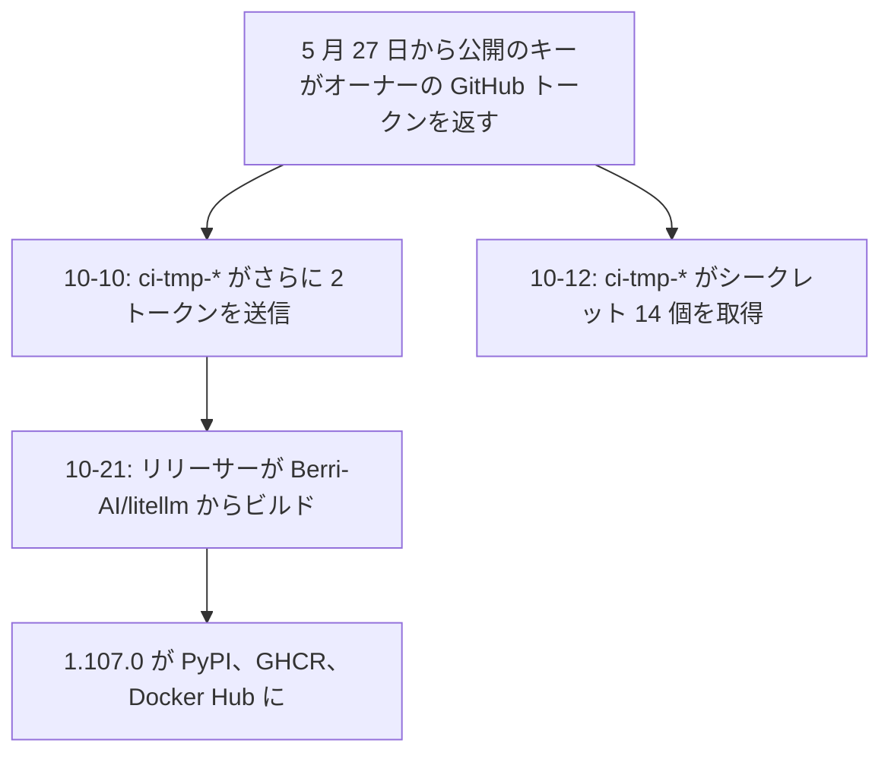
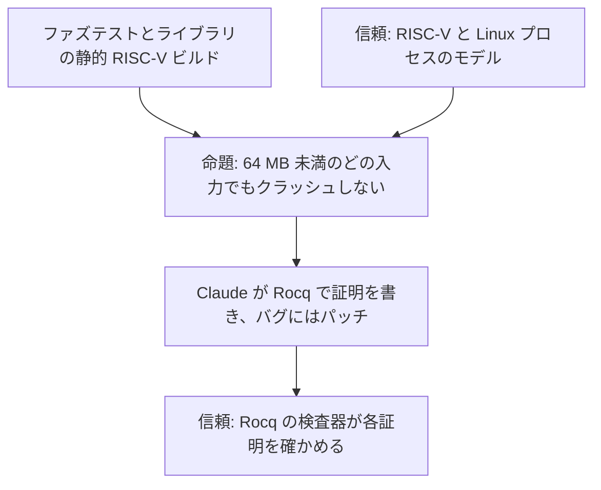

<!-- _class: summary -->
<!-- _header: "" -->

# 🗞️ GenAI Catch-up Report 2026-10-24

2026-10-22 〜 10-24 の 5 トピック (候補 68 件から選定)。詳細は <a href="../research/2026-10-24.md">調査ノート</a>。

<article class="card">
<h3><a href="#3">1️⃣ 🔑 LiteLLM 1.107.0: 自社のリリースパイプラインが認証情報を盗むコードを配布</a></h3>

5 月に漏れたマスターキーから GitHub トークンを得た攻撃者が、自分たちのフォークから 1.107.0 をビルドさせた。仕込まれたファイルは Python を起動するたびに認証情報を盗み、約 2 時間の配布でダウンロードは約 49,000 回に上った。

影響 高将来性 中注目度 高インシデントセキュリティ・安全性API・クラウド

</article>
<article class="card">
<h3><a href="#4">2️⃣ 🌙 Kimi K3.1 Pro: $2/$10 で Artificial Analysis の 4 位、重みは 11 月 4 日までに</a></h3>

単価は K3 より 3 分の 1 安く、thinking は常に有効でコンテキストは 100 万トークン。Artificial Analysis の Terminal-Bench 4.0 では同社の計測で最高の 67% を出し、Plotly は正確だが遅く K3 より高くつくとみる。

影響 高将来性 中注目度 高リリースモデル

</article>
<article class="card">
<h3><a href="#5">3️⃣ 🧮 Claude が Rocq で証明: OSS-Fuzz の 239 のエントリポイントはクラッシュしない</a></h3>

Anthropic と Theorem は 123 ライブラリの静的な RISC-V ビルドについて、64 MB 未満の入力で約 1 億 8,000 万行の証明を通し、数百件のバグを見つけた。公開された証明は 60 のエントリポイントの分で、どれも停止しない実行を排除していない。

影響 中将来性 高注目度 高研究・評価セキュリティ・安全性コーディングエージェント

</article>

---

<!-- _class: summary -->
<!-- _header: "" -->

# 🗞️ GenAI Catch-up Report 2026-10-24

<article class="card">
<h3><a href="#6">4️⃣ 🤝 Agent Skills が Agentic AI Foundation へ、MCP と同じ財団の下に</a></h3>

Anthropic は名称、GitHub の組織、agentskills.io を Linux Foundation 傘下の AAIF に渡し、6 社のエンジニアが標準の舵を取る。SKILL.md の形式は変わらず、バージョン付きのリリースはまだない。

影響 中将来性 高注目度 高仕様変更エージェント開発

</article>
<article class="card">
<h3><a href="#7">5️⃣ 🪨 Flint: Mac 向けの Apache 2.0 コーディング MoE、40B 中アクティブ 2.5B</a></h3>

Recursive は自社の計測で、M4 Pro で毎秒 125 トークン超、50B 未満の MoE で首位とする。その表でも dense の Qwen 3.8 が 6 つのベンチマーク中 4 つで上回り、試用者はツール利用の弱さを報告している。

影響 中将来性 中注目度 高リリースモデルコーディングエージェント

</article>

---

<!-- _class: topic -->

# 1️⃣ 🔑 LiteLLM 1.107.0: 自社のリリースパイプラインが認証情報を盗むコードを配布

期間前の 10-21 に LiteLLM 自身のリリースパイプラインで PyPI と Docker に公開され、10-23 に LiteLLM が攻撃の経路を明かした。

## 要点

- PyPI は 10-21 の 11:39〜13:23 UTC に `litellm==1.107.0` を配り、Docker のイメージは 14:20 まで、ダウンロードは約 49,000 回 (Wiz)。
- 仕込まれた `cook.pth` と `sitecustomize.py` は pip を含む Python の起動ごとに動き、認証情報を盗んで遠隔操作ツールを読み込む。
- LiteLLM の時系列にない 10-12 の実行を Socket が見つけ、そこで `ANTHROPIC_API_KEY` など CI のシークレット 14 個が取られた。
- 16:20〜17:01 UTC には盗まれた AWS のロールで `sts:GetCallerIdentity`、次いで `bedrock:ListFoundationModels` が呼ばれた (Wiz)。
- 背景: 1.82.7 と 1.82.8 も 2026-03-24 に TeamPCP のキャンペーンで汚染され、OSV の `MAL-2026-2144` はそれらと 1.107.0 を併記。

## 見方と論点

- LiteLLM は原因を失効されなかったキーとし、Claude Code の応答の記録からトークンが漏れたという当初の見立てを取り下げた。
- HN は uv や npm での 24〜48 時間のクールダウン (修正も遅れる) を論じ、プライベートレジストリ限定のエンバーゴを批判した。
- GMO Flatt Security によれば収集モジュールは 16 あり、Claude、Cursor、Kiro、Codex CLI、Gemini CLI の設定も狙う。

## 技術要素

- ディスク上の `cook.pth`、`sitecustomize.py`、`litellm-1.107.0.dist-info` は感染の証拠だが、不在は何も証明しない。
- 漏れうるのは IAM ロール、環境変数のシークレット、マスターキーと仮想キー、`LiteLLM_CredentialsTable` の最大 500 行。
- 1.107.0 のイメージの SLSA の来歴はソースが `Berri-AI/litellm`、GitHub のタグはクリーン、10-24 の `latest` は 1.106.2。

出典: <a href="https://docs.litellm.ai/blog/security-incident-oct-21-2026">LiteLLM</a> · <a href="https://docs.litellm.ai/blog/security-incident-oct-21-2026-attack-chain">LiteLLM の攻撃経路の解説</a> · <a href="https://www.wiz.io/blog/litellm-compromised-steals-credentials">Wiz</a> · <a href="https://socket.dev/blog/litellm-attack-timeline">Socket</a> · 📝 <a href="../research/2026-10-24.md#topic-1">調査ノート</a>

---

<!-- _class: topic -->

# 2️⃣ 🌙 Kimi K3.1 Pro: $2/$10 で Artificial Analysis の 4 位、重みは 11 月 4 日までに

Moonshot が 10-23 に Kimi.ai、Kimi Work、Kimi Code、API で公開し、重みは 2026 年 11 月 4 日までにすべて出すとした。

## 要点

- 100 万トークンあたり入力 $2、出力 $10、キャッシュヒット $0.20 と K3 より 33% 安く、Highspeed はキャッシュヒット以外が 2 倍。
- Artificial Analysis (AA) の指数は 55 で Opus 5.5、Sonnet 5.5、Muse Wonder Full に次ぐ 4 位、Terminal-Bench 4.0 は 67%。
- Moonshot の表では SWE-Marathon v1.1 で Opus 5.5 を上回る (51.7 対 46.3) が、ProgramBench では大差で劣る (31.5 対 65.0)。
- ハルシネーション率は Moonshot の社内テストで 23.4% → 8.3% (Opus 5.5 は 15.0%)、AA-Omniscience では 53% → 44%。
- オープンな公開に向け mid-training と RL からサイバー関連データを除き、社内の xdev-bench-hard は除去前の 90.5% から 81.0% に。

## 見方と論点

- Moonshot の表は Terminal-Bench 4.0 の Opus 5.5 を 66.4% とするが、AA が 66 タスクすべてを回した計測では 59.6%。
- Plotly のデータ分析試験では 43 問中 42 問に正解したが、1 問の中央値は 2.5 分、一通りの費用は $13.47 で K3 は $5.01。
- 制約: OpenRouter の計測で Highspeed はうたわれた 2〜3 倍でなく標準の約 1.5 倍、重みのライセンスは未発表。

## 技術要素

- OpenAI 互換の `https://api.moonshot.ai/v1` で `kimi-k3.1-pro` と `kimi-k3.1-pro-highspeed`、コンテキストは 100 万トークン。
- thinking は常に有効で `reasoning_effort` は `low`、`high`、`max` (既定)、出力は既定 131,072、上限 1,048,576 トークン。
- temperature 1.0、top_p 0.95、`n`、各ペナルティは固定で、毎ターン assistant のメッセージ全体を送り返す。
- Responses API をネイティブに備え、Codex は `wire_api = "responses"` で使えるが、`search_context_size` は 400、CLI は動画を渡せない。
- キャッシュは自動で TTL は 5 分 (`prompt_cache_options.ttl` で 1 時間)、利用には $1 以上のチャージが要る。
- AA によれば総数 2.8T、アクティブ 104B、背景 (07-28): Fixstars は約 1.6 TB の K3 の重みを 8×B300 の 1 ノードで動かした。

出典: <a href="https://www.kimi.ai/blog/kimi-k3-1-pro">Moonshot</a> · <a href="https://platform.kimi.ai/docs/guide/kimi-k3-1-pro-quickstart">Kimi API のドキュメント</a> · <a href="https://artificialanalysis.ai/articles/kimi-k3-1-pro-launch-benchmarks">Artificial Analysis</a> · <a href="https://plotly.com/blog/kimi-k3-1-pro-plotly-data-analytics-bench/">Plotly</a> · 📝 <a href="../research/2026-10-24.md#topic-2">調査ノート</a>

---

<!-- _class: topic -->

# 3️⃣ 🧮 Claude が Rocq で証明: OSS-Fuzz の 239 のエントリポイントはクラッシュしない

Anthropic が 10-22 に、Frontier Red Team と Theorem による数週間の取り組みとして発表し、証明の一部を公開した。

## 要点

- Claude は見つけたバグを直したうえで、123 ライブラリの 239 のエントリポイントが 64 MB までのどの入力でもクラッシュしないと証明。
- Claude が書いた Rocq は約 10 億行で、通った証明は約 1 億 8,000 万行、各証明の半分以上は Claude が自作したツールの出力。
- CVE-2026-56132 (libexpat) や約 20 MB の入力でしか起きないアンダーフローなど、ファザーが見逃す数百件のバグが見つかった。
- プログラムを書き換えればどんな定理も証明できてしまうので、パッチにはすべてペナルティを科し、記録して監査した。
- 証明には数億トークンかかりうるが、36 の小さなタスクでは Opus 5.5 が半数を Opus 5 より約 40% 少ないトークンで証明した。

## 見方と論点

- Developers Digest: 安全の証明ではないが、よいファズハーネスがあればクラッシュしないことはもう大規模に証明できる。
- HN はカバレッジの分からないハーネスから作った仕様を疑い、ビジネス+IT は形式検証済みでもバグがないとは限らない点を伝える。
- 記事はプログラムが常に正常に終了すると書くが、公開された証明はどれも停止しない実行を排除していない。

## 技術要素

- 公開分は openssl など 25 ライブラリの 60 のエントリポイントの 138 命題で、`./oft check` 1 回に 20 GiB 要ることも。
- 対象は単一スレッドの静的 riscv64 バイナリ (clang 20.1.8、musl)、命題は 2 GiB (ASan) か 16 GiB (UBSan) 以内が前提。
- Theorem の OSS Verify は無料で、メンテナーが PR で静的 riscv64 ビルドを加え、発見は人のレビューを約束せずに届く。

出典: <a href="https://www.anthropic.com/research/formal-verification">Anthropic</a> · <a href="https://www-cdn.anthropic.com/files/4zrzovbb/website/6867eadf760258fa8b42a504600cd3c036d16358.pdf">Anthropic の付録</a> · <a href="https://github.com/theorem-labs/oss-verify-proofs">Theorem の証明</a> · <a href="https://www.developersdigest.tech/blog/claude-formal-verification-123-libraries-fuzz-tests-proofs-2026">Developers Digest</a> · 📝 <a href="../research/2026-10-24.md#topic-3">調査ノート</a>

---

<!-- _class: topic -->

# 4️⃣ 🤝 Agent Skills が Agentic AI Foundation へ、MCP と同じ財団の下に

Anthropic が 10-22 に Linux Foundation の AAIF へ寄贈し、AGNTCon + MCPCon North America で新規 4 プロジェクトの 1 つとして発表された。

## 要点

- 寄贈されたのは名称とロゴ、GitHub の組織、agentskills.io で、使うにも貢献するにも AAIF への加入は要らない。
- Anthropic、Earendil (Pi)、Google、Microsoft、OpenAI、OpenCode のエンジニアからなる運営委員会が標準を統べる。
- Lead Maintainer は Anthropic の David Soria Parra と Mahesh Murag で、既存のスキルもそのライセンスも変わらない。
- 70 超とされる対応プラットフォーム (ChatGPT、Cursor、GitHub Copilot など) に一覧はなく、agentskills.io の掲載は 46 (10-24)。
- 公開スキル 100 万件、インストール約 2 億 8,000 万回という Anthropic の数字は、Vercel の skills.sh の 8 月までの合計と同じ。

## 見方と論点

- Anthropic はオープンでコミュニティ主導の、ベンダー中立な標準に保つと約束するが、Lead Maintainer は 2 人とも自社の社員。
- Developers Digest は移植できるスキルをベンダー横断のサプライチェーンのリスクとみて、SKILL.md 9,930 件中 30 件の検出を伝える。
- ビジネス+IT は「なぜアンソロピックは、自ら育てた標準をまた手放すのか」と問い、Simon Willison は 2025 年に予測していた。

## 技術要素

- 形式は `SKILL.md` を含むフォルダーのままで、agentskills/agentskills にタグもリリースもなく、最後のコミットは 2026-08-09。
- 提案 #47 の 12 か月の計画は、タグ付きの仕様リリースと変更履歴、SECURITY.md、MCP の SEP のような番号付きの提案。
- 実験的な `allowed-tools` フィールドは安定化か削除の予定で、いまの仕様変更は明文化された規則なしにマージされる。
- 固定できる仕様の版はなく `metadata.version` は検査されないラベルで、Max Nardit は git のコミットかマーケットプレイスの `sha` で固定。
- デモ用の `skills-ref validate` では彼のスキルの約 4 つに 1 つが不合格で、主因は `description` の引用符なしのコロンと最上位の `version`。
- 10-24 時点で提案は open のままで貢献契約は未署名、GOVERNANCE.md も MAINTAINERS.md もまだない。

出典: <a href="https://www.anthropic.com/news/donating-agent-skills-to-the-agentic-ai-foundation">Anthropic</a> · <a href="https://x.com/ClaudeDevs/status/2113328526413996100">ClaudeDevs (X)</a> · <a href="https://github.com/aaif/project-proposals/issues/47">AAIF の提案 #47</a> · <a href="https://www.developersdigest.tech/blog/agent-skills-agentic-ai-foundation-what-changes-2026">Developers Digest</a> · 📝 <a href="../research/2026-10-24.md#topic-4">調査ノート</a>

---

<!-- _class: topic -->

# 5️⃣ 🪨 Flint: Mac 向けの Apache 2.0 コーディング MoE、40B 中アクティブ 2.5B

Recursive が期間前の 10-21 に、Hugging Face の重みと Mac 向けの自社推論エンジン <code>rec</code> とともに公開した。

## 要点

- パラメータは総数 40B、アクティブ 2.5B で、人とエージェントの小さなチームが 4 か月足らずでゼロから作った。
- Recursive は自社エンジンと短いコンテキストで、M4 Pro の MacBook Pro で毎秒 125 トークン超、64 GB の RTX Spark で 150 超とする。
- SWE-Bench Pro v2、Terminal-Bench 2.1、SWE-Bench Verified で 50B 未満の MoE の首位だと主張する。
- 25〜40B の dense モデル並みとするが、自社の表でも dense の Qwen 3.8 が 6 つ中 4 つで勝ち、Terminal-Bench 2.1 は 73.0 対 54.9。
- コンテキストは最大 512K で推奨は 256K 以内、Recursive は大きなクローズドのモデルより多くの指示が要るかもしれないと断る。

## 見方と論点

- コーディングのスコアはすべて Recursive の計測で、MarkTechPost はその SWE-Bench Pro v2 が公開版と比べられないと注意する。
- Wired は 48 GB の Mac で小さな制作 3 本に成功、AINews が伝える r/LocalLLaMA の評価はエージェント作業で Qwen 27B より下。
- 第三者の速度は今のところ Rapid-MLX の数値だけで、M5 Max でコンテキスト 1K のとき毎秒 131 トークン、メモリは約 24 GB。

## 技術要素

- パラメータ 39.8B、49 層、256 のルーティングされるエキスパートのうちトークンごとに 6 つと共有の 1 つが動き、語彙は 150,144。
- スライディングウィンドウ (513 トークン) の 35 層と位置エンコーディングなしの全 attention の 14 層、コンテキストは 262,144。
- BF16 は約 80 GB で B300 か H200 1 基向けの SGLang キット付き、INT4 MLX は 22.6 GB、NVFP4 GGUF は 22.9 GB で、ともに 48 GB 推奨。
- `rec` は 48 GB の M4 Pro、M5 Pro、M5 Max が必要で、Recursive の計測では prefill を除くスループットが llama.cpp の 1.4〜2.6 倍。
- `rec serve` は `http://127.0.0.1:11500/v1` で OpenAI 互換と Anthropic の `/v1/messages` を開き、モデルは `flint`、`rec launch pi` も。
- llama.cpp、Ollama、Unsloth、LM Studio、vLLM、SGLang も対応し、カードは `reasoning_content` を履歴に残すよう求める。

出典: <a href="https://recursive.com/updates/introducing-recursive-flint">Recursive</a> · <a href="https://huggingface.co/RecursiveSI/flint">Hugging Face のモデルカード</a> · <a href="https://github.com/recursive-oss/rec">GitHub の rec</a> · <a href="https://www.marktechpost.com/2026/10/21/recursive-flint-local-coding-model/">MarkTechPost</a> · 📝 <a href="../research/2026-10-24.md#topic-5">調査ノート</a>

