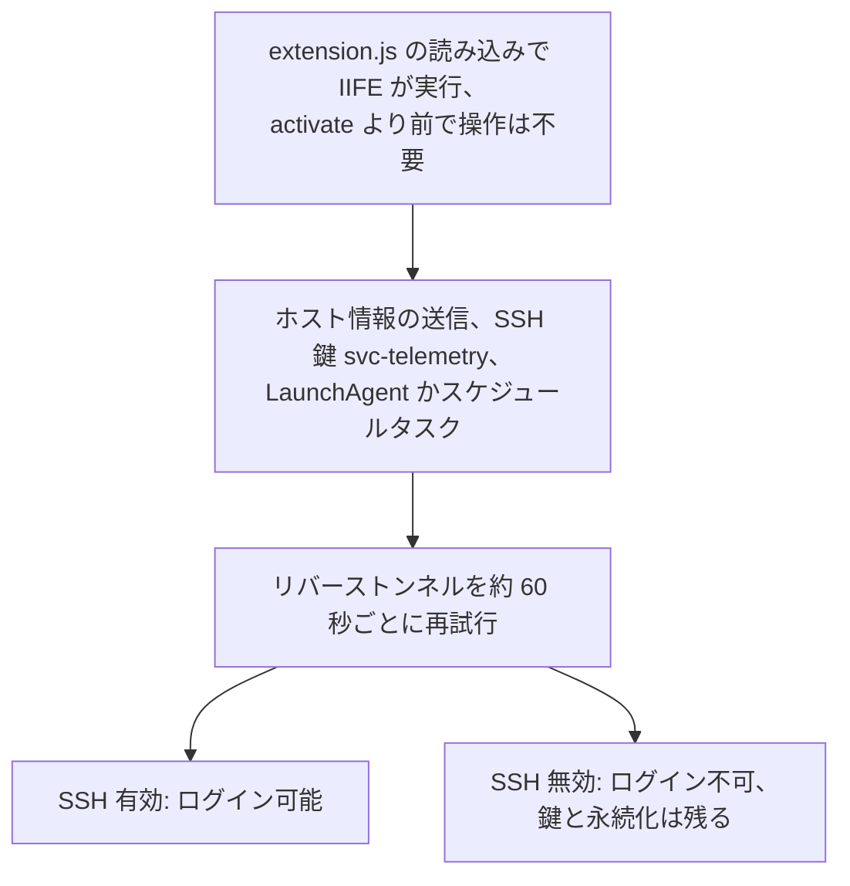
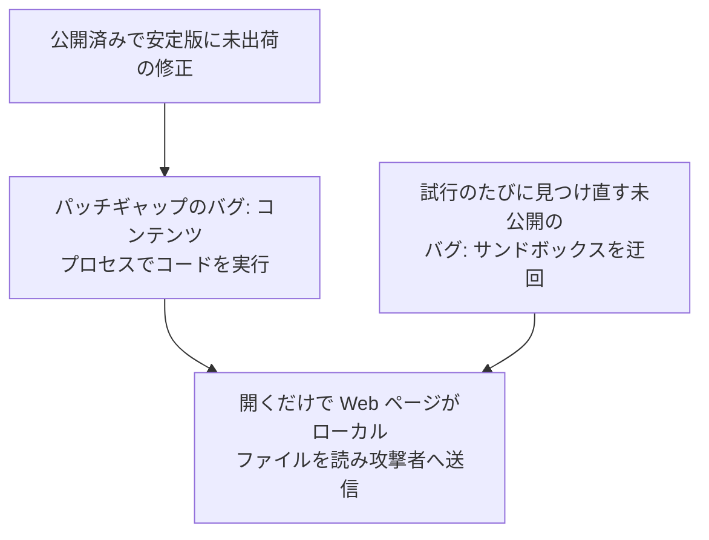

<!-- _class: summary -->
<!-- _header: "" -->

# 🗞️ GenAI Catch-up Report <span class="date">2026-10-31</span>

<p class="lead">2026-10-29 〜 10-31 の 10 トピック (候補 81 件から選定)。詳細は <a href="../research/2026-10-31.md">調査ノート</a>。</p>

<div class="grid">
<article class="card">
<h3><a href="#4">1️⃣ 🔓 Cursor のマーケットプレイスにバックドア入りの Claude Code 拡張機能</a></h3>
<p>macOS と Windows のビルドが SSH 鍵を仕込んだ。最大 5,000 ユーザーは Cursor の X の投稿の数字で、どこが破られたかは争点。</p>
<p class="tags"><span class="tag high">影響 高</span><span class="tag mid">将来性 中</span><span class="tag high">注目度 高</span><span class="tag">インシデント</span><span class="tag">セキュリティ・安全性</span><span class="tag">コーディングエージェント</span></p>
</article>
<article class="card">
<h3><a href="#5">2️⃣ 🦊 Epoch AI: GLM 5.3 がパッチギャップを突き Firefox の 6 リリースを攻略</a></h3>
<p>1 バージョン約 $1,000 だが研究に $100,000 超を要した。どのプロバイダーも拒まず、Firefox 159 は未検証である。</p>
<p class="tags"><span class="tag mid">影響 中</span><span class="tag high">将来性 高</span><span class="tag high">注目度 高</span><span class="tag">研究・評価</span><span class="tag">セキュリティ・安全性</span><span class="tag">モデル</span></p>
</article>
<article class="card">
<h3><a href="#6">3️⃣ 🐘 Mistral Large 4 の重みを修正 MIT ライセンスで公開</a></h3>
<p>Mistral はオープンウェイトの首位を主張するが、Terminal-Bench の 41% は Mistral Vibe の値で、共通のハーネスでは 24.7%。</p>
<p class="tags"><span class="tag mid">影響 中</span><span class="tag mid">将来性 中</span><span class="tag high">注目度 高</span><span class="tag">リリース</span><span class="tag">モデル</span><span class="tag">API・クラウド</span></p>
</article>
<article class="card">
<h3><a href="#7">4️⃣ 🔀 GitHub Copilot Fusion が一般提供に、評価の費用は GitHub が負担</a></h3>
<p>Artificial Analysis の評価は Claude Code の 62 に対し 60 でコストは約半分。誰が払ったかは GitHub の X の返信にしかない。</p>
<p class="tags"><span class="tag mid">影響 中</span><span class="tag mid">将来性 中</span><span class="tag high">注目度 高</span><span class="tag">リリース</span><span class="tag">コーディングエージェント</span><span class="tag">評価・運用</span></p>
</article>
</div>

---

<!-- _class: summary -->
<!-- _header: "" -->

# 🗞️ GenAI Catch-up Report <span class="date">2026-10-31</span>

<div class="grid">
<article class="card">
<h3><a href="#8">5️⃣ 📜 OpenAI の Model Spec 改定: 5 つの価値観と人の監督を定める Root の規則</a></h3>
<p>副作用の制御は Root から User レベルに下がり、スタイルの節は消えた。モデルへの反映はまだ不完全だと OpenAI は認める。</p>
<p class="tags"><span class="tag mid">影響 中</span><span class="tag mid">将来性 中</span><span class="tag high">注目度 高</span><span class="tag">仕様変更</span><span class="tag">モデル</span><span class="tag">セキュリティ・安全性</span></p>
</article>
<article class="card">
<h3><a href="#9">6️⃣ 📈 OpenAI が Pro 100 と Pro 500 の枠を 2 倍にし、Pro 200 の削減を撤回</a></h3>
<p>倍増を裏づける絶対値は示されず、前日に加わった月最大 $500 の API クレジットはプロモーション扱いである。</p>
<p class="tags"><span class="tag mid">影響 中</span><span class="tag mid">将来性 中</span><span class="tag high">注目度 高</span><span class="tag">仕様変更</span><span class="tag">コーディングエージェント</span><span class="tag">API・クラウド</span></p>
</article>
<article class="card">
<h3><a href="#10">7️⃣ 🛤️ 元 GitHub CEO Dohmke の Entire がプライベートリポジトリを無料でホスト</a></h3>
<p>Trails は eval で採点するレビューのエージェントでプルリクエストを置き換え、GitHub の COO は新しい GitHub は不要と応じた。</p>
<p class="tags"><span class="tag mid">影響 中</span><span class="tag mid">将来性 中</span><span class="tag high">注目度 高</span><span class="tag">リリース</span><span class="tag">コーディングエージェント</span></p>
</article>
</div>

---

<!-- _class: summary -->
<!-- _header: "" -->

# 🗞️ GenAI Catch-up Report <span class="date">2026-10-31</span>

<div class="grid">
<article class="card">
<h3><a href="#11">8️⃣ ⏱️ Claude Code の <code>agent_summary</code>: 1 チームの 1 週間で 16.4%、Anthropic は約 2%</a></h3>
<p>ステータス行のため、作業中のバックグラウンドエージェントのトランスクリプトを約 30 秒ごとに再送する。2 つの割合は基準が違う。</p>
<p class="tags"><span class="tag mid">影響 中</span><span class="tag mid">将来性 中</span><span class="tag high">注目度 高</span><span class="tag">検証・実践</span><span class="tag">コーディングエージェント</span><span class="tag">評価・運用</span></p>
</article>
<article class="card">
<h3><a href="#12">9️⃣ 🪙 Anthropic: 専門家の選択はコイントスで決めたエージェントの傾きに 86% 一致</a></h3>
<p>分析者 50 人の研究の主張で、86% は統合した率 (偶然なら 50%)、48 人中 25 人は結果をより自分のものと評価した。</p>
<p class="tags"><span class="tag low">影響 低</span><span class="tag mid">将来性 中</span><span class="tag high">注目度 高</span><span class="tag">研究・評価</span><span class="tag">コーディングエージェント</span><span class="tag">評価・運用</span></p>
</article>
<article class="card">
<h3><a href="#13">🔟 ✍️ Martin Fowler: LLM の文体は編集してもまず消えない</a></h3>
<p>1 本のエッセイの主張で、人に届けたい書き手は LLM に下書きを任せるべきではないという。測定はしていない。</p>
<p class="tags"><span class="tag low">影響 低</span><span class="tag mid">将来性 中</span><span class="tag high">注目度 高</span><span class="tag">論考</span><span class="tag">モデル</span></p>
</article>
</div>

---

<!-- _class: topic -->

# 1️⃣ 🔓 Cursor のマーケットプレイスにバックドア入りの Claude Code 拡張機能

<p class="lede">改ざんされた <code>Anthropic.claude-code</code> の 2.1.312 と 2.1.313 が、10-29 に約 11 時間 Cursor のマーケットプレイスに載っていた。</p>

<div class="cols">
<div>

## 要点

- Cursor は Anthropic の開発ではないとし、最初の告知で 2.1.313 だけを挙げたあと、10-30 に 2.1.312 を加えた。
- 範囲: 最大 5,000 ユーザーは告知ではなく Cursor の X の投稿の数字で、Beaumont はこれを約 5000 台の開発者のシステムと書いた。
- ペイロードはホスト名、ユーザー名、Git のメールアドレス、パブリック IP と、環境変数の名前を最大 40 個送り、値は送らない。
- Cursor は当該バージョンを取り下げ、マーケットプレイスを止めて再構築し、鍵を更新して、他の拡張機能に改ざんはないとした。
- Cursor は攻撃者のサーバーを止めてリバースシェルもホスト情報の送信も機能しないと言い、後続のペイロードの報告もない。

## 見方と論点

- どこが破られたか: Beaumont は Anthropic、Anthropic の社員は Cursor のマーケットプレイスと言い、Cursor は名指ししない。
- ログイン: Cursor はほとんどのホストに SSH を有効にする権限がないとし、Phorion はリモートログインが有効な Mac には入れると警告する。
- 未確認: 認証済みアカウントでのアップロード (Beaumont)、攻撃者のログイン、噂の Binance との関連で、侵入経路も不明。

</div>
<div>



## 技術要素

- Cursor が挙げるのは公式 8 ビルドのうち `darwin-arm64` と `win32-x64` だけで、Linux はコードのみで配信の証拠はない。
- 確認は `authorized_keys` の `svc-telemetry` を探すもので、アンインストールで足りない場合の修復スクリプトもある。
- Anthropic の Dworken によれば 2.1.313 はほかのどこにも公開されておらず、次の更新は区別のため 2.1.314 とした。

</div>
</div>

<p class="sources">出典: <a href="https://cursor.com/blog/claude-code-extension-security-notice">Cursor</a> · <a href="https://phorion.io/blog/offical-claude-code-vsx-compromise/">Phorion</a> · <a href="https://doublepulsar.com/anthropic-hacked-to-deliver-remote-access-trojan-to-claude-developer-laptops-worldwide-1148a92baae2">DoublePulsar</a> · <a href="https://thehackernews.com/2026/10/official-claude-code-vs-code-extension.html">The Hacker News</a> · 📝 <a href="../research/2026-10-31.md#topic-1">調査ノート</a></p>

---

<!-- _class: topic -->

# 2️⃣ 🦊 Epoch AI: GLM 5.3 がパッチギャップを突き Firefox の 6 リリースを攻略

<p class="lede">Epoch AI が 10-29 に、オープンウェイトの GLM 5.3 が Firefox 156.0 から 158.0.1 までの 6 リリースすべてのエクスプロイトを作ったと公表した。</p>

<div class="cols">
<div>

## 要点

- 研究者が用意したのはハーネスと未出荷の修正を調べる指示だけで、既定設定の Ubuntu 26.04 を狙うチェーンはモデルが独力で組んだ。
- 1 バージョンあたり約 $1,000 だが研究の API コストは $100,000 超で、実行の上限は 48 時間、最速は 12 時間だった。
- セキュリティ演習という体裁のタスクを、Z.ai の API もサードパーティの API も一切拒まなかったと Epoch は報告する。
- Firefox 159.0 (10-27) は未公開のバグを修正したが、同様の攻撃がまだ通るかを Epoch は確かめていない。
- 背景 (06-08): Anthropic の Mythos Preview は JS エンジンのパッチ 18 件中 8 件をエクスプロイト化、相手はブラウザでなく `jsshell`。

## 見方と論点

- Mozilla は攻撃者のモデルが見つけられるバグはほぼ掘り尽くされたと言うが、Epoch のモデルはサンドボックス脱出を見つけ続けた。
- Lambert はエクスプロイトを数ある段階の 1 つと見て、重みの公開からの 1 か月で目立つ変化はないとしつつ、不安も認める。
- 再現も実ユーザーへの悪用の報告もなく、The Decoder の人の入力ゼロという見出しは用意済みのオフライン環境に触れていない。

</div>
<div>



## 技術要素

- Mozilla の次の手は修正を防御の層ごとにまとめてギャップを重ねないことで、攻撃者は新しいバグを最低 1 つ探すしかなくなる。
- Firefox は修正の出荷までリグレッションテストを非公開にする運用に戻し、テストがないと GLM 5.3 の成績は大きく落ちる。
- Chrome では約 $100,000 の API コストでも同等のエクスプロイトはできなかったが、Epoch はこれを強い証拠とは見ない。

</div>
</div>

<p class="sources">出典: <a href="https://epoch.ai/publications/open-weight-models-patch-gap">Epoch AI</a> · <a href="https://blog.mozilla.org/en/firefox/privacy-security/defending-patch-gap/">Mozilla</a> · <a href="https://www.interconnects.ai/p/was-i-wrong-about-open-models-and">Interconnects</a> · <a href="https://the-decoder.com/open-weight-model-glm-5-3-built-full-firefox-exploit-chains-with-zero-human-input-in-under-48-hours/">The Decoder</a> · 📝 <a href="../research/2026-10-31.md#topic-2">調査ノート</a></p>

---

<!-- _class: topic -->

# 3️⃣ 🐘 Mistral Large 4 の重みを修正 MIT ライセンスで公開

<p class="lede">Mistral が 10-29 に、さらに 3 週間の強化学習 (RL) で改良した Large 4 の重みを公開し、コーディングで最良のオープンウェイトモデルと称した。</p>

<div class="cols">
<div>

## 要点

- Mistral の主張は Artificial Analysis (AA) の Coding Agent Index で 48%、GLM-5.3 と同等でトークンはタスクあたり 47% 少ない。
- Terminal-Bench 4.0 の 41% は AA のエージェントのボードでの Mistral Vibe の値で、共通の mini-swe-agent では AA の値は 24.7%。
- AA Intelligence Index v5 は 26 で、DeepSeek V4.1 Flash と GLM-5.3 の 32、重みが未公開の Kimi K3.1 Pro の 46 に及ばない。
- API は 100 万トークンあたり入力 $0.70、キャッシュ $0.07、出力 $2.10 で、プレビューは定価 $1.36/$4.18、当初 2 週間 $0.68/$2.09。
- 利用、改変、ファインチューニング、商用化は無料だが、Model-as-a-Service の事業者は先に別途ライセンスを結ぶ必要がある。

## 見方と論点

- The Decoder はコーディングは強いが総合で中国勢に劣ると読み、GIGAZINE は「GPT-6.1 Terraと同等のコーディング性能」とうたう。
- FrontierCode 2.0: Mistral は 19.7% でオープンウェイト首位と言うが、AA の Stirrup での実行は 15.0% で GLM-5.3 の 21.6% を下回る。
- 拒否率 96.6% は公開のプロンプト集での Mistral 自身の測定で、AA の Cyber Index では 50.9 の 3 位、拒否は 0% である。

</div>
<div>

```mermaid
xychart-beta horizontal
    title "Terminal-Bench 4.0、ハーネス別の % (AA、10-31 に取得)"
    x-axis [Vibe の Large 4, OpenCode の GLM-5.3, mini-swe の Large 4, mini-swe の GLM-5.3]
    y-axis 0 --> 50
    bar [41.4, 39.9, 24.7, 41.9]
```

## 技術要素

- `Mistral-Large-4-1T-A52B` は総計約 1T、トークンあたりのアクティブは 49B、埋め込みと出力層を含めて 52B。
- サービングは vLLM か SGLang で、Nvidia B300 が 8 基、圧縮版なら GB300 が 4 基要る。
- MaaS の条項の対象外は製品への組み込み、社内利用、リクエストの中継で、条文に売上の基準も料金も書かれていない。

</div>
</div>

<p class="sources">出典: <a href="https://mistral.ai/news/mistral-large-4-oss/">Mistral</a> · <a href="https://the-decoder.com/paris-based-mistral-releases-le-chonk-a-strong-coding-model-that-still-trails-china-overall/">The Decoder</a> · <a href="https://artificialanalysis.ai/evaluations/terminalbench-4-0">AA Terminal-Bench 4.0</a> · 前回: <a href="./2026-10-10.md#3">10-10 #2</a> · 📝 <a href="../research/2026-10-31.md#topic-3">調査ノート</a></p>

---

<!-- _class: topic -->

# 4️⃣ 🔀 GitHub Copilot Fusion が一般提供に、評価の費用は GitHub が負担

<p class="lede">GitHub が期間前の 10-28 に Copilot Fusion を一般提供にし、根拠に挙げた Artificial Analysis (AA) の評価は X の返信によれば GitHub が委託して費用も負担した。</p>

<div class="cols">
<div>

## 要点

- Fusion は HydraFusion と自動モデル選択の統合で、利用者が選ぶのは Standard、High、Max だけ、モデルはプロンプトごとに決まる。
- AA が Copilot CLI で測った Fusion Max は Coding Agent Index v2.0 で 60、Opus 5.5 Max の Claude Code は 62 だった。
- タスクあたりのコストは $5.59 対 $11.42 で 51% 低く、トークンは 7.2M で約半分、Devin Fusion は $8.00 で 62 を取った。
- 2 ポイント差は逆向きの差の平均で、Terminal-Bench は 71 対 63、FrontierCode は 51 対 56、SWE-Atlas-QnA-AA は 57 対 66。
- タスクあたりの時間が約 40% 短いという GitHub の主張は、AA の記事に時間の記載がなく未確認である。

## 見方と論点

- 費用負担: 見つかった開示は GitHub の X の返信だけで、AA の記事と X のスレッド、変更履歴、gihyo.jp は触れていない。
- VentureBeat は AA の作業を独立したテストと呼びつつ、総コストはレビュー、再実行、統合が左右しうると警告する。
- gihyo.jp は「評価項目によって強みが異なる」と読み、Nadella の最大 77% は GitHub 自身の DeepSWE の実行での最大値である。

</div>
<div>

## 技術要素

- Single は 1 モデルで解き、Cascade は judge が下書きを受け入れるか上位へ回し、Critique は並行の批評で下書きを直す。
- High と Max は Pro+、Max、Business、Enterprise が対象で、Free、Student、Pro はベンチマークされた水準に届かない。
- 課金はモデルごとの標準の単価で、有料プランは 11-30 まで 30% 引き、AA のタスクあたりのコストにこの割引は含まれない。
- AA はプールに Opus 5.5、Sonnet 5.5、GPT-6 Astra、GPT-6 Sol を挙げ、ドキュメントにモデル名はなく、ポリシーで絞ることもできる。
- Fusion が下書きを捨ててもワークスペースの編集は元に戻らず、サブエージェントとは別に動いて起動もしない。
- ローカルルーティング (プレビュー、Standard のみ) は MAI Code 1.1 Flash か Qwen3.8 Flash Next で、オフラインの可否は説明が割れる。

</div>
</div>

<p class="sources">出典: <a href="https://github.blog/changelog/2026-10-28-route-and-orchestrate-models-with-github-copilot-fusion">GitHub Changelog</a> · <a href="https://x.com/github/status/2115480273932697764">GitHub の X の投稿</a> · <a href="https://artificialanalysis.ai/articles/github-copilot-fusion-orchestrates-anthropic-and-openai-models-to-balance-performance-and-cost">Artificial Analysis</a> · 前回: <a href="./2026-10-01.md#13">10-01 #8</a> · 📝 <a href="../research/2026-10-31.md#topic-4">調査ノート</a></p>

---

<!-- _class: topic -->

# 5️⃣ 📜 OpenAI の Model Spec 改定: 5 つの価値観と人の監督を定める Root の規則

<p class="lede">OpenAI が 10-29 付けの Model Spec を公開し、5 つの価値観で組み直して監督についての Root の節を加え、スタイルの指針を外した。</p>

<div class="cols">
<div>

## 要点

- 価値観は土台となる人間の意図への忠実さのほか、害の最小化、誠実さと透明性、人間の主体性、配慮の 5 つ。
- 新設の Root の節 `Support human oversight and correction` は GPT に修正可能であり続けることを求め、権限のある停止への協力も含む。
- Root の新しい段落は、禁じられた行為を委任、自分の指示やスコープの書き換え、予約によって間接的に果たすことを禁じる。
- `Control and communicate side effects` は Root から User に下がり、開発者やユーザーの明示の指示で上書きできるようになった。
- 削除は `Be warm`、`Love humanity`、`Use Markdown with LaTeX extensions`、音声のスタイルすべてなどで、ラベル付きの節は 60 から 51 に。

## 見方と論点

- OpenAI はモデルがまだ Spec を完全には反映していないと認め、この版で学習したモデルの名も挙げていない。
- The Decoder は遵守を疑って 10 月のエージェントの例を引くが、実際に弱められたのはエージェント自身ではなく作業の監視である。
- ブログは副作用の指針を広げたと言うだけで、The Decoder も ITmedia も User への移動に触れていない。

</div>
<div>

## 技術要素

- Root の出どころは Spec だけ、System は OpenAI だけで、開発者が上書きできるのは Developer、User、Guideline の節。
- Root に残る部分もあり、重大な悪影響を及ぼす副作用は高リスクの一覧に載り、自律のスコープも副作用を扱う。
- 高リスクの一覧: `deploying persistent agents` を追加、`spawning sub-agents` と `resource acquisition` を削除。
- スコープの終了条件は must から should に緩み、サブエージェントは指示がない限りスコープを引き継ぐようになった。
- User レベルの小節 6 つを新設し、言われたことと推測を分け、保存や削除について根拠のない主張をしないよう求める。
- the assistant から GPT への呼称の変更は本文だけで、メッセージのロール `assistant` は残り、API のロールは変わらない。

</div>
</div>

<p class="sources">出典: <a href="https://model-spec.openai.com/2026-10-29.html">Model Spec</a> · <a href="https://openai.com/index/updated-model-spec">OpenAI</a> · <a href="https://github.com/openai/model_spec/blob/main/CHANGELOG.md">CHANGELOG</a> · <a href="https://the-decoder.com/openai-sets-new-behavioral-guidelines-for-ai-models-that-have-already-proven-hard-to-control/">The Decoder</a> · 📝 <a href="../research/2026-10-31.md#topic-5">調査ノート</a></p>

---

<!-- _class: topic -->

# 6️⃣ 📈 OpenAI が Pro 100 と Pro 500 の枠を 2 倍にし、Pro 200 の削減を撤回

<p class="lede">OpenAI が 10-29 に ChatGPT Pro 100 と Pro 500 の Work と Codex の利用枠を 2 倍にして Pro 200 の 9 月の削減を取り消し、前日の 10-28 には API クレジットを加えていた。</p>

<div class="cols">
<div>

## 要点

- Pro 100 ($100) と Pro 500 ($500) は Work と Codex の枠がこれまでの 2 倍になり、契約の更新を待たずに適用される。
- Pro 200 ($200) は低いほうの枠だけが 2 倍で、これが 09-29 の削減の取り消しにあたり、全契約が同じ枠にそろった。
- Plus の利用量は変わらず、Chat の GPT-6 Pro の週次メッセージ上限はこの枠とは別扱いである。
- API クレジット (10-28) は毎月、Pro の各階層に価格と同額、Business に有料の Standard 席あたり $20、Premium 席あたり $100。
- OpenAI は API クレジットをプロモーションと呼ぶが、倍増を一時的とする記述は同社のページにない。

## 見方と論点

- Sottiaux の X の投稿はすべての上限が倍になると書き、ITmedia のリードも同じだが、ヘルプセンターでは Work と Codex に限られる。
- The Decoder は Anthropic との競争と読むが OpenAI はそう説明しておらず、ITmedia は 9 月の変更への反応が割れたと伝える。
- 未確認: Business Premium の 2 倍の根拠は X の投稿だけで、倍増を確かめられる絶対値は OpenAI のどのページにもない。

</div>
<div>

## 技術要素

- Fast の枠の消費は Standard の 2.5 倍で、Pro 500 だけの Ultrafast は GPT-6 Astra と GPT-6.1 Sol で 8 倍、続くクレジットは 6 倍。
- 枠が増えてもタスクが 2 倍とは限らないと OpenAI は断り、消費はモデル、コンテキスト、ツール、速度モードで変わる。
- API クレジットは ChatGPT の利用クレジットと別物で有料の API 利用に充て、API キー経由の Codex には使えず ChatGPT の上限も増えない。
- Business のプールは月 $500 が上限で、申請者は API の組織の所有者に限られ、Plus、Enterprise、Edu は対象外。
- 未使用分はサイクルの終わりに失効し、尽きるとリクエストは HTTP 429 `credit_balance_exhausted` で失敗する。
- 日本の月額は 16,800 円、30,000 円、84,000 円で、クレジットの対象国を挙げた情報源はなく、日本で使えるかは未確認。

</div>
</div>

<p class="sources">出典: <a href="https://help.openai.com/en/articles/9793128-about-chatgpt-pro-tiers">OpenAI ヘルプ: Pro の階層</a> · <a href="https://help.openai.com/en/articles/20001626-api-credits-benefit-for-eligible-chatgpt-subscriptions">OpenAI ヘルプ: API クレジット</a> · <a href="https://www.itmedia.co.jp/aiplus/article/2610/30/2000002738/">ITmedia AI+</a> · <a href="https://the-decoder.com/openai-doubles-usage-limits-on-pro-plans-as-competition-with-anthropic-heats-up/">The Decoder</a> · 📝 <a href="../research/2026-10-31.md#topic-6">調査ノート</a></p>

---

<!-- _class: topic -->

# 7️⃣ 🛤️ 元 GitHub CEO Dohmke の Entire がプライベートリポジトリを無料でホスト

<p class="lede">GitHub の元 CEO Thomas Dohmke のスタートアップ Entire が期間前の 10-26 にプライベートの Git の直接ホスティングを始め、GitHub の応答は 10-29 に The New Stack が伝えた。</p>

<div class="cols">
<div>

## 要点

- Entire は Git フォージを 3 つの部品で説明し、レビューの Trails、新しいサーバーによる分散ホスティング、Continuous Memory を挙げる。
- リポジトリは Entire に直接置くか GitHub からミラーするかで、ミラーでは GitHub が正本のまま、公開リポジトリはロードマップにある。
- Trail はプルリクエストに代わるもので、バグ報告やエージェントから始まり、リポジトリをまたぎ、先頭に eval のスコアが並ぶ。
- push のたびにレビューのエージェントがクラウドのサンドボックスで動いてスコアを出し、任意の Gates は人の承認と CI の合格を必須にする。
- 課金はエージェントの利用だけで前払いのクレジットから引き、$100 のトライアルのクレジットが尽きても他の機能は無料だという。

## 見方と論点

- GitHub COO の Daigle は世界に要るのは新しい GitHub ではなく別のツールかもしれないとし、Dohmke は開発者には明らかに要ると返す。
- Daigle が次のボトルネックと見る検証は Trails の前提でもあり、問われるのは新しいフォージまで要るのかである。
- 未確認: GitHub の 89 倍という数値の再現も、Trails の独立した検証も、eval が欠陥を予測するというデータも見つかっていない。

</div>
<div>

## 技術要素

- ForgeMark の毎秒の push は Entire 418、Cursor 65、Pierre 15、GitLab 10、GitHub 4.7 で、並行数もサイズも示されない。
- README は github.com がタイトな push のループを絞るとしており、4.7 はレート制限の反映かもしれないが未検証の推測。
- EntireDB は ref の PostgreSQL とストレージノードを cell にまとめ、各リージョンが全コピーを持ち、書き込みの確定は 1 つの home cell。
- GitHub の障害時もミラーは clone に応じ、`entire/unmirrored/` で始まるブランチには push できる。
- プリセットはコード品質、セキュリティ、slop で、カスタムは `.json` で作り、Daytona と E2B 上の Claude Code と Codex で動く。
- トークンは公表価格で 100 万あたり Opus 5.5 が $4.00/$20.00、GPT-6.1 Sol が $2.00/$10.00、ストレージと転送量の上限は記載がない。

</div>
</div>

<p class="sources">出典: <a href="https://entire.com/blog/the-git-forge-for-agent-human-collaboration">Entire</a> · <a href="https://docs.entire.com/billing">Entire Docs: 課金</a> · <a href="https://thenewstack.io/github-agentic-infrastructure-rebuild/">The New Stack</a> · 前回: <a href="../research/2026-10-27.md#topic-4">10-27 のノート、トピック 4</a> · 📝 <a href="../research/2026-10-31.md#topic-7">調査ノート</a></p>

---

<!-- _class: topic -->

# 8️⃣ ⏱️ Claude Code の `agent_summary`: 1 チームの 1 週間で 16.4%、Anthropic は約 2%

<p class="lede">Flamerix が 10-29 の gist で、Claude Code は作業中のバックグラウンドエージェントのトランスクリプトをステータス行のために約 30 秒ごとに送り直すと報告した。</p>

<div class="cols">
<div>

## 要点

- 約 30 秒ごとにトランスクリプト全体をそのエージェント自身のモデル (多くは Opus) に送り、エージェントパネルの 3〜5 語の説明を作る。
- 2.1.232 (2026 年 8 月) 以降、対話型のバックグラウンドエージェントでは既定で有効で、ヘッドレスの `claude -p` では既定で動かない。
- Flamerix の 1 週間では支出の 16.4% とメインの会話の 15.7% を上回り、リクエストの 19.7% を占め、その支出の 96% は Opus だった。
- Claude Code チームのメンバーによれば、先週は定価でコストの約 2%、リクエストの 4% 弱、ターミナルに限るとコストの約 6%。
- Flamerix によれば呼び出しの約 98% はキャッシュから読み直すが、コールドキャッシュに当たる約 2% がコストの 3 分の 1 超を占める。

## 見方と論点

- 16.4% は 1 チームの 1 週間、約 2% は Anthropic の集計で、他の報告は約 8%〜26% だが、`cost_usd` など基準が異なり比べられない。
- Anthropic は 16.4% をバックグラウンドエージェント中心のチームの値と読むが、全体の数値は外から検証できない。
- 見つかった声明は Hacker News の返信だけで、issue #86879 は開いたまま、定評ある媒体の記事も日本語の記事も見つかっていない。

</div>
<div>

## 技術要素

- このリクエストはセッションログに書かれないので、トランスクリプトを読むコスト集計には映らず、見えるのは OpenTelemetry の出力だけ。
- `claude_code.api_request` の `query_source` が発行元のサブシステムを示し、`cost_usd` は請求額ではなく見積もりである。
- 10-31 の時点で公式のスイッチはなく、`agentProgressSummaries: false` は効かず、30〜240 秒の間隔はサーバーのフラグで決まる。
- 2.1.310 には約 2k トークンのメモを送る `short` モードがあるが、既定は全トランスクリプトのままで、変えられるのはサーバーのフラグだけ。
- プロンプトキャッシュの修正を 2.1.311+ で配布済みと Anthropic は言うが、変更履歴に記載はない。
- Flamerix の Bun プリロード `no-agent-summary.js` は 2.1.312 でフォークを 5 から 0 にしたが、フェイルオープンで規約に触れるおそれも。

</div>
</div>

<p class="sources">出典: <a href="https://gist.github.com/flamerix-ai/c3905705cc4205e5de3011fa2e74efce">Flamerix</a> · <a href="https://news.ycombinator.com/item?id=50284255">Hacker News</a> · <a href="https://github.com/anthropics/claude-code/issues/86879">Issue #86879</a> · <a href="https://code.claude.com/docs/en/monitoring-usage">Claude Code Docs</a> · 📝 <a href="../research/2026-10-31.md#topic-8">調査ノート</a></p>

---

<!-- _class: topic -->

# 9️⃣ 🪙 Anthropic: 専門家の選択はコイントスで決めたエージェントの傾きに 86% 一致

<p class="lede">Anthropic が期間前の 10-27 に、因果推論の分析の 5 つの判断で Claude Code のエージェントの傾きを隠れたコイントスで決めた研究を公開した。</p>

<div class="cols">
<div>

## 要点

- 有償の専門家マーケットプレイスの分析者 50 人がエージェントと合成の農場データを分析し、48 人がアンケートを終えた。
- 86% は統合した一致率で偶然なら 50% (フリップ率 72 ポイント、CI 60〜83)、判断ごとには 81%〜92% だった。
- 最終的な提言の差は有意に届かず (17 ポイント、p = 0.069)、展開を勧めた割合は展開に傾けると 54%、反対に傾けると 36%。
- 48 人中 25 人は結果をより自分のものと評価し、77% がエージェントの論拠を反復し、エージェントに触れたのは 15%、傾きを疑う人は皆無。
- 先に立場を取った自己選択の 38 試行では、反対の傾きは同じ向きの傾きより乗り換えを 53 ポイント増やした。

## 見方と論点

- 限界は強めた傾きと、タスク、分野、モデルが 1 つずつなことで、GIGAZINE はこれを省いており、再現も見つかっていない。
- 86% は統合した率なので The Decoder の最大 86% という書き方は誤りで、Decrypt はこの実験を human in the loop の試験と位置づける。
- 専門家という呼び方には注意が要り、81% が 35 歳未満、31% は分析職の経験が 2 年以下、全員が農業の分野は初めてだった。

</div>
<div>

## 技術要素

- ブラウザの VS Code と Claude Code v2.1.220 (Opus 4.8、effort は high) で、隠したシステムプロンプトが傾きを与えた。
- コーディングした 245 の判断の 77% でエージェントが先に立場を述べ、欺くなと指示されても別の選択肢はまず論じなかった。
- 経験を含む 10 の特性はどれも補正後に調整効果を示さず、事前分析計画はこうした検定を検出力不足とする。
- 重大なエラーはエージェントなしの 11 人中 6 人、ありの 50 人中 3 人だが、11 人は自己選択で経験も浅かった。
- 傾きなしの Opus 4.8 は 123 回の 91% で同じ 5 つの選択をし、試した 8 モデルのうち 5 つでもこの組み合わせが最多だった。
- どのエージェントにも傾きがあるので素のエージェントへの同調を測る群はなく、計画に OSF の正式な登録もない。

</div>
</div>

<p class="sources">出典: <a href="https://www-cdn.anthropic.com/519c17a5d23a794e8b6d50a854048d0b61e0d73a.pdf">Anthropic の論文</a> · <a href="https://www.anthropic.com/research/agents-judgment-calls">Anthropic の研究ページ</a> · <a href="https://the-decoder.com/experts-adopt-ai-agents-random-opinions-and-think-theyre-their-own-anthropic-study-finds/">The Decoder</a> · <a href="https://decrypt.co/382065/ai-can-quietly-influence-experts-decisions">Decrypt</a> · 📝 <a href="../research/2026-10-31.md#topic-9">調査ノート</a></p>

---

<!-- _class: topic -->

# 🔟 ✍️ Martin Fowler: LLM の文体は編集してもまず消えない

<p class="lede">Martin Fowler が 10-29 に bliki の項目 LLM Voice を公開し、翌日に角征典の日本語訳が bliki-ja に載った。</p>

<div class="cols">
<div>

## 要点

- 投稿の裏に LLM を感じると読む気が失せ、ときに嫌悪にまで至るとして、これを文章の不気味の谷と呼ぶ。
- 編集しても文体はまず抜けないとして LLM の下書きを強く戒め、提案された言い換えを受け入れることさえ危険だという。
- LLM によるアウトラインは認め、唯一の反例は大手の定期刊行物のプロの編集者が手を入れた LLM の初稿である。
- より広い懸念は、角征典の訳で「書くことをLLMに委ねるようになると、思考や理解までもLLMに委ねるようになるだろう」という点。
- 例外はパーキンソン病を抱える Jim Highsmith と誰も読まない定型の書状で、翻訳では不格好でも人の文章を選ぶ。

## 見方と論点

- 測定はなく、あるのは反応、1 つの逸話、サイトの方針だけで、人が編集した LLM の下書きの読者研究は検索でも見つからない。
- Ronacher の試み (09-14) はアウトラインの許容を崩し、Opus 5 の構成を保って書き直した文章は Pangram で 100% AI と判定された。
- azukiazusa (08-22) は下書きしてから編集しても学びの大半は残るとし、Willison の方針の線はもっと緩い。

</div>
<div>

## 技術要素

- Clark ら (10-21): フロンティアとそれに近い 9 モデルのすべてが、人の文章より低頻度の n-gram を多く使った。
- 大半は依存関係が長く名詞の積み重ねも多く、どちらも処理の難しさに結びつく特徴だが、読者を使ったテストはしていない。
- 日本語を介した往復翻訳でこれらは減り、著者らは別の言い方があるのにモデルが選んだものと読む。
- Karr ら (2026): 人の要旨に LLM が軽く手を入れたものを検出器は 38〜80% で AI と判定し、人間らしく書き直したものでは 4% 未満。
- Russell ら (ACL 2025): LLM をよく使う 5 人の多数決の誤りは、人間らしくする加工があっても 300 本中 1 本だけ。
- Fowler のサイトは著者に AI の利用を明かすよう求めるが、Schilke と Reimann (2025) は 13 の実験で開示すると信頼が下がると報告する。

</div>
</div>

<p class="sources">出典: <a href="https://martinfowler.com/bliki/LLM-Voice.html">Martin Fowler</a> · <a href="https://arxiv.org/abs/2610.29162">arXiv: Clark ら</a> · <a href="https://bliki-ja.github.io/LLM-Voice">bliki-ja</a> · <a href="https://lucumr.pocoo.org/2026/9/14/interpreting-pangram/">Armin Ronacher</a> · 📝 <a href="../research/2026-10-31.md#topic-10">調査ノート</a></p>
